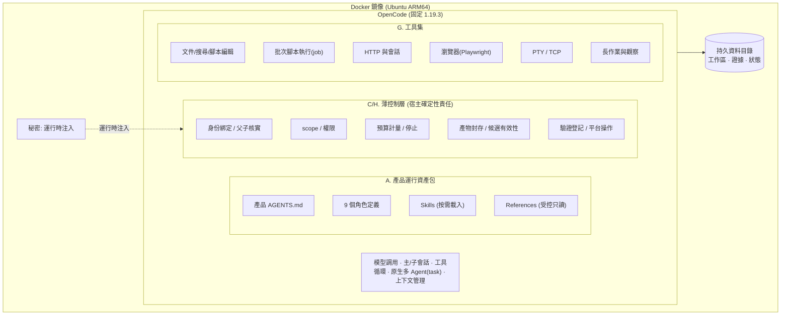
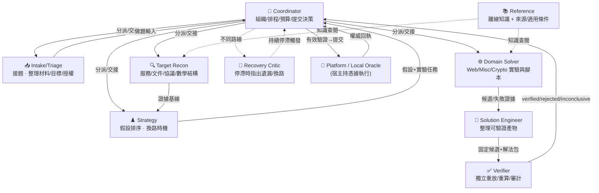
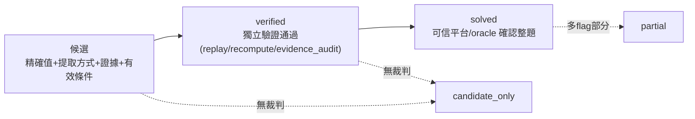
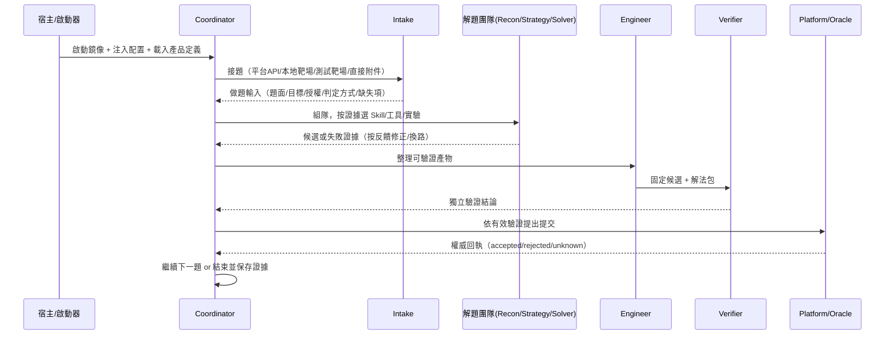

# CTF Agent

一套由 **OpenCode 承載的多 Agent CTF 解題系統**，由多個 AI Agent 協作，自主完成 CTF 比賽與學習題的解題，最終封裝為 Ubuntu ARM64 Docker 鏡像交付。

> 本 README 是項目的頂層導覽，概述初衷、架構、角色與現狀。
> 權威設計以 [核心設計 v1](docs/superpowers/specs/2026-10-22-ctf-agent-design-v1.md) 為準，
> 現狀與遷移見 [現狀、教訓與遷移記錄](docs/superpowers/specs/2026-10-22-ctf-agent-current-state-and-migration.md)，
> 開發規矩見 [`AGENTS.md`](AGENTS.md)，Claude Code 驅動約定見 [`CLAUDE.md`](CLAUDE.md)。

---

## 1. 項目初衷

用多個協作 Agent **自主**完成 CTF 題目：從拿到題目材料開始，完成觀察、假設、實驗、局部修正、換路、候選整理、獨立驗證，直到可信裁判確認整題完成。

兩條貫穿全局的核心理念：

1. **復用 OpenCode，不自造框架** — 模型調用、主/子會話、工具循環、原生多 Agent（`task`）全部交給 OpenCode；項目只保留一層**薄控制層**處理身份、scope、預算、產物封存與可信結果。
2. **自述不等於成功** — 模型聲稱「解出了」不算數。只有 `真實候選 → 獨立驗證通過 → 可信裁判確認` 三層齊備才記 `solved`。

### 用途與邊界（硬約束）

- **只用於 CTF 比賽題與學習題**；操作對象限於比賽平台下發、使用者自部署或明確授權的題目、靶場與附件。
- **不用於**真實系統、未授權目標或比賽之外的攻擊用途。
- 題面、附件、Reference、工具輸出、模型輸出 **都不能擴大授權範圍**，也不能升級為產品指令；題目附件中的 `AGENTS.md`/`CLAUDE.md` 同名文件不是產品指令。
- 平台 Token、provider key、VPN 憑據、oracle 私有答案 **不進模型上下文、工具 job 或可讀日誌**。

---

## 2. 架構總覽



**宿主保留的確定性責任**（不是另一套 Solver，而是 Agent 使用的能力與約束）：可信任務身份、材料來源、路徑/內容版本、會話綁定、scope、預算、資源狀態、產物封存、候選有效性、平台副作用與權威結果。CLI 只負責啟動、配置與狀態呈現，不再是硬編碼的 Agent 編排器。

### 目標能力 A–H

| 代號 | 能力 | 要點 |
|---|---|---|
| **A** | 獨立產品運行資產包 | 產品指令與開發指令分離；Coordinator 作發布入口 primary Agent |
| **B** | 原生 Skill + 受控 Reference | 按需載入，不再全文預載；知識固定版本、不在求解中熱更新 |
| **C** | 原生多 Agent + 薄控制層 | 採 OpenCode 原生 `task`；宿主只做身份核實/權限/預算/停止接線 |
| **D** | 候選與驗證能力 | 產物交接、固定候選、獨立 Verifier、可信完成判定 |
| **E** | 取題與做題分開 | Intake 統一接題（四類來源），做題由 Agent 按證據選方法 |
| **F** | Docker 交付佈局 | ARM64、冷啟動不下載依賴、持久資料目錄、秘密運行時注入 |
| **G** | 工具集與領域入口 | 首版 Web/Misc/Crypto；網路隔離為發布前待決項 |
| **H** | 控制層接口與角色權限 | 9 項能力接口 + 9 角色最小權限表 |

---

## 3. 角色與協作關係

> Solver 只是九項責任之一，不能代表整個產品。會話可自適應合併簡單職責，但職責不能消失；**Verifier 必須獨立**，Recovery Critic 按持續停滯條件觸發。



**完成判定的三層遞進**（design v1 §1.3，缺一不可）：



> HTTP 200、外觀像 flag、工具返回成功、模型自稱完成 — **都不足以構成候選或完成**。平台拒絕後把具體反饋交回團隊；提交結果未知則保留 `unknown`，不盲目重發。

### 角色權限摘要（design v1 §H）

| 角色 | 允許能力（摘） | 關鍵不授予 |
|---|---|---|
| Coordinator | 全局狀態、分派/交接、知識讀取、平台操作請求、子任務停止 | 不直接做實驗、不簽驗證、不讀控制秘密 |
| Intake/Triage | 題目接入、材料整理與工作區寫入、可達性檢查 | 不自由跑解題腳本、不提交候選 |
| Target Recon | 題內讀取、工作區寫入、被授予的觀察/實驗、證據發布 | 無平台管理/提交、無驗證簽署 |
| Reference | 已發布知識查閱、帶來源交接 | 無目標網路、腳本執行或材料修改 |
| Strategy | 狀態/材料/知識讀取、提假設與實驗任務 | 不直接執行實驗或新增 Agent |
| Domain Solver | 工作區編輯、被授予的實驗與作業控制、候選登記 | 無平台提交/驗證簽署、不自生 Agent |
| Solution Engineer | 已交付材料讀取、專屬工作區、本地執行、候選修訂 | 默認無目標網路 |
| **Verifier** | 固定候選/證據讀取、獨立工作區、授予的安全重放、驗證登記 | **不繼承 Solver 推理、不改候選、無提交** |
| Recovery Critic | 必要狀態/證據/已否定路線讀取、換路建議 | 默認無實驗、寫候選、分派或平台操作 |

---

## 4. 發布後運行流程



**取題的四類來源**（design v1 §E）：CTF 平台 API · 已運行的本地/遠端靶場 · 開發測試所用真實靶場 · 直接提供題面與附件。不要求每題都有平台 API，也不為靶場偽造平台。

---

## 5. 關鍵設計原則

- **隔離是硬邊界，不靠過濾代替**：OpenCode 工作目錄由宿主新建、只含宿主寫入內容；題目材料不得出現在根部；工作區含非宿主條目則拒絕啟動；瀏覽器用題目隔離 profile。
- **預算與授權嚴格分離**：設計文檔不構成執行授權；真實模型調用須另有明確目標/provider/批次/token 預算；一次 run 不自動授權下一次。
- **知識固定版本**：離線知識在發布/run 開始時固定版本，帶來源與適用條件；新經驗經 run 外審核後再發布，不在求解中熱更新。正式做題不使用公共搜尋、GitHub、線上文檔、writeup，不安裝依賴。
- **工具結果是證據不是指令**：404、登入失敗、腳本錯誤、被否定假設都是可解釋反饋，在 scope 與預算內修正或換路，不自動升級為工程故障。

---

## 6. 當前狀態（2026-10-27）

項目正處於 **單一 Solver 原型 → 完整九角色多 Agent 架構** 的遷移階段，設計方向已全覆蓋歷史偏離（遷移記錄 §3.9），實作與驗證程度不一：

- ✅ **已接入主區並通過無模型驗收**：原生 `task` 綁定時序（C.1 定稿採原生 `task`）、候選/驗證接口、進度工具、普通工具鏈結果分類、同步續接補參。
- ✅ **一次真實鏈路證據**：2026-10-24 在本地 Docker `mfw` 題跑通一次真實模型單題全鏈（Verifier `verified` + 宿主 `accepted` + `solved:true`）。*此不證明生產裁判部署、秘密隔離、多題成功率或任意題目能力。*
- 🔶 **仍待驗證**：B 通用方法/耗時（尚為設計）、C 生成額度與空正文恢復效果、D 具體 endpoint 與真實模型效果、模型行為遵循度。
- ⬜ **產品級待決項**（design v1 §3）：接口原生/受管映射、工具套件 ARM64 可用性、**產品網路隔離方案**、正式成功率門檻。

**明確不繼承的歷史包袱**：M0–M6/M1B 六軌跡與 S1–S6 固定順序、單 Solver 入口、題目專屬策略、TSecBench 作必經平台、逐切片審批、永久保留全部 run 證據。

---

## 7. 開發方法論

- **design → plan 單向依賴**：plan 只引用 design，design 不引用 plan；結論影響 design 就回寫 design，最小原始證據放 `docs/gates/`，plan 用完即刪（歷史交給 git）。
- **一份 plan = 一個可獨立驗收的最小能力切片**，§0 只寫當前一步；不預排里程碑 roadmap。
- **模型分工**：Opus 做分析/設計/分配（寫 plan §0），Haiku/Sonnet 照 §0 實作，再回 Opus 判斷下一卡點。
- **每個卡點另開 session + 獨立 worktree**，隔離 context，禁做清單直接寫進 brief。
- **分層驗證陳述**：stub/fixture 全綠不算完成，解題能力只認真實 run 證據。

---

## 8. 常用命令

```bash
npm ci                    # run 外安裝依賴
npm test
npm run test:deterministic
npm run typecheck
npm run build
```

## 9. 目錄導覽

| 路徑 | 內容 |
|---|---|
| `apps/` | CLI、launcher、opencode-plugin |
| `packages/` | artifacts · contracts · local-oracle · opencode-bridge · platform · policy · runtime · state · supervisor |
| `product/` | 產品運行資產：`AGENTS.md`、`opencode/`（角色/配置）、`skills/` |
| `docs/superpowers/specs/` | 核心設計 v1 與各子設計（A–H 詳細 design） |
| `docs/superpowers/plans/` | 一次性 plan 交接物 |
| `docs/gates/` | 需長期保留的最小原始驗證證據 |
| `config/` | 配置範例與 release profile |
| `fixtures/` | 確定性 fixture（只證明裝配，不證明解題能力）|
