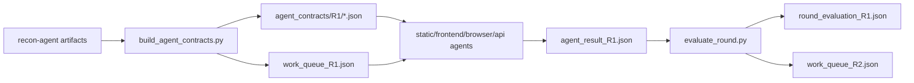

# Agent Contract 与并发编排 v1 设计

## 背景

当前 MVP 已经具备基础目录、Recon 产物和报告骨架，但多数 Agent 与 Skill 仍停留在职责描述层。参考 `code-audit-main` 与 `security-skill-distiller` 后，本轮优先补齐可执行的调度协议：让 Recon 结果能够转成子 Agent 合约，让 Dispatcher 能生成并发工作队列，让 Evaluation 能根据多 Agent 结果决定 R2。

## 目标

- 将 Recon 输出转成 `Agent Contract`，明确每个子 Agent 的输入、写入边界、证据要求、预算和完成条件。
- 生成 `work_queue.json`，把 R1/R2 的可并发任务显式化。
- 定义 `agent_result.json` 与 `round_evaluation.json`，让多 Agent 输出可以被统一聚合和比较。
- 提供最小可执行工具，支持生成合约、校验合约、评估轮次。
- 更新 Dispatcher、Evaluation、核心审计 Agent 与 Skill 文档，使其引用这些协议，而不是只描述抽象职责。

## 非目标

- 本轮不实现真实并发执行器，不启动浏览器或调用外部扫描器。
- 本轮不把所有漏洞类型方法论一次性补全。
- 本轮不做跨项目学习模型，只保留后续可接入的结果格式。

## 架构

新增三类数据对象：

- `agent_contract`：单个子 Agent 的执行合约，包含 `agent`、`round`、`inputs`、`owned_paths`、`evidence_requirements`、`budget`、`completion_criteria`、`failure_conditions`。
- `work_queue`：Dispatcher 的轮次任务队列，包含任务状态、优先级、依赖和合约路径。
- `round_evaluation`：Evaluation 的轮次汇总，包含覆盖缺口、冲突、R2 任务和跳过原因。

工具链：

1. `build_agent_contracts.py <run_dir> --round R1` 读取 `artifacts/recon-agent/recon_priority_queue.json`、`threat_model.json`、`trust_boundaries.json`、`source_sink_seed.json`，写入 Dispatcher artifacts。
2. `check_agent_contracts.py <run_dir> --round R1` 校验每个 contract 与 work queue 的必要字段和写入边界。
3. `evaluate_round.py <run_dir> --round R1` 读取各 Agent 的 `agent_result_R1.json`，输出 `round_evaluation_R1.json` 和 R2 focused queue。

## 数据流

## 轮次规则

- R1 由 Recon 队列驱动，优先覆盖 P0/P1 的边界、威胁和 source/sink。
- R1 Agent 可以输出 `unchecked_candidates`，表示发现但未完成验证的候选。
- Evaluation 将高风险覆盖缺口、缺动态证据的 High/Critical、跨 Agent 冲突和 `unchecked_candidates` 转成 R2 focused tasks。
- R2 任务必须收敛，默认不继续扩展新的候选链。

## 验收

- 新增测试先失败，再通过。
- `python3 pentest-agent-harness/tests/run_all.py` 通过。
- 新增工具错误输出不暴露 traceback，不泄露临时目录绝对路径。
- 文档全部使用中文，并明确后续生成文档继续使用中文。
