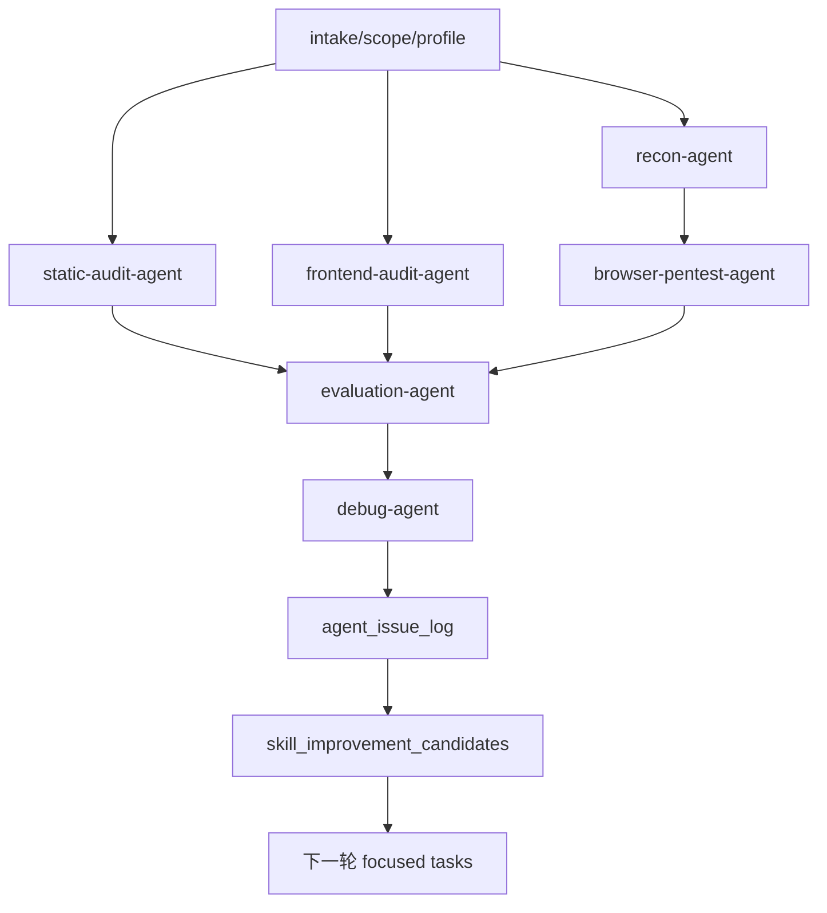

# Juice-Shop 运行时调试与 Agent/Skill 优化设计

## 背景

当前 MVP 已经完成两件关键修正：

1. 核心 `agents/`、`skills/` 和认证会话工具不再写死 Juice-Shop。
2. Juice-Shop 的登录入口、API 候选、受保护资源、scope 和 expected findings 已移动到 `labs/juice-shop/` 的 profile/fixture 层。

下一步可以开始用本地 Juice-Shop 靶场调试“当前 Agent”的真实动态能力。但本轮调试必须继续遵守产品边界：Juice-Shop 只是第一套可替换训练靶场，不能把靶场路径、账号、资源名、挑战 ID 或固定 payload 写回通用 Agent/Skill。

## 目标

本轮采用 B 方案：**文件级闭环 + 真实浏览器安全侦查 + 调试归因 + 能力优化候选**。

完成后应能回答：

1. 当前文件级 harness 在 Juice-Shop profile 下能否稳定生成账号清单、认证计划、动态观察占位、expected finding 对比和 debug 报告。
2. 当前浏览器阶段能真实识别哪些页面、菜单、表单、登录入口、运行时 API 和阻塞条件。
3. 哪些漏报是 Agent/Skill 能力不足，哪些是账号、网络采集、资源 ID、selector 或安全边界导致的 blocked。
4. 下一轮应该优先优化哪个子 Agent、哪个 Skill、哪个 schema 或哪个工具。
5. 换成 WebGoat、DVWA、PortSwigger Labs 或真实业务项目时，是否只需要替换 profile、scope、账号资料和 expected catalog。

## 非目标

- 不在通用 Agent/Skill 中加入 Juice-Shop 专属逻辑。
- 不自动完成 Juice-Shop challenge。
- 不执行暴力破解、垃圾请求、真实支付、真实邮件/短信、数据删除、持久化 payload 或高强度 fuzz。
- 不绕过验证码、MFA 或用户未授权的安全交互。
- 不把 token、cookie、密码、验证码、个人资料原文写入 artifacts。
- 不把一次浏览器观察直接升级为最终漏洞，必须经过证据门控、归因和报告门控。

## 安全边界

本轮只允许访问用户本地打开的目标：

```text
http://localhost:3000
```

安全策略：

- 只访问 `labs/juice-shop/scope.json` 允许的 host/path。
- 第一轮真实浏览器调试以只读侦查、登录前置验证和无害页面交互为主。
- 账号可用性不足时输出 blocked，不使用爆破、撞库或非授权账号尝试。
- 不提交支付、删除、批量发送、持久化 XSS、文件落地或影响真实外部系统的动作。
- 请求速率遵守 profile 中的 `safe_test_policy.max_request_rate_per_second`。
- 任何 mutation 必须来自 profile 的 `allowed_mutations`，并且由后续 safe-replay 明确记录 replay reason、scope、rollback/cleanup 说明和证据脱敏策略。

## 输入

### 靶场输入

- `pentest-agent-harness/labs/juice-shop/lab_profile.json`
- `pentest-agent-harness/labs/juice-shop/scope.json`
- `pentest-agent-harness/labs/juice-shop/expected_findings.json`
- `pentest-agent-harness/labs/juice-shop/accounts.example.json`
- 可选：用户本地 `accounts.local.json` 或环境变量中的测试账号密码。

### MVP 运行输入

- `run_state.json`
- `agent_graph.json`
- `agent_contracts/<round>/*.json`
- `artifacts/recon-agent/*`
- `artifacts/browser-pentest-agent/*`
- `artifacts/evaluation-agent/*`
- `reports/*`

### 浏览器输入

- 当前本地 Juice-Shop 页面。
- 匿名会话页面状态。
- 如账号已准备好，则包含普通用户、管理员或用户提供角色账号的独立会话状态。

## 输出

本轮调试应产生或更新以下产物：

```text
runs/<run_id>/
  artifacts/browser-pentest-agent/account_inventory.json
  artifacts/browser-pentest-agent/auth_session_plan.json
  artifacts/browser-pentest-agent/auth_validation.json
  artifacts/browser-pentest-agent/browser_workflow_inventory.json
  artifacts/browser-pentest-agent/runtime_api_observations.json
  artifacts/browser-pentest-agent/session_observations.json
  artifacts/browser-pentest-agent/dynamic_evidence.json
  artifacts/browser-pentest-agent/skill_improvement_candidates.json
  artifacts/debug-agent/lab_debug_report.json
  artifacts/debug-agent/agent_issue_log.json
  reports/lab-debug-summary.md
```

其中：

- `browser_workflow_inventory.json` 描述浏览器发现的页面、菜单、按钮、表单、搜索、过滤、上传下载、外部跳转和前端路由。
- `runtime_api_observations.json` 描述运行时 API 的 method、path、status、触发页面、触发动作、actor_role、字段名和脱敏状态。
- `auth_validation.json` 描述账号、登录入口、登录结果、storage/cookie key 差异和登录 blocked 原因。
- `skill_improvement_candidates.json` 描述本次调试暴露的具体 Agent/Skill 优化项。
- `agent_issue_log.json` 把漏报、误报、阻塞和证据不足归因到固定 root_cause。

## 调试流程

### 1. 文件级基线闭环

先用现有工具跑一轮文件级闭环，验证通用 profile 驱动逻辑仍然稳定：

1. `init_lab_run.py` 初始化 Juice-Shop run。
2. `load_lab_accounts.py` 加载账号清单，禁止明文密码。
3. `build_auth_session_plan.py` 从 profile、scope 和 expected catalog 生成认证/授权计划。
4. `write_simulated_auth_session_observations.py` 生成计划驱动的动态观察占位。
5. `compare_lab_expected_findings.py` 对 expected findings 做发现、漏报、阻塞和归因对比。

这一阶段不依赖真实浏览器成功登录。它用于确认 core harness 没坏，并给真实浏览器调试提供基准。

### 2. 真实浏览器只读侦查

使用浏览器控制能力访问当前本地页面，执行安全侦查：

1. 记录当前 URL、标题、可见主导航、菜单入口和弹窗状态。
2. 枚举允许 scope 内的前端 route、按钮、链接、表单和搜索入口。
3. 记录每个入口的 role、route、action_type、trigger、coverage status 和截图路径。
4. 对外部链接只记录 href、目标域和跳转风险，不实际访问 scope 外目标。
5. 对需要登录、MFA、selector 缺失或页面异常的入口写 blocked。

输出 `browser_workflow_inventory.json` 和 `browser_notes.md`。

### 3. 认证前置验证

如果账号资料可用，执行最小登录验证：

1. 登录前记录 cookie/localStorage/sessionStorage 的 key，不记录值。
2. 使用 profile 中的 `auth_surface.login.page_url` 和 `api_candidates` 识别登录入口。
3. 对每个 ready 角色建立独立会话上下文。
4. 登录后记录 URL 变化、菜单变化、storage/cookie key 差异和登录状态。
5. 登录失败时写 `browser.login_failed`。
6. 账号缺失时写 `browser.account_missing`，不把后续认证类 expected finding 算作真实漏报。

输出 `auth_validation.json` 和 `session_observations.json`。

### 4. 运行时 API 捕获

运行时 API 捕获优先来自真实浏览器网络事件、HAR 或代理日志。如果当前浏览器工具无法提供网络事件，则不能编造 API 证据，必须写：

```text
root_cause = browser.network_capture_missing
```

捕获到 API 时，每条观察至少包含：

- method
- path
- status
- trigger
- actor_role
- source_workflow
- request_field_names
- response_field_names
- sensitive_fields_redacted
- auth_required
- csrf_observed
- cors_observed

输出 `runtime_api_observations.json` 和 `api_replay_candidates.json`。

### 5. Expected Findings 对比与归因

对比逻辑必须区分三类状态：

- `found`：已有足够证据证明 Agent 发现了预期问题。
- `missed`：环境和前置条件可用，但 Agent 没有覆盖或没有形成证据。
- `blocked`：账号、登录、网络捕获、资源 ID、selector、scope 或安全边界阻止验证。

不能把 blocked 简单归为 missed。Debug-agent 应输出固定 root_cause，例如：

| root_cause | 含义 | 优先优化对象 |
|---|---|---|
| `browser.auth_surface_missing` | profile 或侦查结果没有提供登录入口 | `auth-validation`、`target-intake` |
| `browser.account_missing` | 没有可用测试账号或环境变量 | `load_lab_accounts`、`auth-validation` |
| `browser.login_failed` | 账号可用但登录失败 | `auth-validation`、`browser-pentest-agent` |
| `browser.selector_changed` | 页面元素选择器或 UI 状态不符合预期 | `browser-workflow-recon` |
| `browser.network_capture_missing` | 无法获得浏览器网络事件、HAR 或代理日志 | `runtime-api-capture` |
| `browser.resource_id_missing` | 未找到可安全比较的资源 ID | `authorization-control` |
| `recon.workflow_missed` | 页面或工作流未枚举 | `browser-workflow-recon`、`recon-agent` |
| `skill.instruction_too_vague` | Skill 缺少可执行步骤、输入输出或证据要求 | 对应 Skill |
| `evaluation.merge_wrong` | 多 Agent 结果合并或去重错误 | `evaluation-agent` |
| `report.false_negative` | 报告门控过滤了有效证据 | `report-agent` |

### 6. 反推 Agent/Skill 优化

每轮调试结束后生成 `skill_improvement_candidates.json`，字段建议：

```json
{
  "items": [
    {
      "id": "runtime-api-capture-001",
      "source_run_id": "juice-shop-runtime-debug",
      "affected_agent": "browser-pentest-agent",
      "affected_skill": "runtime-api-capture",
      "root_cause": "browser.network_capture_missing",
      "observed_gap": "当前浏览器调试只能记录页面元素，不能形成 API 请求响应证据。",
      "required_change": "为运行时 API 捕获增加 HAR/Playwright/代理日志三种输入适配，并定义 network event 脱敏摘要 schema。",
      "acceptance_check": "同一工作流至少能关联一个 trigger 和一个 method/path/status 观察，敏感字段只保留字段名。"
    }
  ]
}
```

优化项必须具体到：

- 哪个 Agent 或 Skill。
- 缺了哪个输入。
- 缺了哪个执行步骤。
- 缺了哪个输出字段。
- 缺了哪个证据要求。
- 用哪个回归案例验证优化生效。

## 多 Agent 并行协调

本轮调试继续沿用 `agent_graph` 和 `agent_contracts`，但要把浏览器调试暴露的问题反馈到并行协调层：



并发规则：

- Recon、Static、Frontend 可并行启动，但必须共享同一个 scope 和 trust boundary。
- Browser-pentest 依赖 Recon 的入口、Frontend 的 route/API 线索和账号前置验证。
- Evaluation 只消费带证据或明确 blocked 的结果。
- Debug-agent 在 evaluation 后运行，不参与攻击执行，只做训练/归因。
- 下一轮 focused tasks 由 debug-agent 输出，不能由单个子 Agent 自行扩大 scope。

## 断点续跑

每个阶段都必须写 checkpoint：

- `baseline_files_done`
- `browser_workflow_recon_done`
- `auth_validation_done`
- `runtime_api_capture_done`
- `expected_compare_done`
- `skill_improvement_candidates_done`

如果中断：

1. `resume_run.py` 读取 `run_state.json` 和 checkpoints。
2. 已完成且 schema 校验通过的 artifacts 不重复生成。
3. 浏览器阶段如果页面状态丢失，需要重新记录匿名 baseline。
4. 账号登录失败或网络捕获缺失应保留 blocked 记录，不阻断后续 debug-agent 归因。

## 验收标准

1. 设计文档和后续 plan 均为中文。
2. 通用 Agent/Skill 仍通过“禁止靶场绑定”测试。
3. 文件级 Juice-Shop profile 调试可以稳定输出 debug 报告。
4. 真实浏览器调试至少输出 `browser_workflow_inventory.json`。
5. 如果账号或网络捕获不可用，产物中必须出现明确 blocked root_cause。
6. 至少产生一批具体 `skill_improvement_candidates`，每项都能转成后续实现任务。
7. 所有新增 schema、工具和文档通过现有测试或新增测试验证。

