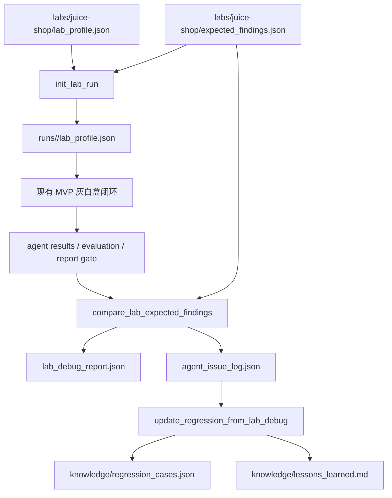

# 靶场驱动 Agent/Skill 调试闭环设计

## 背景

当前 `pentest-agent-harness` 已经具备可运行 MVP 闭环：`run_state`、`agent_graph`、侦查产物、Agent Contract、R1/R2 evaluation、verification queue、动态证据占位、report gate 和 dry-run 总入口都已接通。下一步不应继续只扩写 Agent/Skill 文档，而应通过真实调试靶场反复运行，让系统知道每次哪里没发现、哪里误报、哪个 Agent 或 Skill 需要增强。

本轮以本地 `OWASP Juice Shop` 作为第一套调试靶场。用户已在浏览器中打开 `http://localhost:3000/#/`，页面标题为 `OWASP Juice Shop`，当前可见入口包括商品列表、搜索、登录、购物车、Customer Feedback、AI Chat、About、Photo Wall 和外部 redirect 链接。设计必须保留靶场抽象，后续可以接入 WebGoat、DVWA、PortSwigger Labs 或自建业务靶场。

## 目标

本轮目标是构建一条“靶场驱动调试闭环”：

```text
lab_profile
  -> 灰白盒运行输入
  -> recon/static/frontend/browser/evaluation/report
  -> expected findings 对比
  -> debug-agent 归因
  -> agent_issue_log
  -> regression cases / lessons learned
  -> 下一轮 Agent/Skill 优化
```

完成后，每次调试运行都应能回答：

1. 哪些预期漏洞已被发现，哪些漏报，哪些误报？
2. 漏报根因属于 Recon、静态审计、前端审计、浏览器复现、结果合并、报告过滤，还是 Skill 指令太空？
3. 哪个 Agent/Skill 应该优先优化？
4. 下一轮如何回放同一靶场问题，验证优化是否生效？
5. 换成其他靶场时，是否只需要换 profile 和 expected catalog，而不改核心流程？

## 非目标

本轮不直接实现真实攻击执行器，不做高强度 fuzz，不写破坏性 exploit，不绕过验证码或安全交互，不自动提交真实订单、真实邮件、真实支付或持久化恶意载荷。

第一阶段只实现靶场配置、基准漏洞目录、调试归因结构和可回放学习产物。真实 Playwright 登录、动态 API replay、代理流量采集和 PoC 自动生成会在后续迭代中接入。

## 参考项目映射

| 参考项目 | 迁移到本设计的经验 |
|---|---|
| `code-audit-main` | 将“候选、确认、误报、漏报”分层，报告前做证据门控 |
| `DeepAudit-3.0.0` | 保留运行状态、checkpoint、任务交接和可续跑能力 |
| `security-skill-distiller-master` | 从失败案例中提炼规则，反哺 skill 与知识库 |
| `shannon-main` | 使用 verification queue 与结果对比推动下一轮 focused task |
| `strix-main` | 用 agent graph 与生命周期事件表达多 Agent 协调和证据汇聚 |

## 核心架构

新增“靶场层”和“调试归因层”，不替换现有 MVP 闭环。

```text
pentest-agent-harness/
  labs/
    juice-shop/
      lab_profile.json
      expected_findings.json
      scope.json
      accounts.example.json
      README.md
  agents/
    debug-agent.md
  skills/
    lab-profile/
      SKILL.md
    lab-debug-analysis/
      SKILL.md
  schemas/
    lab_profile.schema.json
    expected_findings.schema.json
    lab_debug_report.schema.json
    agent_issue_log.schema.json
  tools/
    init_lab_run.py
    compare_lab_expected_findings.py
    update_regression_from_lab_debug.py
```

`lab_profile` 描述目标靶场和灰白盒上下文；`expected_findings` 描述靶场基准漏洞；`debug-agent` 对比实际运行结果和基准目录，输出可执行的优化建议；回归与 lessons 进入 `knowledge/`。

## Lab Profile

`lab_profile.json` 是可替换靶场配置。Juice-Shop 第一版 profile 使用：

```json
{
  "lab_id": "juice-shop",
  "name": "OWASP Juice Shop",
  "mode": "graybox-lab",
  "target_url": "http://localhost:3000",
  "source_repo_path": "",
  "tech_stack": ["Angular", "Node.js", "Express", "SQLite", "Sequelize"],
  "entrypoints": [
    "login",
    "search",
    "products",
    "basket",
    "customer-feedback",
    "ai-chat",
    "photo-wall",
    "redirect"
  ],
  "safe_test_policy": {
    "destructive_allowed": false,
    "max_request_rate_per_second": 2,
    "allowed_mutations": ["login", "add_to_basket", "submit_feedback_with_safe_payload"],
    "forbidden_actions": ["payment", "spam_email", "data_deletion", "persistent_payload"]
  },
  "agents_enabled": [
    "recon-agent",
    "static-audit-agent",
    "frontend-audit-agent",
    "browser-pentest-agent",
    "evaluation-agent",
    "report-agent",
    "debug-agent"
  ]
}
```

`source_repo_path` 允许为空。为空时仍可运行黑盒/动态调试；有值时进入灰白盒模式，静态和前端 Agent 必须使用源码证据。

## Expected Findings

`expected_findings.json` 是靶场基准目录。第一版不追求覆盖 Juice-Shop 所有 challenge，而是选一组能打磨 Agent/Skill 的代表性类别。

建议第一批类别：

- authentication
- authorization / IDOR
- injection
- XSS
- open redirect
- sensitive data exposure
- file upload / media handling
- business logic
- security misconfiguration
- frontend route/API exposure

每个 expected finding 包含：

```json
{
  "id": "juice-shop-open-redirect-001",
  "title": "外部跳转入口需要重定向验证",
  "category": "open_redirect",
  "risk": "Medium",
  "expected_agents": ["recon-agent", "browser-pentest-agent", "evaluation-agent"],
  "expected_skills": ["browser-recon", "frontend-runtime-test", "finding-verification"],
  "requires_source": false,
  "requires_browser": true,
  "requires_two_roles": false,
  "safe_reproduction_hint": "只验证跳转目标是否可控，不提交敏感数据",
  "evidence_requirements": [
    "入口 URL",
    "跳转参数",
    "浏览器观察",
    "安全影响说明"
  ]
}
```

目录的作用不是替 Agent 泄题，而是为调试提供基准。Agent 仍然通过源码、浏览器和 API 证据产出 findings；debug-agent 只在事后做对比和归因。

## Debug Agent

新增 `debug-agent`，职责是把靶场调试结果转成产品优化信号。

输入：

- `lab_profile.json`
- `expected_findings.json`
- `run_state.json`
- `artifacts/*/agent_result_<round>.json`
- `artifacts/evaluation-agent/round_evaluation_<round>.json`
- `artifacts/evaluation-agent/verification_queue.json`
- `artifacts/browser-pentest-agent/dynamic_evidence.json`
- `artifacts/report-agent/report_gate.json`
- `reports/pentest-report.md`

输出：

```text
artifacts/debug-agent/lab_debug_report.json
artifacts/debug-agent/agent_issue_log.json
reports/lab-debug-summary.md
knowledge/regression_cases.json
knowledge/lessons_learned.md
```

`lab_debug_report.json` 面向运行结果，包含发现率、漏报率、误报率、阻塞项和回归建议。`agent_issue_log.json` 面向工程优化，逐条说明哪个 Agent/Skill 需要改。

## 归因分类

调试问题必须落到固定分类，避免报告只写“未发现”。

| root_cause | 含义 | 优先优化对象 |
|---|---|---|
| `recon.asset_missed` | 页面、API、路由、入口未枚举 | `recon-agent`、`browser-recon` |
| `static.source_sink_missed` | 源码 source/sink 或控制点未建模 | `static-audit-agent`、`taint-analysis` |
| `frontend.api_route_missed` | 前端路由、API client、状态流未关联 | `frontend-audit-agent`、`frontend-recon` |
| `browser.session_setup_failed` | 登录、cookie、角色切换失败 | `browser-pentest-agent`、`auth-session-testing` |
| `browser.replay_failed` | 动态复现失败或证据不足 | `browser-pentest-agent`、`finding-verification` |
| `evaluation.priority_wrong` | R2 优先级或覆盖缺口判断错误 | `evaluation-agent`、`adaptive-weighting` |
| `evaluation.merge_wrong` | 多 Agent 结果合并错误 | `evaluation-agent` |
| `report.false_negative` | 报告过滤导致漏报 | `report-agent`、`report-template` |
| `report.false_positive` | 报告放出误报 | `report-agent`、`finding-verification` |
| `skill.instruction_too_vague` | Skill 缺少具体步骤、输入、输出、证据要求 | 对应 Skill |

示例 issue：

```json
{
  "issue_id": "JS-DEBUG-001",
  "expected_finding_id": "juice-shop-auth-001",
  "status": "missed",
  "root_cause": "browser.session_setup_failed",
  "affected_agent": "browser-pentest-agent",
  "affected_skill": "auth-session-testing",
  "evidence": [
    "login page detected but no usable account profile was loaded"
  ],
  "recommended_change": "为 lab_profile 增加账号加载与登录状态验证步骤",
  "regression_case": true
}
```

## 数据流



## Agent/Skill 打磨策略

每次靶场运行后，按以下优先级优化：

1. 先修阻塞项，例如 profile 缺源码路径、账号不可用、浏览器无法登录。
2. 再修漏报 root cause，优先 High/Critical 和多次重复出现的问题。
3. 再修误报过滤，避免报告污染。
4. 最后补 Skill 细节，把成功复现步骤沉淀成输入、执行步骤、证据要求和退出条件。

优化必须能回放验证。每个 `agent_issue_log` 中 `regression_case=true` 的条目，会进入 `knowledge/regression_cases.json`，后续 dry-run 或 lab-run 必须能再次加载。

## 安全边界

Juice-Shop 是本地授权靶场，但系统仍默认遵守安全边界：

- 只对 `lab_profile.target_url` 和允许 scope 执行测试。
- 默认禁用破坏性动作。
- 对 mutating 操作使用安全 payload 或靶场专用测试数据。
- 不自动进行支付、邮件轰炸、数据删除、持久化 payload 或 webshell 类操作。
- 真实账号密码不提交进仓库，`accounts.example.json` 只放占位字段。

## 测试策略

第一阶段使用可重复的本地文件测试，不依赖真实 Juice-Shop 服务在线：

1. `init_lab_run.py` 能读取 `labs/juice-shop/lab_profile.json` 并复制到 run 目录。
2. `compare_lab_expected_findings.py` 能比较 expected findings 与模拟 findings，输出 missed/found/blocked/false_positive。
3. `agent_issue_log.schema.json` 能校验归因字段。
4. `update_regression_from_lab_debug.py` 能把漏报归因写入 regression cases，且重复运行不产生重复条目。
5. 现有 `pentest-agent-harness/tests/run_all.py` 保持通过。

真实浏览器运行将在下一阶段接入，优先打磨登录、页面枚举、网络请求采集和安全复现证据。

## 交付边界

第一阶段交付：

- Juice-Shop lab profile 与 expected findings 基准。
- `debug-agent` 和相关 skill 文档。
- lab/debug 相关 schema。
- 初始化 lab run、对比 expected findings、更新 regression cases 的工具。
- 测试覆盖调试归因闭环。

第一阶段完成后，系统能在不真实攻击的情况下，根据模拟或已有 agent 输出判断哪些 expected findings 漏掉，并给出具体 Agent/Skill 优化建议。第二阶段再把 browser-pentest-agent 接入真实 Juice-Shop 登录、浏览器遍历和安全复现。
