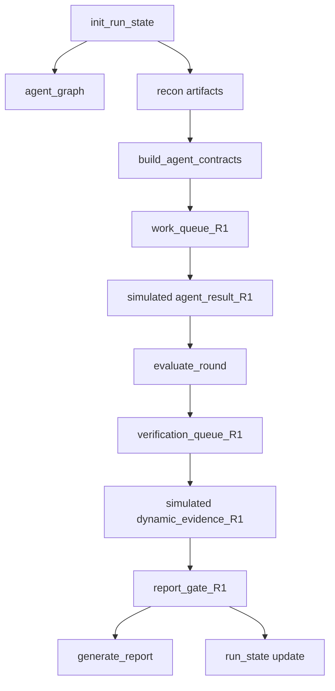

# 可运行闭环 MVP 打磨设计

## 背景

当前 `pentest-agent-harness` 已经完成第一版 MVP scaffold：具备 Agent/Skill 文档、Recon artifacts、Agent Contract、R1/R2 evaluation、resume、报告/反馈工具、dry-run 和质量门禁。测试入口 `python3 pentest-agent-harness/tests/run_all.py` 当前通过。

参考项目分析后，下一步不应继续只扩写 Agent/Skill 文档，而应把 MVP 打磨成一条可运行、可续跑、可验证、可报告的产品闭环。该闭环先用模拟 Agent 输出和模拟动态证据证明架构成立，再为后续接入真实浏览器、API、PoC 和多 Agent 执行器预留稳定接口。

## 目标

本轮目标是升级现有 dry-run，使它从“Recon → Contract → Evaluation”扩展为：

```text
intake/run 初始化
  → run_state + agent_graph
  → recon artifacts
  → R1 agent contracts + work queue
  → simulated agent results
  → verification queue
  → simulated dynamic evidence
  → round evaluation
  → report gate summary
  → markdown/json/html report
```

完成后，MVP 应能回答四个产品级问题：

1. 当前运行在哪个阶段、哪个轮次、哪些 Agent 已完成？
2. 哪些白盒/前端/API 候选需要动态验证？
3. 哪些发现已验证、哪些只是候选、哪些被阻塞？
4. 报告是否满足证据和覆盖门控？

## 非目标

本轮不实现真实浏览器攻击、真实 HTTP proxy、真实 API fuzz、真实 PoC exploit、Web UI 或数据库服务化。

这些能力只建立数据结构和占位流程：

- 浏览器证据用模拟 `dynamic_evidence.json` 表达。
- Playwright PoC 只写路径字段，不执行真实脚本。
- Agent graph 用 JSON 文件表达，不引入 SQLite/Temporal。
- report gate 只做本地 JSON/Markdown 门控，不引入平台级工作流。

## 参考项目映射

| 参考项目 | 迁移到本轮 MVP 的部分 |
|---|---|
| `code-audit-main` | 报告门控、候选与验证分层、R2 不扩散 |
| `DeepAudit-3.0.0` | Agent 状态、TaskHandoff 思想、checkpoint/run state |
| `security-skill-distiller-master` | 从资料到工程的配置化思路，保留后续 harness generator 接口 |
| `shannon-main` | verification queue、proof-by-exploitation 状态分层、workspace resume |
| `strix-main` | agent graph、finish/report 生命周期工具、browser/proxy 证据接口 |

## 架构设计

### 1. Run State

增强 `runs/<run_id>/run_state.json`，作为运行状态的单一摘要。

建议字段：

```json
{
  "run_id": "demo",
  "target_url": "https://example.test",
  "repo_path": "/workspace/source",
  "scope_hash": "sha256-placeholder",
  "config_hash": "sha256-placeholder",
  "current_phase": "report-gate",
  "current_round": "R1",
  "status": "completed",
  "completed_agents": ["recon-agent", "static-audit-agent"],
  "failed_agents": [],
  "pending_agents": [],
  "verification_queue": {
    "total": 1,
    "verified": 0,
    "blocked": 0
  },
  "report_gate": {
    "status": "passed",
    "verified_findings": 0,
    "candidate_findings": 1,
    "blocked_findings": 0
  },
  "resume": {
    "checkpoint_dir": "checkpoints",
    "last_completed_step": "report-gate"
  }
}
```

### 2. Agent Graph

新增 `artifacts/dispatcher-agent/agent_graph.json`，记录 root、dispatcher、recon、static、frontend、browser、evaluation、report 等节点。

节点字段：

- `agent_id`
- `name`
- `parent_id`
- `status`
- `round`
- `task`
- `contract_path`
- `result_path`
- `skills`
- `started_at`
- `completed_at`

MVP 中时间字段可使用稳定占位值，避免测试不确定。

### 3. Verification Queue

新增 `artifacts/evaluation-agent/verification_queue_R1.json`，把 `agent_result_R1.json.unchecked_candidates` 和浅覆盖高风险项转成待验证任务。

队列项字段：

- `verification_id`
- `source_agent`
- `target_agent`
- `candidate_id`
- `title`
- `risk`
- `verification_type`
- `safety_level`
- `status`
- `evidence`
- `required_artifacts`

`status` 允许值：

- `candidate`
- `queued`
- `reachable`
- `verified`
- `exploited`
- `blocked`

默认动态验证使用安全等级：

- `safe-observation`
- `safe-replay`
- `mutating-requires-approval`
- `destructive-forbidden`

### 4. Dynamic Evidence

新增 `artifacts/browser-pentest-agent/dynamic_evidence_R1.json`，用模拟证据表达后续浏览器/API/PoC 工具要写入的标准结构。

证据项字段：

- `verification_id`
- `status`
- `method`
- `request`
- `response`
- `screenshot`
- `playwright_poc`
- `observed_result`
- `limitations`
- `evidence_paths`

MVP 不执行真实请求，只写入脱敏摘要和占位路径。

### 5. Report Gate

新增 `artifacts/report-agent/report_gate_R1.json`，由 evaluation/report gate 工具生成。

门控判定：

- 未验证候选不能作为 confirmed finding。
- `verified` 或 `exploited` 才能进入“已验证漏洞”。
- `candidate`、`queued`、`reachable` 进入“需要人工验证”。
- `blocked` 进入“阻塞项”。
- 存在 coverage gap 时报告必须列出缺口。

MVP 允许 `verified_findings=0`，但必须明确说明当前为 dry-run 或未执行真实动态验证。

## 数据流



## 工具设计

### 新增工具

1. `tools/init_run_state.py`

创建：

- `run_state.json`
- `artifacts/dispatcher-agent/agent_graph.json`
- `checkpoints/`

2. `tools/build_verification_queue.py`

读取：

- `artifacts/evaluation-agent/round_evaluation_R1.json`
- `artifacts/*/agent_result_R1.json`

写入：

- `artifacts/evaluation-agent/verification_queue_R1.json`

3. `tools/write_simulated_dynamic_evidence.py`

读取：

- `verification_queue_R1.json`

写入：

- `artifacts/browser-pentest-agent/dynamic_evidence_R1.json`

4. `tools/report_gate.py`

读取：

- `round_evaluation_R1.json`
- `verification_queue_R1.json`
- `dynamic_evidence_R1.json`

写入：

- `artifacts/report-agent/report_gate_R1.json`
- 更新 `run_state.json`

### 修改工具

1. `tools/run_harness_dry_run.py`

串联新增工具，让 dry-run 输出完整闭环。

2. `tools/generate_report.py`

如果当前报告工具已能读取 findings，则本轮只增强它读取 `report_gate_R1.json` 的摘要；若改动成本过高，则先在 dry-run summary 中引用 report gate，报告增强留到后续计划。

3. `tools/resume_run.py`

本轮只确认不破坏现有 resume 测试；如需要，可补充读取 `run_state.json.report_gate` 的展示字段。

## Schema 设计

新增：

- `schemas/agent_graph.schema.json`
- `schemas/verification_queue.schema.json`
- `schemas/dynamic_evidence.schema.json`
- `schemas/report_gate.schema.json`

增强：

- `schemas/run_state.schema.json`

Schema 先约束根对象、必需字段和主要枚举，不追求覆盖所有子字段细节。

## 测试设计

新增测试：

1. `tests/test_run_state_and_agent_graph.py`
   - 初始化 run state。
   - 校验 agent graph 有 root/dispatcher/recon 节点。
   - 校验状态字段和 checkpoint 目录。

2. `tests/test_verification_queue.py`
   - 从 round evaluation 和 agent result 构建 verification queue。
   - 校验候选字段、目标 Agent、安全等级、状态枚举。

3. `tests/test_dynamic_evidence_and_report_gate.py`
   - 从 verification queue 生成模拟 dynamic evidence。
   - report gate 正确区分 verified/candidate/blocked。
   - 未验证候选不进入 confirmed finding 统计。

修改测试：

- `tests/test_harness_dry_run.py` 增加对新产物的断言。
- `tests/test_validate_schema.py` 增加新 schema。
- `tests/run_all.py` 加入新增测试。

验证命令：

```bash
python3 pentest-agent-harness/tools/check_agent_skill_docs.py --root pentest-agent-harness
python3 pentest-agent-harness/tests/run_all.py
PYTHONPYCACHEPREFIX=/private/tmp/pentest-agent-pycache python3 -m py_compile \
  pentest-agent-harness/tools/init_run_state.py \
  pentest-agent-harness/tools/build_verification_queue.py \
  pentest-agent-harness/tools/write_simulated_dynamic_evidence.py \
  pentest-agent-harness/tools/report_gate.py
```

## 成功标准

本轮完成后：

1. `python3 pentest-agent-harness/tools/run_harness_dry_run.py runs/demo --force` 生成完整闭环产物。
2. `dry_run_summary.json` 包含 run_state、agent_graph、verification_queue、dynamic_evidence、report_gate 路径。
3. `report_gate_R1.json` 明确区分 verified/candidate/blocked/coverage gap。
4. `run_state.json` 可说明当前 run 是否完成、哪些 Agent 已完成、是否存在验证队列。
5. 全量测试通过。

## 风险与处理

| 风险 | 处理 |
|---|---|
| 范围膨胀到真实浏览器测试 | 本轮只写 schema、模拟证据和门控 |
| 工具数量增加导致重复逻辑 | 保持工具单一职责，dry-run 负责串联 |
| 报告工具改动过大 | 先用 report gate 产物证明门控，报告增强可拆后续 |
| run_state 与现有 resume 语义冲突 | 保持现有字段兼容，只追加字段 |
| Agent graph 过度复杂 | MVP 只记录节点和状态，不实现消息总线 |

## 后续演进

本轮之后可以继续推进：

1. 接入真实浏览器工具，替换 simulated dynamic evidence。
2. 接入 API replay/fuzz 工具，扩展 verification queue 类型。
3. 接入 Distiller 生成器，把用户资料转成项目专属 harness。
4. 引入更完整的 agent graph message passing。
5. 把 run_state/checkpoint 迁移到轻量数据库或服务化 API。
