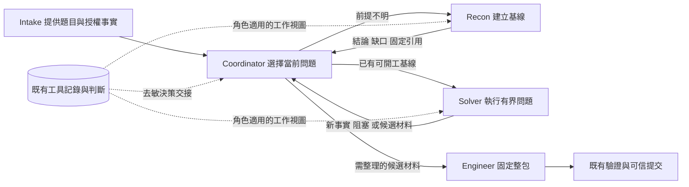

# Coordinator／Recon／Solver：決策上下文與責任調整

**狀態：設計建議，已審閱；§6.0 前置完成後第一片暫緩（2026-11-08，見 §6.0），未實作。** 2026-11-07（Asia/Tokyo），檢查基線 `main / 9e874d44` 與當時工作樹。本文是[核心 design v1](2026-10-22-ctf-agent-design-v1.md) C 的子設計，負責三角色之間的問題歸屬、決策交接與驗證方法；此範圍的建議細節以本文為準。既有產品行為仍以實作及原子設計為準，本文不把候選當成已生效契約。

## 1. 結論與本次交付

**優先調整「誰持有當前問題、下一角色直接看到什麼、交回如何改變下一次決策」，暫不重寫多 Agent 架構，也不能現在判定模型能力不足。** 已有系統能保存、注入及讀取調查資料；缺少的更可能是貼近決策的工作視圖，以及跨 Recon／Solver 持續保存的語義判斷。這是有實作依據的設計假設，尚不是所有未解題的已證實根因。

目標是讓同一道題的已有證據和未決問題連續推進：Recon 給出可使用的基線，Solver 能承接並完成一個具體問題，Coordinator 根據交回的新事實決定續接、補調查、換路、整理候選或停止。即使整題未解，也應能辨認失敗發生在資料交付、事實理解、實驗選擇、執行能力或收尾，而不是只得到「一直跑到 deadline」。

本次只交付 design。保留 OpenCode 原生模型／task 循環、薄 host、既有工具與獨立驗證／可信提交；不新增 Agent、知識服務、通用規劃器、監控調度器、專屬題解或新的 solved 判據。不改現存未提交 plan，不執行產品 run，不提交或推送。

## 2. 證據能回答什麼

### 2.1 已核對的實作事實

| 位置 | 當前事實 | 含義與限制 |
| --- | --- | --- |
| `apps/launcher/src/control-service.ts`：`prepareContext` | 調查投影只給 recon／domain-solver／engineer；Coordinator 不在其內 | 不是所有角色共享同一決策視圖；不能因此斷言 Coordinator 完全沒有上下文，它仍有 task 交回和 progress |
| 同檔：`checkExperience` | Solver 可 `recon.read`，不可 `recon.note`；decision／handoff 寫入僅給 Recon | Solver 的工具軌跡自動保留，但其解釋、否定範圍和下一步理由主要留在會話交回，不能穩定進入同一語義主本 |
| `apps/launcher/src/investigation-context.ts`：`investigationView` | full 投影是最近一頁 200 條導航索引，加本 session 最後 6 個終態步驟；完整歷史可展開 | 新 Solver 沒有自己的最近步驟，所以上游存在的判斷不等於正文直接可見；索引不是可開工摘要 |
| `control-service.ts`：`prepareContext` | full 的 current_question 指回原生派單文字，delta 傳變更索引／狀態；已有 append-only、版本、失敗拒絕與審計 | 問題不是「尚未接通注入」。不能再新增一套傳輸，也不能把輸出 bytes 縮小等同決策品質改善 |
| `product/opencode/agents/coordinator.md` | Coordinator 要從交回手工維護未測線索、轉交 refs、設定有界問題；背景 child 執行中不自動喚醒父會話 | 它同時做派單、語義整理與引用搬運；長 child 暫時沒有父決策機會，但短 child 仍可能被無效續派 |
| `product/opencode/agents/domain-solver.md` | 已要求問題與停止條件、消費上游 ref、遇新前提缺口經 Coordinator 補調查 | 不能將「再加一句有界探索／先讀記錄」當作新方案；應改資料承載和責任邊界 |

以上是靜態核對，沒有量測「索引使模型分心」的因果效應，也沒有證明每一次失敗都是遺失交接。

### 2.2 失敗與反例

- **a5 E2：** 本次只讀 `runs/alibaba-easy-20261107-a5/runs/E2/alibaba-a5-ezoj-2/state/run.json` 與 `evidence/task-executions.json` 的終態／角色欄位，核對到 deadline、root stop 且 complete、11 completed／1 cancelled、沒有 Engineer execution。約 13 分鐘長 Solver 回合及具體時序引用[已有生命週期分析](../analysis/2026-11-07-a5-e2-lifecycle.md)，本次未重算整條時間線。這支持「未進入整理鏈」；**不能證明當時已有足以打包的候選，也不能以沒派 Engineer 單獨判定派單錯誤。**
- **短回合反例：** [結果完整性 §5.2](2026-10-25-design-v1-run-readiness-and-result-completeness.md)記錄 a4 的 6 次交回各為 0.2–2.9 分鐘，仍反覆派 Solver。只縮短 child 不足以修復 Coordinator 的選擇。
- **收尾延誤反例：** [Recon 重設計 §5](2026-10-29-design-v1-recon-redesign.md)的離線重算記錄 a3 C3 在 13.6 分鐘發布了後來被 Engineer 使用的材料，到 25.8 分鐘才派 Engineer，中間有多個短回合。這使交回時的狀態與結果語義值得優先研究，但不能把「後來可用」倒推成 Coordinator 當時已知完整候選。
- **機械停滯指標不成立：** 同一離線重算發現換參數／不同結果 hash 很常見，無新 artifact 門檻又會截斷成功 run。本文保留「暫不推廣 Solver closure」的既有結論，不藉本次設計重新引入固定 3 次、30 次或剩餘 8 分鐘的強制 gate。
- **已注入不等於已使用：** [Recon 重設計 §4](2026-10-29-design-v1-recon-redesign.md)記錄 r18／r19 投影正常，卻無角色用 `recon.read` 展開歷史。這不能單獨判模型忽略證據：有些內容可能已經在原交回可見，須逐個決策點查必要資訊。
- **上下文大小不是已證實的耗時主因：** [延遲設計 §2–3](2026-11-04-design-v1-run-latency-and-context-cost.md)的 r18／r19 分析更支持生成量與延遲相關。本文研究的是資訊適配與判斷連續性，不宣稱縮短 context 就能大幅提速。

除明列的 a5 結構化欄位外，上述歷史觀察引用既有設計／復盤，未重新讀全量消息、題目材料或實驗輸入。已有分析中的「主要是模型選擇」只描述選擇發生在哪裡，不足以排除資訊缺失、任務不清或模型推理限制。

## 3. 之前研究的 Agent，原文實際怎麼做

核對日期 2026-11-07。此前[單 Agent 能力分析 §3](../analysis/2026-10-29-single-agent-capability-analysis.md)明寫其外部方法只是訓練知識；下表補核原作者論文，限定所引版本，不將舊模型成績外推到本項目。

| 系統與原始來源 | 與本題相關的做法 | 建議借鑑／不照搬 |
| --- | --- | --- |
| [PentestGPT，作者論文 §5](https://pinzger.github.io/papers/Deng2023-pentestgpt.pdf)、[USENIX 發表頁](https://www.usenix.org/conference/usenixsecurity24/presentation/deng) | Reasoning 以 PTT 保存任務狀態，Generation 展開局部操作，Parsing 處理輸出；三者各有上下文，並有人參與流程 | 借鑑「持續的任務判斷」與「原始輸出」分開。不是把它描述成完全無人自主系統；不再建第二棵任務樹或額外 Parser Agent |
| [D-CIPHER v1，§4.1–4.5](https://arxiv.org/html/2502.10931v1#S4) | Planner 委派具體任務，Executor 返回摘要；每次新委派建立新的 Executor 歷史，Planner 保留計畫與交回。Executor 有回合上限及最後交回機會，輸出／歷史可截短；Auto-prompter 做初步探索 | 借鑑派單以具體問題為單位、父端只保留決策相關結果。它也可能重複初探，且 Planner 有觀察工具；不能直接映射成本項目受限 Coordinator。不照搬每次清空會話或其輪次常數 |
| [EnIGMA v1，§3.1–3.2](https://arxiv.org/html/2409.16165v1#S3) | 以主要解題 Agent 持續操作，改進交互工具；長輸出採可導航視窗或模型摘要，原輸出仍可查看 | 借鑑「先給可用觀察，原文可追溯」。不由此推論單 Agent 必勝，也不在缺少具體工具故障證據時擴充終端／瀏覽器或增加摘要模型 |
| [Cybench v1，§2.3–2.4、§5](https://arxiv.org/html/2408.08926v1) | 分別評估無提示整題、帶子任務引導和子任務成功，避免只靠全題成敗觀察能力 | 借鑑區分定位與最終驗收。測試用合成問題可隔離理解能力；帶人工中間答案的成功不能當自主解題驗收，也不能補進正式 Solver |

共同啟發是讓**規劃記憶、局部工作上下文與詳細工具輸出各有用途**，不是「角色數越多越好」。本項目已有相近角色，直接缺口更接近角色間的語義接口，而非缺某一個名稱的 Agent。這是本次綜合判斷，不是上述論文對本項目的結論。

## 4. 方案比較與推薦

| 方案 | 作用點與代價 | 決定 |
| --- | --- | --- |
| 只補交回時 host 數字 | 提醒剩餘時間、派單歷史、是否已打包；變更小，但無法說明「本輪解決了什麼／為何值得續派」 | 已實作（`2ed7054c`），作所有對照的基線；先跑對照（§6.0），不稱完整修復 |
| **保留角色，形成可追溯的決策交接** | 沿既有主本保存 Recon／Solver 的簡短判斷；按角色直接呈現所需結果；Coordinator 不再重抄全部 refs | **推薦首先驗證。** 會涉及 Solver 記錄准入與角色視圖調整，屬待審閱接口變更 |
| 合併 Recon／Solver，由同一會話持續探索 | 少一次工作上下文重建，但長會話仍會偏航，並改變現有分工和權限 | 後備對照，不先實施；只有決策交接完整後仍有明顯跨角色重做，才考慮最小合併實驗 |
| 新增 Planner／Summarizer／監控角色 | 增加推理與交接成本，也可能增加摘要失真 | 當前不採用；現有 Coordinator 已承擔全局選擇 |

「保留角色」不等於每題固定跑完整角色流水線。簡單材料已有可開工基線時，Coordinator 可直接派 Solver；派 Recon 應針對尚未確認的材料、入口或環境前提。此為建議行為，須與目前角色規則一起審閱，不在本次改 prompt。

## 5. 推薦設計：一份事實主本，三種工作視圖

### 5.1 責任與控制流

- **Coordinator 負責全題問題順序和資源取捨。** 根據觀察／判斷選下一個可區分的問題，不生成逐條實驗腳本，不直接讀普通原始工具正文。是否繼續、換路、請 Critic 或進 Engineer 由它決定。
- **Recon 負責讓求解具備可用前提。** 輸出支持範圍內的基線、關鍵未知、可使用材料。不能為「調查完整」一直深解；交回不是把一個尚未證實的猜測包裝成 Solver 必須遵守的結論。
- **Solver 負責局部推理—實驗—解釋閉環。** 能自行完成與當前問題直接相關的補充觀察與修錯，不因每個小前提都回 Coordinator；只有需要獨立調查、跨範圍、缺失上游材料或必須改全局方向時才請補調查。不重新做整套 Recon 來替代已交付材料。
- **host 負責來源、綁定、完整性、時間、預算與機械投影。** 不以內容 hash、產物數或工具成功推斷語義進展，不代替模型選路；模型判斷可錯，必須標明作者及證據範圍。

不合併 Engineer／Verifier／裁判權限，不以「Solver 宣稱候選」觸發 solved。

### 5.2 派單與交回要承載的內容

下列是內容契約，不要求建立新的 JSON 動作協議，也不要求每次工具呼叫填表。

**每次派單：** 要回答的問題；當前相關結論及來源；仍未測的線索及前提；何種結果足以交回；允許操作與剩餘資源。任務文字保留在原生 task；run／challenge／execution／refs／時間由 host 綁定，不讓模型重填可信身份。

**每次交回：** 本輪回答了什麼或仍未知；支持與反證及適用範圍；下一項有價值的問題；必要材料 refs 與未讀／不完整範圍；交回理由。候選材料單列，但僅是模型提出的「可交 Engineer 檢查」訊號，不是已登記候選。

角色應用短句區分以下語義：問題已回答、需要具體前提、提出候選材料、當前探索無進展、資源／執行中斷。這些分類先作交回約定，不為缺一個標籤就阻塞 task 結束，也不讓 host 從任意自然語言默認解析成可信狀態。無交回或 length 時保存實際完整性與 unknown，不能從舊摘要補造本輪結果。

**同問題續接保留同 session；新問題才考慮新 session。** Coordinator 續派須指出還剩哪個不確定性、何種新前提或未完成步驟使繼續有價值；無新觀察但確有未完成實驗仍可續接。避免用「繼續嘗試」掩蓋沒有下一問題。新 session 不重置預算，也不把舊題的答案或人工解法作初始化。

### 5.3 判斷的存放與唯一來源

推薦最小增量：復用 `ExperienceStore.note` 現有 observation／assessment／next_action／next_reason、related_ids、evidence_refs 與自動 scope 綁定，讓同題 Solver 也能記錄自己的 decision／handoff。沿用現有工具名作最小驗證，不先進行全庫改名或另造 task tree。

這明確改變當前「只有 Recon 可寫」准入，尚未實施。記錄是作者判斷，不是工具事實或全局裁定；Solver 不能覆寫 Recon 判斷，發現衝突時追加反證和相關 id。Coordinator 的全局取捨仍放既有 progress.note，不再複製一份詳細線索帳本。歷史經驗檢索與題後 episode 會受到新增作者記錄影響，必須核對來源角色、覆蓋與語義，不把新 note 當已驗證 lesson。

不強制每一步寫 decision。寫入時點為已回答問題、推翻重要前提、選擇不同路線或交回；無筆記不抹去自動工具記錄。失敗保留原始交回與完整性，不能因 note 缺失反覆求模型重寫到耗盡預算。

### 5.4 角色工作視圖

| 接收者 | 直接呈現 | 按需展開／禁止自動帶入 |
| --- | --- | --- |
| Coordinator | 本 execution 的交回判斷、去敏的支持／反證小摘錄與 refs、未決問題、完整性；host 的剩餘時間、回合時長、派單統計、已打包事實 | 不給全題工具索引和原始 body，不讀 sibling work，不把候選 bytes／憑據放進決策文字 |
| Recon／Solver | 本次問題、上游交回 note 的相關正文、必要材料 refs 與覆蓋缺口；本 session 局部歷史和當前 host 狀態 | 全題步驟索引和完整輸出仍可用既有 read 展開，歷史 lesson 作次要參考，不搶占本題交接 |
| Engineer | Solver 提出的候選材料引用、提取說明、依賴、未知與必要觀察 | 仍自己讀固定 bytes 和整理整包；不將父端摘要作候選來源 |

使用既有追加式 hook，不改寫已完成消息，不破壞 tool-call/result 配對。主本完整保留，**工作視圖不是另一份可編輯事實庫**。先以明確的 execution／note 引用選正文，不用 host 猜「哪條最重要」，不添加模型摘要服務。正常新派單優先呈現本次上游交回；同問題續接按引用補新增判斷。需要其他歷史時由角色按 id 展開。

正文超界須明示 coverage／omitted refs，並保留分頁入口；不能截斷後聲稱完整。索引超過 200、交回超過一頁、compaction／重啟失去基線都須可恢復。**初次驗證先保留既有全索引投影，隔離「有無直接決策正文」變量；是否把索引改為按需，留待讀取成本和行為證據支持後再定。**

Coordinator 的新視圖必須經受限去敏呈現，不能直接開放 `recon.read` 或將所有 note 原文無條件注入。即使欄位叫 observation 也不可信；需維持既有敏感資料與來源綁定限制。無法安全呈現時報缺口，不用整段工具輸出補齊。這一接口可行性須先以合成資料驗證。

### 5.5 候選與收尾

保留既有四項決策事實：remainingMs、turnMs、dispatches、packaged，來源和投遞語義歸[結果完整性 §5.2](2026-10-25-design-v1-run-readiness-and-result-completeness.md)。已於 2026-11-08 實作（merge `2ed7054c`），背景與同步交回都會帶上；行為收益尚未經配對 run 驗證。

`packaged=false` 只表示未打包，不表示沒有候選。Solver 提出候選材料時，Coordinator 應評估派 Engineer 確認其是否能整理，而不是默認再次深挖。Engineer 無法整理就交回具體缺口；不能因時間緊要求它編造 bytes、補解或略過原出處契約。

最小片不新增 host 的 candidate_available 真值欄位。若後續確需結構化訊號，必須使用「角色聲稱＋綁定 refs＋unknown」語義另行定案；hash 存在只證明材料身份，不證明其內容是正確答案。固定 deadline 或單回合上限不在本片。

## 6. 當前最小能力切片與驗證

**最小結果：一次 Recon→Solver→Coordinator 的既有問題與判斷能被直接承接，Solver 新結果能進入下一次父決策，且全程保留來源／未知。** 第一片不追求所有題目成功率，也不順帶調模型、thinking、工具或提交策略。

### 6.0 動工前的兩個前置（2026-11-08 收窄）

本文的核心假設是「Solver 的判斷在交接中遺失或未被承接」，目前未驗證。動任何接口前，先回答兩件更便宜的事：

1. **decisionFacts 對照。** 在已實作四項決策事實的產品上，以 a5 相同設定重跑 ezoj 與對照題，觀察 Coordinator 是否在交回後改派 Engineer 或 Critic。這同時回答[結果完整性 §5.2](2026-10-25-design-v1-run-readiness-and-result-completeness.md)的問題 2，需另行授權模型、批次與 token 預算。若續派同一 Solver 的情況明顯減少，本文第一片的優先級下調。
2. **交回內容核對。** 在授權實驗 session 中，逐個核對 a3／a4／a5 的 Coordinator 決策點：當時的原生交回是否已含「回答了什麼、下一問題、候選材料」。工程 session 只接收分類計數（已含／缺失／無法判斷），不接收正文。若大多已含，缺口在承接而非傳遞，第一片改為只調整 Coordinator 的交回呈現；若大多缺失，才實作 §6.1。

兩項都不改產品。結論寫回本節後再決定是否進入 §6.1。

**第 1 項結果（a6，2026-11-08）：** 沒有觀察到改善。ezoj 兩次都沒進入 Engineer：F2 有 5 次 Solver→Solver 續派，交回時 `packaged=no`，提前以 0 提交結束；對照題 K2 正常解出。單次、非配對，不判定 decisionFacts 無效。細節見[結果完整性 §5.2](2026-10-25-design-v1-run-readiness-and-result-completeness.md)。本文第一片的優先級不下調，下一步是第 2 項。

**第 2 項結果（2026-11-08，[交回內容核對](../analysis/2026-11-08-handoff-content-check.md)，a3–a6 共 10 個 run、43 次交回）：**
- **承接沒有缺口。** 只有 4 次交回提出候選材料，4 次的下一派單都是 Engineer，候選被忽略 0 次。
- **瓶頸在 Solver 沒產出候選。** 6 個 run（a3 C1、C2，a4 D1，a5 E2，a6 F1、F2）從未提出候選材料。
- **截斷集中在失敗的 run。** 8 次交回因 `finish=length` 截斷，既沒回答問題也沒留線索，全部落在這 6 個 run。
- **決定。** 本文的核心假設「判斷在交接中遺失或未被承接」沒有得到支持，§6.1 第一片暫緩，不寫 plan。§5 的設計保留為候選；若日後出現「候選已提出但未被承接」或「跨角色大量重做」的證據再重評。
- **下一步。** 兩件事，都不屬本文：
  - 提高 child 的單次輸出上限，見[結果完整性 §5.2](2026-10-25-design-v1-run-readiness-and-result-completeness.md)；
  - 對這 6 個 run 做 P2 結構化失敗復盤，見 [a1–a4 harness 分析](../analysis/2026-11-06-alibaba-a1-a4-harness-findings.md) P2，在授權實驗 session 中進行。

### 6.1 第一片：Solver 交接 note 與接手方可見（無模型接口驗證）

只做兩件事：Solver 可用既有 `ExperienceStore.note` 追加本題、本 execution 的 decision／handoff；下一次派單時，接手角色（Recon、Solver、Engineer）的實際出站請求帶有被引用 note 的正文。Coordinator 的新視圖不在本片。

沿實際 launcher／plugin／固定 OpenCode 公開接口，用合成事件和固定回應檢查：

1. 上游判斷不在最後 6 條、歷史超過 200 條、新 Solver 沒有本 session 歷史時，仍由指定 handoff ref 在實際出站請求得到必要正文與材料入口。
2. Solver 只能在 host 綁定同題、當前 execution 下追加自己的判斷，不能改寫他人或異題記錄；Verifier 不獲得求解私有上下文。
3. 同 child 多次續接、同步／背景交回均對應本次 execution；舊 handoff 不冒充新結果，partial／empty／unknown 保留原語義。

本輪未執行上述驗證。若公開接口無法可靠綁定交回與 note，先保留既有原生交回文字，報告精確缺口；不另造 provider 循環。如果只是 schema 通過、hook 有輸出而實際請求沒有正文，判失敗。

### 6.1a 後續片（第一片成立且有行為證據後才拆）

- **Coordinator 受限去敏視圖**：碰到「控制憑據與私有資料不進模型上下文」的底線，單獨成片。驗證點：含合成敏感欄位的 note 不進 Coordinator 正文，不因新增視圖擴大原始資料權限。
- **衝突呈現**：同一條合成觀察被 Recon 和 Solver 不同解釋時，父端能看到衝突與支持範圍；沒有額外證據不被 host 自動裁定。
- **恢復與經驗庫**：compaction、重啟、長交回及缺分頁保留來源和缺口；經驗檢索／episode 保留作者與來源，不把 Solver 自述當成功。

每片各自一份 plan，不合併成一次大改。

### 6.2 行為歸因：分清沒有看到、沒理解與沒有能力

| 檢查結果 | 合理判斷 | 下一步 |
| --- | --- | --- |
| 必要 ref／正文未抵達，或錯題／錯輪 | 交接工程缺陷 | 修綁定／呈現；不能歸因模型弱 |
| 已抵達，但事實被誤讀／反證範圍擴大 | 理解或表示問題，仍有兩種解釋 | 固定相同合成事實，只對照工作視圖，不改題解提示 |
| 正確理解且有合理實驗，但工具不支持／結果不可讀 | 執行接口或環境缺口 | 從失敗接口定向處理，不增加泛化 Agent |
| 資訊、工具可用，仍反覆選無法區分假設的動作 | 任務分解／模型推理限制的證據增強 | 固定架構再做模型／thinking 單變量對照，不能直接斷言純能力上限 |
| Solver 有具體交回，Coordinator 不承接或不合理續派 | 全局決策／交回語義問題 | 檢查它當時收到的判斷與狀態，而非延長 Solver |
| 交接完整但跨角色仍大量重做 | 分工成本假設獲支持 | 再評估合併 Recon／Solver 的受控對照 |

使用既有安全合成案例評估「事實理解與下一步選擇」，不往自主題目上下文注入研究者知道的中間答案。讀取 API 被呼叫只證明訪問；實際行動引用並正確使用證據才支持承接，最終 solved 仍只看原可信完成鏈。

### 6.3 真實能力驗收的候選方法

需另行明確目標、環境、模型／provider、批次、token 上限及重試邊界，本文不授權運行。先完成接口驗證，再選已授權題目中「未產生候選」和「材料已出但收尾延遲」兩類；保留至少一個原成功對照，避免用止損截斷成功探索。

對照保持題目初態、材料、工具、版本、模型設定、時間和 token 邊界一致。兩臂基線都包含已實作的四項 decisionFacts；只比較有無本片決策交接。每臂至少兩次只是初步方向，不能估計穩定成功率；順序交錯，兩臂間不共享新學到的 lesson。後續模型對照、角色合併各自另做，不一次疊加。

記錄首次可開工交接、實際承接的來源、錯輪／缺資料次數、無新前提的重做、首次候選材料聲稱／固定 package／提交時點、accepted／solved、用量和停止原因。模型語義的人工復核保留判斷依據與不確定性，不自動用 hash 當「新資訊」。所有失敗計入；usage 缺失記 unavailable。

驗收分兩層：

- **接口成立：** 合成鏈路的必要判斷與引用可核對抵達，沒有越權／錯輪／未知丟失；這不證明模型會用。
- **收益成立：** 配對軌跡支持必要事實被正確承接、相關重做／收尾延誤減少，且不是靠放寬判定、加預算或損失原成功樣本換來。少量樣本只給條件性結論；整題不成功不能把接口結果改寫成產品成功。

若正文已抵達但決策與結果沒有改善，停止繼續堆字段和提示；回到本節歸因表。若壓縮丟失關鍵前提，保留原詳細讀取面並撤回該壓縮方式。未定未知只生成有界驗證 plan，不直接生成大規模實施 roadmap。

## 7. 與既有工作的關係及停點

- 四項決策事實已實作（`2ed7054c`），是本文所有對照的共同基線；其權威 design 仍是結果完整性 §5.2，本文只引用。
- 保留 Recon 記錄、追加式穩定歷史、完整 artifact 消費、失敗與 unknown、Critic 建議權、Engineer 整理、Verifier 獨立性、oracle 規則與總預算。本文不修改這些既定底線。
- 本文待審閱的實質變更是：Solver 可追加判斷；Coordinator 可收到受限的決策視圖；Recon 不再被理解為每題必跑深度前置；Solver 可處理本輪所需的局部補充觀察。未審閱／驗證前不改產品角色或權限。
- 延後：全索引按需化、強制 Solver closure、角色合併、模型更換、額外工具和摘要服務。沒有證據不預排下一里程碑。
- 交付前主會話自檢了證據層次、與 closure 反例的相容性、當前 plan 邊界、候選真值及敏感資料權限。2026-11-08 主會話審閱後收窄：更正 decisionFacts 已實作；把 §6.1 縮成 Solver note 與接手方可見兩件事，Coordinator 視圖等移到 §6.1a；新增 §6.0 兩個前置。下一步是 §6.0，不直接寫 §6.1 的 plan。§6.0 兩項已完成，結論是 §6.1 暫緩（見 §6.0）。
