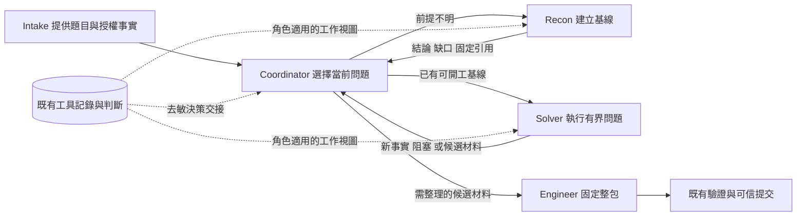

# Coordinator／Recon／Solver：決策上下文與責任調整

**狀態（2026-11-18）：** 進行中。§6.1 題目工作簿已落地（host 接口、角色檔，以及 Recon 重設計 §4 的索引摘要），§6.2–6.3 的內容契約已寫入角色檔，通過無模型測試；三次真實 run 與一次冒煙 run 確認模型會寫、會接上工作簿，索引摘要與材料去重在 runtime 成立。首輪配對對照（§7.2，3 題 × 2 組 × 2 次）兩組候選結果持平，未顯示工作簿對解題的收益或損害。2026-11-17 有界診斷把 7 個無候選 run 的停止多數歸到授權／環境邊界，3 次 Critic 建議均被承接；主缺口在 Solver 方法內容與運用，另有 ac5a1bc0 的授權／部署邊界，不是續派或工作簿交付。§6.3 無候選停止規則已寫入角色檔，尚無變更後行為證據；§6.4 後續片未開始。2026-11-18 離線核對：Solver 不是「沒看到」，假設升級缺依據不是常態，續接比新建承接得好但有混雜；Coordinator 的假設證據 ref 已實作（§6.1）；下一步是另行授權的合成案例對照（§7.1）。

本文是[核心 design v1](2026-10-22-ctf-agent-design-v1.md) C 的子設計，負責三角色之間的問題歸屬、決策交接與驗證方法，此範圍的細節以本文為準。既有產品行為仍以實作及原子設計為準，本文的候選不是已生效契約。

## 1. 結論

**目前已知：**
- **候選出現後的承接沒有缺口。** a3–a6 共 4 次交回提出候選材料，4 次的下一派單都是 Engineer（§3.2）。
- **沒有候選時的續派大致合理。** 19 個決策點中 16 個續派了新的、能區分假設的問題，沒有一次忽略換路訊號（§4 問題 1）。
- **主瓶頸是 Solver 沒產出候選。** 6 個未解 run 從未提出候選；[P2 復盤](../analysis/2026-11-06-alibaba-a1-a4-harness-findings.md)把它們歸為方法缺口（Java gadget 施工、特權 helper 列舉、native RASP）。2026-11-17 的配對批次把同題缺口定位到 OGNL 成員存取／靜態呼叫，以及 Python 運行時審計限制下的另一條執行路徑；沒有觀察到能解釋全部無候選的工具能力或資料交付缺口；一次 Reference 空交回是局部例外（§6.3、[B §7.1](2026-10-26-design-v1-b-method-generalization-and-efficiency.md#71-配对批次无候选复盘2026-11-17)）。這不屬本文的續派契約。
- **方法缺口是內容缺失，不只是發現失敗。** `ac5a1bc0` on-2／off-2 的 Reference 讀了現有 Web Skill 的目錄與兩份 Reference，off-2 另讀了 SKILL.md；其中沒有 OGNL 成員存取或運行時審計相關的方法。Solver 沒有 `skill` 呼叫是另一個問題，但不能用它解釋這兩題的缺口。
- **提前結束不是主要規則缺口。** 配對批次 7 個無候選 run 中，5 個的停止理由指向授權邊界或 DAC；其中 ezoj 的同題成功 run 顯示 DAC 不是唯一路徑。2 個仍有剩餘時間，但一個只剩 4.3 分鐘、另一個的區分價值未知。3 次 Critic 建議都被承接。無候選停止規則主要改善收尾的可核對性，不能單獨補上方法缺口（§6.3）。
- **Recon 不是 Solver 時間被壓縮的主因。** 16 個 Recon 階段中，建好基線後還繼續求解或列舉的只有 2 個（a3 C3、a7 F1），Intake 材料從來不足以直接派 Solver（§4 問題 2）。
- **相鄰的兩個執行問題已另行處理。** child `finish=length` 截斷已由輸出上限 32000 消除（a7，[結果完整性 §5.2](2026-10-25-design-v1-run-readiness-and-result-completeness.md)）；child 拖到 deadline 不交回已由執行中時間事實改善（a8，[Recon 重設計 §5](2026-10-29-design-v1-recon-redesign.md)）。兩者都不改變三角色的分工與決策。

**目前未知（本文要回答的）：**
1. 統一的題目工作簿（§6.1）能否讓各角色接上前一角色的理解，並在上限內不膨脹。§4 問題 3 的舊核對只確認交回有內容，沒有核對承接，不作為否定依據。
2. 無候選停止規則在變更後 run 的行為。目前只有角色檔文字與無模型檢查，沒有變更後的執行證據；配對批次早於規則，不能當驗收（§6.3）。
3. `ezoj` 同題的成功與失敗差異，能否由通用方法內容改善；目前只有一次 accepted 候選與三次環境歸因的對照，沒有內容增量的效果證據（[B §7.1](2026-10-26-design-v1-b-method-generalization-and-efficiency.md#71-配对批次无候选复盘2026-11-17)）。

**不做：** 不重寫多 Agent 架構，不新增 Agent、知識服務、通用規劃器、監控調度器或摘要模型，不加專屬題解或新的 solved 判據。保留 OpenCode 原生模型／task 循環、薄 host、既有工具與獨立驗證／可信提交。不據現有證據判定模型能力不足。

## 2. 範圍與角色責任

### 2.1 目標

讓同一道題的證據和未決問題連續推進：Recon 給出可用基線，Solver 承接並完成一個具體問題，Coordinator 根據交回的新事實決定續接、補調查、換路、整理候選或停止。

即使整題未解，也要能分辨失敗發生在哪一層：資料交付、事實理解、實驗選擇、執行能力或收尾。只得到「一直跑到 deadline」不算可診斷。

### 2.2 責任分工（目標狀態）

| 角色 | 負責 | 不負責 |
| --- | --- | --- |
| Coordinator | 全題問題順序與資源取捨；決定續派、換路、請 Critic、進 Engineer 或停止 | 不寫逐條實驗腳本，不直接讀普通原始工具正文 |
| Recon | 讓求解具備可用前提：支持範圍內的基線、關鍵未知、可用材料 | 不為「調查完整」一直深解；不把未證實的猜測包裝成 Solver 必須遵守的結論 |
| Solver | 局部的推理—實驗—解釋閉環，包括與當前問題直接相關的補充觀察與修錯 | 不重做整套 Recon；只有需要獨立調查、跨範圍、缺上游材料或必須改全局方向時才請補調查 |
| host | 來源、綁定、完整性、時間、預算與機械投影 | 不以內容 hash、產物數或工具成功推斷語義進展，不代替模型選路 |

Engineer、Verifier 與裁判的權限不合併，「Solver 宣稱候選」不觸發 solved。

**與現行角色規則的差異：**
- ~~Recon 不是每題必跑的深度前置~~：已由 §4 問題 2 否定（Intake 材料 16/16 不足以直接派 Solver），每題仍先派 Recon，不改角色規則。
- Solver 可自行處理本輪所需的局部補充觀察：仍是候選。現行 `domain-solver.md` 只寫「發現前提缺口時交回、不要自己重做整個 Recon」，沒有明文允許局部補充；未審閱，不改 prompt。

## 3. 證據

### 3.1 已核對的實作事實

靜態核對，基線 `main / 9e874d44`（2026-11-07）。沒有量測「索引使模型分心」的因果效應，也沒有證明每次失敗都是遺失交接。

下表是 §6.1 落地前的狀態，保留作為設計動機。已改變的部分：Solver 可寫帶欄位的工作簿條目，Coordinator 可寫問題條目並收到工作簿注入（§6.1）；full 投影預設改為索引摘要，200 條索引按需讀取（[Recon 重設計 §4](2026-10-29-design-v1-recon-redesign.md)）；Coordinator 改為引用條目 id，不再手工維護線索清單（§6.1「角色檔的定案寫法」）。

| 位置 | 當前事實 | 含義與限制 |
| --- | --- | --- |
| `apps/launcher/src/control-service.ts`：`prepareContext` | 調查投影只給 recon／domain-solver／engineer，Coordinator 不在其內 | 角色之間沒有共享決策視圖；Coordinator 仍有 task 交回和 progress |
| 同檔：`checkExperience` | Solver 可 `recon.read`，不可 `recon.note`；decision／handoff 只有 Recon 能寫 | Solver 的工具軌跡自動保留，但解釋、否定範圍和下一步理由只留在會話交回 |
| `apps/launcher/src/investigation-context.ts`：`investigationView` | full 投影是最近 200 條導航索引，加本 session 最後 6 個終態步驟；完整歷史可展開 | 新 Solver 看不到自己的最近步驟；索引不是可開工摘要 |
| `control-service.ts`：`prepareContext` | full 的 current_question 指回原生派單文字，delta 傳變更索引／狀態；已有 append-only、版本、失敗拒絕與審計 | 注入已接通，不需要新傳輸；縮小輸出 bytes 不等於決策品質改善 |
| `product/opencode/agents/coordinator.md` | Coordinator 從交回手工維護未測線索、轉交 refs、設定有界問題；背景 child 執行中不自動喚醒父會話 | 它同時做派單、語義整理與引用搬運；長 child 期間父端沒有決策機會 |
| `product/opencode/agents/domain-solver.md` | 已要求問題與停止條件、消費上游 ref、遇新前提缺口經 Coordinator 補調查 | 「再加一句提示」不算新方案；要改的是資料承載和責任邊界 |

### 3.2 已完成的核對

**交回時的四項決策事實（a6，2026-11-08）。** `remainingMs`、`turnMs`、`dispatches`、`packaged` 已於 `2ed7054c` 實作，權威 design 是[結果完整性 §5.2](2026-10-25-design-v1-run-readiness-and-result-completeness.md)。a6 沒有觀察到派單改變：ezoj 兩次都沒進 Engineer，F2 有 5 次 Solver→Solver 續派；對照題 K2 正常解出。單次、非配對，不判定無效，保留為所有對照的固定基線。

**交回內容核對（2026-11-08，[記錄](../analysis/2026-11-08-handoff-content-check.md)，a3–a6 共 10 個 run、43 次交回）。** 當時在實驗 session 中逐次分類並只交回分類結果；按現行 [AGENTS.md](../../../AGENTS.md) 工作模式，這類有界讀取既有 run 的分類屬於工程 session 的離線分析。
- 提出候選材料的 4 次交回，下一派單都是 Engineer，候選被忽略 0 次。
- 6 個 run（a3 C1、C2，a4 D1，a5 E2，a6 F1、F2）從未提出候選。
- 8 次交回因 `finish=length` 截斷，既沒回答問題也沒留線索，全部落在這 6 個 run。
- 未截斷的 Solver 交回大多含「回答／原因」與「下一問題／線索」，下一派單大多仍是 Solver。

**結論與適用範圍。** 原核心假設「判斷在交接中遺失或未被承接」沒有得到支持，所以第一片暫緩。但這次核對只回答了「交回有沒有內容」和「候選有沒有被接」，沒有判斷無候選時的續派是否合理，見 §4 問題 1。

**冒煙 run 的兩個接口缺口（2026-11-17 核對）。** 冒煙 run 的 Coordinator 一次只帶 `task_id`、漏 `subagent_type` 的續接被拒為 `task id not owned`，隨即改開新 Solver session；Solver 兩次想以 refuted 撤回事實：一次因 refuted 不帶 status 被拒，一次因 facts 不能由 refuted 取代被拒；錯誤事實留在視圖（[冒煙 gate](../../gates/workbook-smoke-20261116/)）。兩者已在 `ccdd0c0a` 修正：續接拒絕改為指出原角色，facts 可由同角色的 refuted 取代（refuted 仍不帶 status）。配對批次（`b88529ed`，含此修正）的 `ac5a1bc0` on-2 有 3 次成功續接、0 次拒絕，直接支持續接訊息已修好；12 次 run 的 facts→refuted 為 0，事實撤回只有契約測試，沒有真實使用樣本（§6.1）。這兩項只證明接口可用，不證明會改善候選產生。

### 3.3 反例與限制

- **只縮短 child 不夠。** a4 的 6 次交回各為 0.2–2.9 分鐘，Coordinator 仍每次再派 Solver（[結果完整性 §5.2](2026-10-25-design-v1-run-readiness-and-result-completeness.md)）。a8 時間事實生效後，F2 在 Critic 交回後又派 2 次 Solver，剩約 4.2 分鐘以 0 提交結束。
- **收尾延誤。** [Recon 重設計 §5](2026-10-29-design-v1-recon-redesign.md)離線重算：a3 C3 在 13.6 分鐘發布了後來被 Engineer 使用的材料，到 25.8 分鐘才派 Engineer。不能把「後來可用」倒推成 Coordinator 當時已知完整候選。
- **機械停滯指標不成立。** 換參數／不同結果 hash 很常見；「無新 artifact」門檻會截斷成功 run。本文不重新引入固定次數或剩餘分鐘的強制 gate。
- **已注入不等於已使用。** r18／r19 投影正常，但沒有角色用 `recon.read` 展開歷史（[Recon 重設計 §4](2026-10-29-design-v1-recon-redesign.md)）。有些內容可能已在原交回可見，須逐個決策點查必要資訊。
- **上下文大小不是已證實的耗時主因。** r18／r19 更支持生成量與延遲相關（[延遲設計 §2–3](2026-11-04-design-v1-run-latency-and-context-cost.md)）。本文研究資訊適配與判斷連續性，不宣稱縮短 context 能提速。
- **派單前提無法追溯。** 問題 2 的核對中，a3 C1、a5 E2、a8 F1 三次首個 Solver 派單寫入了 Recon 記錄找不到出處的前提（工具鏈可用性、位置相關觀察、精確環境數值）。這是 Coordinator 派單的寫法問題，不是 Recon 時長問題；目前 3 例，只記錄，不改派單規則。
- **a5 E2 的限制。** 只核對了終態與角色欄位（deadline、11 completed／1 cancelled、無 Engineer execution），約 13 分鐘的 Solver 回合引用[生命週期分析](../analysis/2026-11-07-a5-e2-lifecycle.md)。這支持「未進入整理鏈」，不能證明當時已有可打包的候選。

## 4. 未決問題

### 問題 1：沒有候選時，Coordinator 續派 Solver 是否合理

- **為什麼要問。** 在無候選的 run 中，Solver→Solver 續派是最常見的模式：a6 F2 續派 5 次後提前結束；a5 E2 的 Critic 給出 `redirect` 後仍續派同一個 Solver；a8 F2 在 Critic 交回後又派 2 次。§3.2 的核對確認交回含「下一問題」，但沒有判斷那個問題是否新、是否能區分假設。
- **方法。** 不跑模型、不訪問目標，在工程 session 中按摘要優先、只取必要字段或行的方式讀 a3–a8 已有 run，對每個「無候選交回 → 下一派單」決策點分類，記錄計數：
  - (a) 續派的問題與上輪不同，且能區分剩餘假設；
  - (b) 重複上輪問題，或沒有新前提；
  - (c) 有 Critic 建議或交回明示要換路，仍續派原路線；
  - (d) 無法判斷。
- **結果去向。**
  - 大多為 (a)：Coordinator 選擇合理，瓶頸在 Solver 方法（P2），本文維持暫緩。
  - (b)＋(c) 佔多數：缺口在 Coordinator 決策。第一片改為 §6.2 的派單／交回契約與 Coordinator 的交回呈現，不先做 Solver note。
  - (d) 佔多數：記錄缺口，先改善交回可判讀性，不推測。
- **判讀約定。** 只計下一派單為 Solver／Reference 的決策點，前一次交回被截斷的不計。a ≥ 2/3 判「大致合理」；b＋c ≥ 1/3 且出現在至少 3 個 run 判「Coordinator 決策缺口」。這是本次判讀約定，不是產品門檻。
- **結果（2026-11-10，[核對記錄](../analysis/2026-11-09-q1-redispatch-check.md)）：** 大致合理，本文第一片維持暫緩，轉 Solver 方法缺口（P2）。
  - **計數。** a3–a8 共 42 個 Solver execution，計入 N = 19（8 個 run，bypassit2、ezbean、ezoj 三題）：a 16、b 3、c 0、d 0。另有前序截斷 5 個；下一派單為 Critic 4 個、Engineer 5 個，只記錄。
  - **沒有忽略換路訊號。** 交回自稱路線窮盡或已有 Critic 交回的 4 個決策點，下一派單都換了路線或收斂到新線索。
  - **b 集中在收尾。** 3 個 b 只落在 a4 D1（2 個）與 a6 F2（1 個），都在 deadline 前最後幾分鐘：2 個是 Coordinator 自擬的同一阻塞再試，1 個是照搬 Solver 建議的「只執行」重述。不到 3 個 run，不算系統性缺口。
  - **無候選得到確認。** 19 個決策點對應的交回都沒提出候選材料，與 §3.2 一致。
  - **反例的覆蓋。** a6 F2 的 5 次續派中，計入的 4 次是 3 a、1 b；a8 F2 Critic 交回後的 2 次都是 a，其中 1 次是 Critic 執行期間並行派出。a5 E2 在 Critic `redirect` 後的那次續派，前一個交回是 Critic 而非 Solver，不在本次口徑內，未判斷。
  - **限制。** 單人分類，無第二評審；3 個邊界列全部改判時 a 為 13/19，結論不變。ezoj 佔多數，不代表題目分佈。
- **2026-11-17 配對批次复核。** 7 個無候選 run 的續派與換路仍大致合理，沒有新的 (b)／(c) 系統性缺口。
  - **Critic 被承接。** 3 次 Critic（2 次 `redirect`、1 次 stop）都對應到一致的下一步：`ac5a1bc0` on-2 續接 Solver 做了 H1/H2 兩個判別觀察，`ezoj` off-2 續接 Solver 做了兩項有界實驗，`ac5a1bc0` off-1 依 Critic 建議停止。沒有觀察到忽略 redirect 而續跑。
  - **多數停止有外部邊界。** 5 次的最後障礙是授權或環境邊界：`ac5a1bc0` 的 backend 8080 不在授權內，`ezoj` 的 `/flag` 是 root 0600、服務為 uid1000。這些不是 Coordinator 選錯下一個問題。
  - **仍有兩個可疑收尾。** `ac5a1bc0` on-1 剩 4.3 分鐘，仍有具體的 OGNL 成員存取檢查；off-2 剩 13.5 分鐘，仍有未測 anomaly。兩者的可區分價值與能否在剩餘時間完成打包／送驗都未證實，只記錄，不判成規則缺口。
  - **與舊核對的關係。** 這次复核沒有推翻 2026-11-10 的 a 16/19；它補上了「停止時是否仍有有效下一步」與 Critic 承接的行為證據，結論是主要缺口仍在 Solver 方法，不在續派。

### 問題 2：Recon 何時算完成、是否每題都要派

- **為什麼要問。** 所有 run 都是 intake→recon 開場。Recon 總時長：ezoj 為 136–1170 秒，a7 F1 的 Recon 跑滿 30 分鐘未交回；8a6ac7ff 為 133–224 秒。按題 Recon cap 設 1000，等於關閉。Recon 佔掉的時間直接壓縮 Solver 的探索時間。
- **方法。** 同樣在工程 session 中有界讀取每次 Recon 的軌跡與交回，判斷「可開工基線」（入口、材料、環境前提）最早在何時已經具備，與實際交回時間比較，記錄時間差與分類。
- **結果去向。**
  - 基線早已具備、Recon 仍繼續深入：屬職責邊界問題，在本文定 Recon 的完成條件，並評估讓 Coordinator 在 Intake 材料足夠時跳過 Recon。改角色規則前先審閱。
  - 基線本身就需要長時間：不屬協作問題，回 [Recon 重設計 §5](2026-10-29-design-v1-recon-redesign.md)看預算分層。
- **邊界。** Recon 的時間上限、cap 與 closure 歸 Recon 重設計 §5，本文只定完成條件與是否派。
- **判讀約定。** T_base = 首個 Solver／Engineer 派單 S 所依賴的前提中，最晚建立的那次 Recon 工具呼叫時間；gap = 交回 − T_base。上限 max(60 秒, 階段時長 20%)：A 及時交回；B 超限且基線後主要是求解嘗試；C 超限且主要是擴大列舉或空轉；D 未超限但 T_base > 300 秒；E 無法判斷。續接 execution 合併，19 個 execution 成 16 個階段。比例是本次判讀約定，不是產品門檻。
- **結果（2026-11-10，[核對記錄](../analysis/2026-11-10-q2-recon-baseline-check.md)）：** Recon 時長大致合理，每題仍需派 Recon；不在本文定 Recon 完成條件。
  - **計數。** A 3、B 1、C 1、D 2、E 3，另 6 個階段（a3 C2、a4 D1、a6 F1、a7 K2、a8 F2、a8 K2）基線後主要是整理證據與寫交回，gap 60–139 秒，超過上限但不屬 B／C，原口徑未覆蓋。照字面套規則只能得出「混合」。
  - **事後補的口徑。** 交回準備屬於完成的一部分，這 6 個歸入 A：A 為 9/16，排除 E 後 9/13 ≈ 69%，達到「Recon 時長合理」的 2/3。這是看到結果後補的口徑，照實記錄。
  - **越界深入很少。** B＋C 為 2/16、只涉及 ezoj。a7 F1 是 Recon 跑滿 30 分鐘未交回，a8 加入執行中時間事實後未再出現；a3 C3 是基線後繼續查其他面約 2 分鐘。
  - **基線本身慢（D）。** a5 E1、a6 F2 都是 ezoj，派單依賴的較深入實測約 600 秒才建立。轉 [Recon 重設計 §5](2026-10-29-design-v1-recon-redesign.md) 的預算分層，不屬協作問題。
  - **Intake 不足以跳過 Recon。** 16/16 都是「部分」：有題面與入口，但沒有派單所用的實測、服務行為或環境前提。不評估「Intake 足夠時直接派 Solver」。
  - **無法判斷（E）。** a3 C1、a5 E2、a8 F1 的派單含 Recon 記錄找不到出處的前提，見 §3.3。a8 F1 的 Recon 用了 1202 秒，是 a8 最長的一次，因此其時長是否合理未判定。
  - **旁證。** 有確認解出的 5 個階段 gap 為 46–67 秒，未解的 a3 C3、a6 F2、a7 F1 為 116–1755 秒；樣本小、題目不同，不作因果結論。
  - **限制。** 判讀在 codex 手動 session 中完成，單人、無第二評審；a6 K2 的 Recon 在基線呼叫時已取得候選來源，分類為 A 不代表 Recon 沒有深入。ezoj 佔 10 個階段。

### 問題 3：Solver 判斷是否需要持久化給下一角色

- **舊結論的範圍。** §3.2 只確認交回有內容、候選有被承接，沒有核對下一角色是否用上前一角色的判斷；問題 1 只判斷續派問題是否新，沒有判斷回合切分與轉述損失。兩者都不能否定持久化的需要。
- **現狀（2026-11-11）。** 改由 §6.1 題目工作簿回答：判斷以欄位條目保存在既有主本，按角色呈現。先做無模型接口驗證，再以配對對照判斷收益（§7）。

## 5. 方案比較

| 方案 | 作用點與代價 | 決定 |
| --- | --- | --- |
| 只補交回時 host 數字 | 提醒剩餘時間、派單統計、是否已打包；變更小，但說明不了「本輪解決了什麼、為何值得續派」 | 已實作（`2ed7054c`），作所有對照的基線，不稱完整修復 |
| **保留角色，形成可追溯的決策交接** | 沿既有主本以欄位條目保存 Recon／Solver 的判斷，折疊成題目工作簿按角色呈現；Coordinator 不再手工維護線索與轉抄 refs | 推薦的候選方向，第一片為 §6.1 |
| 合併 Recon／Solver，同一會話持續探索 | 少一次上下文重建，但長會話仍會偏航，且改變現有分工和權限 | 後備對照；只有決策交接完整後仍有明顯跨角色重做才考慮 |
| 新增 Planner／Summarizer／監控角色 | 增加推理與交接成本，也可能增加摘要失真 | 不採用；Coordinator 已承擔全局選擇 |

## 6. 設計與後續片

§6.1–6.3 已落地，§6.4 仍是候選。共同原則：一份事實主本（既有追加式調查記錄），按角色提供工作視圖；工作視圖由主本機械折疊而成，不是另一份可編輯事實庫。

### 6.1 題目工作簿（第一片）

**要解決的缺口。** 現有視圖給的是步驟日誌（最近 200 條索引加本 session 最後 6 步），不是「目前對這道題的理解」：新 Solver 看不出已知什麼、在懷疑什麼；Coordinator 看不到調查記錄，只能從交回文字手工維護線索並轉抄 refs，§3.3 的 3 次無出處前提就出在這一步。§4 問題 3 的核對只確認交回有內容，沒有核對下一角色是否接上，因此不作為暫緩本片的理由。

**主本與折疊。**
- 條目仍是追加到同題調查記錄的 note，格式見下方「寫入接口」。
- 目前的工作簿 = 各欄中仍有效、未被取代的條目。被取代的條目留在記錄中，可按 id 追溯；工作簿是狀態，記錄是證據。
- host 只做機械折疊、上限截取與身份綁定，不判斷哪條重要，不從自然語言解析可信狀態。

**欄位與寫入權。**

| 欄 | 寫入者 | 內容 |
| --- | --- | --- |
| 目標與約束 | host（來自 Intake） | 題面、入口、材料、可信限制 |
| 已確認事實 | Recon／Solver | 一句事實＋證據 ref＋適用範圍 |
| 工作假設 | Recon／Solver | 假設＋狀態（open／supported／refuted）＋依據 |
| 已排除路線 | Recon／Solver | 一行一條，帶排除範圍 |
| 未決問題 | Coordinator 為主；Recon／Solver 可提出 | 下一個要回答的問題，即派單單位 |
| 材料目錄 | host（發布時） | artifact ref＋kind＋size；以 context 的 `state.publications` 呈現，不在工作簿內重複（見下方「host 接口的實作結果」） |
| 候選狀態 | Solver 提出或撤回；已打包與提交結果由 host 從 package 與 completion 記錄計算 | 有無候選材料、是否已打包、提交結果 |
| host 事實 | host | 剩餘時間、派單次數、回合時長 |

- 事實與假設由實際做實驗的角色寫，問題排序由 Coordinator 寫；Coordinator 不改寫事實欄。
- 條目是作者判斷，不是工具事實。取代權按角色而非 session：新 Solver session 可以取代先前 Solver 的條目，這正是承接所需；Recon 與 Solver 不能互相取代，發現衝突時追加反證並以 related_ids 關聯，host 不自動裁定。唯一例外是 Coordinator 可取代任何角色的未決問題條目，因為問題排序歸它。
- 寫入只能在 host 綁定的同題、當前 execution 下進行；Verifier 不讀、不寫工作簿，保持獨立。
- Solver 提出的假設與問題直接進入工作簿，不再只經 Coordinator 轉述。

**寫入接口（2026-11-11 定）。**
- **沿用 `decision` kind，加欄位。** 帶 `slot` 的 decision 就是工作簿條目；新增欄位為 `slot`、`text`（≤ 300 字元，超過即拒絕並說明上限）、選填的 `status`、`scope`、`supersedes`，既有 related_ids／evidence_refs 照用。不帶 `slot` 的 decision 與 handoff 語義不變，不進工作簿。理由：寫入時去敏、episode 來源與快照鏈都已處理 decision，不另開新 kind 和新路徑。
- **狀態取值。** 工作假設為 open／supported／refuted；未決問題為 open／answered／dropped；候選為 proposed／withdrawn；事實與已排除路線不帶狀態。answered、dropped、withdrawn 的條目仍有效、可再被取代，但不進視圖。
- **狀態變化即取代。** 假設由 open 變 supported 或 refuted，寫新條目取代舊條目；被否定的假設，或後來證明不成立的事實，可由同一角色以「已排除路線」欄的條目跨欄取代，其他跨欄取代一律拒絕。事實可撤回是冒煙 run 後補的：Solver 想撤回先前 Solver 寫錯的事實，被拒後另寫了一條不關聯的排除路線，錯誤的事實仍留在視圖中。跨角色仍不能取代，拒絕訊息提示改用 `related_ids` 關聯。
- **只能取代仍有效的條目。** 目標已被取代時拒絕，並回傳目前有效條目的 id，避免分叉；並行寫入以先寫入者為準。
- **被取代的標示。** 工作簿視圖只呈現有效條目；`recon.read` 讀到被取代的條目時，在讀取時附上 `superseded_by`，不改寫原記錄。
- **host 欄不是條目。** 目標與約束、材料目錄、host 事實由 host 從既有 challenge、publication 與預算狀態即時計算；候選的已打包與提交結果取自既有 package 與 completion 記錄。模型不能寫這些欄，Engineer 也不需要寫入權。
- **Solver 的寫入範圍。** Solver 只能寫帶欄位的條目，不能寫不帶欄位的 decision 或 handoff；handoff 會觸發 Recon 的快照發布，不在本設計內。
- **Coordinator 的寫入入口。** Coordinator 的 binding 沒有 `challengeId`（它是跨題角色），所以開放 `recon.note` 給 Coordinator 時必須顯式帶 `challenge`，host 核對該題屬於本 run；Coordinator 只能寫 `slot=未決問題`，其他欄與不帶 slot 的 note 一律拒絕；其他角色帶 `challenge` 也拒絕，題目由 binding 決定。Coordinator 可以取代任何角色的問題（例如標為 answered），Recon／Solver 不能取代 Coordinator 寫的問題。全局的繼續／換路／停止決策仍寫既有 `ctf_progress_note`，不併入工作簿。不採用「把 progress note 折疊進工作簿」：progress note 記在另一份審計記錄、沒有題目欄位，折疊要跨兩份主本。也不採用「從派單文字解析問題」：違反 host 不解析自然語言的原則。

**角色視圖。** 同一份折疊結果，按角色過濾與排序：

| 接收者 | 直接呈現 | 不自動帶入 |
| --- | --- | --- |
| Coordinator | 未決問題、假設狀態、已排除路線一行摘要、候選狀態、host 事實；事實欄只給一行加 ref | 原始工具輸出、步驟索引、候選 bytes、憑據 |
| Recon | 目標與約束、材料目錄、已確認事實、工作假設、已排除路線、全部未決問題 | 候選條目 |
| Solver | 全部欄位（帶 ref，含已排除路線的範圍），加本 session 最近步驟；本次問題由派單引用的條目 id 指出 | — |
| Engineer | 候選條目與材料目錄 | 父端摘要不當候選來源，仍自讀固定 bytes |

- 視圖按欄過濾，不按「相關性」或「分給誰」篩條目：條目沒有指派欄位，host 也不判斷哪條與本次問題相關，符合「host 不判斷重要性」。實作見 `apps/launcher/src/workbook.ts` 的 `VIEWS`。
- 經既有 `prepareContext` 追加式 hook 注入：新 session 給 full，工作簿版本變化時給 delta；不改寫已完成消息，不破壞 tool-call/result 配對。
- Coordinator 的 binding 沒有 `challengeId`，原先 `prepareContext` 對它直接返回空；現改走 `prepareCoordinatorContext` 放行注入，plugin 端的追加路徑原本就對所有 session 接通。

**Coordinator 視圖與去敏（2026-11-11 定）。**
- **定位。** 底線保護的是控制憑據、oracle 私有資料與候選 bytes。Coordinator 現在本來就會收到 Solver／Recon 交回的全文（原生 task 結果，未過濾），而工作簿條目在寫入時已經去敏、單條 300 字元；所以 Coordinator 視圖不比現狀更敏感，去敏要做的是不讓它成為新的洩漏通道。
- **寫入時。** 所有條目經既有 `ExperienceStore` 寫入清理：控制秘密清單替換、flag 樣式、Authorization／Cookie 類樣式與敏感欄位名。這已在現有 note 寫入路徑上，不新增機制。
- **呈現時欄位白名單。** Coordinator 視圖只組出 id、題目、欄、作者角色、`status`、`text`、證據 ref id；不帶工具參數、結果、`scope` 以外的作者自由欄，也不帶步驟索引。已確認事實與已排除路線截成一行（≤ 120 字元）加 ref；候選狀態只給狀態與 ref，不給條目文字。
- **呈現時再清理一次。** 每條 `text` 再經 progress ledger 既有的 `redactProgressText`（run 的秘密清單＋flag 樣式），覆蓋寫入後才加入的秘密。
- **失敗即省略。** 單條組裝或清理失敗時省略該條並在 coverage 裡標 id 與原因，不退回原文；整份視圖組不出來時報缺口，Coordinator 仍按現狀只看交回文字。
- **呈現內容。** 未決問題與工作假設給全文（≤ 300 字元），工作假設另附證據 ref（2026-11-18 起，見下條）；事實與已排除路線截成一行；候選只給狀態與 ref；每題附提交狀態、已打包 version、completion 狀態與各角色 execution 次數，全局附剩餘分鐘。不給 scope、related_ids、步驟索引與任何工具參數或結果。
- **假設的證據引用（2026-11-18 已實作）。** 白名單列了證據 ref id，原實作只給事實、已排除路線與候選附 ref，假設只有文字與狀態；同一個判斷經工作簿、派單與 Critic 摘錄轉述時，支持依據沒有一起傳下去。現在工作假設也附清理後的 `evidence_refs`；未決問題不附，`related_ids` 與 `supersedes` 仍不給。沿用本節的清理與失敗即省略。`tests/contract/workbook.test.ts` 新增一項覆蓋假設附 ref、ref 內的秘密被清理、問題不附 ref；確定性測試 835 項通過。用 13 個有工作簿的 run 重算（每次寫入後重組視圖，[gate](../../gates/fixed-decision-point-20261118/summary.json)）：最大視圖 7731 字元（不附時 7500），單一 run 峰值最多增加 231 字元，0 次省略；離 8K 只剩約 270 字元，下一次觸頂按下方「上限數值」的觸發條件處理。引用抵達不等於判斷改善，後者交 §7.1 的固定決策點診斷。
- **多題。** Coordinator 視圖按題分段，只列本 run 中有 execution 或有有效條目的題（派單前的指派聲明在派單後即被消費，不能作依據）；總量 8K 字元內，超界時最久未更新的題先折成一行狀態。截取按更新時間，不按內容。

**防止膨脹。**
1. **狀態取代日誌。** 新條目以 `supersedes` 取代舊條目，工作簿大小跟目前的理解有關，跟步驟數無關。
2. **每欄機械上限。** 超出時寫入照常成功、記錄不丟；視圖只顯示最新 N 條，並標出省略數與展開入口。角色檔要求：看到有條目被省略時，交回前合併自己的條目。上限見下方「上限數值」。
3. **交回即整理點。** 每次交回時，角色把本輪條目合併成最終版本並取代中間條目；不新增摘要 Agent。
4. **總量上限。** 每個角色視圖設總字元上限；超界明示 coverage 與 omitted ids，不截斷後聲稱完整。200 條步驟索引已改為按需讀取、預設只注入摘要（[Recon 重設計 §4](2026-10-29-design-v1-recon-redesign.md)，運行設定 `context.index`）。

**上限數值（候選，2026-11-11 離線估算）。**

| 項目 | 上限 |
| --- | --- |
| 單條條目 | 300 字元 |
| 已確認事實／已排除路線 | 各 20 條 |
| 工作假設／未決問題 | 各 8 條 |
| 材料目錄 | 不設上限（隨 `state.publications` 送出，按 ref 增量） |
| 候選狀態 | 3 條 |
| 視圖總量 | Recon／Solver 12K 字元；Coordinator 8K；Engineer 4K |

依據：[a3–a8 代理量](../../gates/workbook-size-20261111/a3-a8-proxies.json)，由 `tests/manual/workbook-size-estimate.py` 從 16 個 run 離線算出，只取計數與字數。
- **現在的「目前狀態」有多大。** 42 次 Solver 派單中，Coordinator 手抄的線索清單 9–21 行、帶 2–9 個 ref；派單全文平均每行清單約 190 字元。上限給清單最大值約 3 倍空間，正常情況不觸發。
- **每次交回會新增多少。** Solver 交回 3–26 行清單，Recon 交回 8–36 行；Recon 現有 note 把 1.3K–3.7K 字元塞進一條，改按欄位後會拆成多條。單條 300 字元按現有清單行長度定。
- **對照現有注入。** 新 Solver session 收到的完整調查投影為 8.4K–86.9K 字元（中位數 15.1K），主要是步驟索引，之後每次增量約 450 字元。12K 上限只有在各欄同時接近滿額時才會觸發。
- **限制。** 「一行清單 ≈ 一條條目」是代理，沒有讀交回內容逐條核對；ezoj 佔 9 個 run。接口驗證後用真實寫入的條目數重估，數值不是產品門檻前的定案。
- **用 r1–r3 重估（2026-11-16，只取 `experience.sqlite` 的計數與字數）。** 結束時視圖中的條目：r2 有 25 條，正文 4.7K、條目 JSON 9.0K；r3 有 15 條，正文 3.0K、條目 JSON 5.5K。每條約 360 字元，是正文的兩倍左右，多出的部分是 evidence_refs（約 42）、scope（約 30）與欄位名（約 100）。加上目標、材料、coverage 與 guidance 約 1.8K，Recon／Solver 視圖約在 28 條時觸及 12K，遠早於各欄上限合計的 59 條，因此實際起作用的是總量上限。r2 末尾第 4 個 Solver 的視圖約 10.8K，已用掉約 90%。超界時按 sequence 先省略最舊條目，最先被省略的往往是 Recon 的基線事實（列在 `omitted_ids`，不靜默丟失）。原估算按「單條 300 字元」計總量，低估了每條條目的實際大小。
- **決定：數值暫不改，改設觸發條件。** 三次 run 都未觸頂，模型也從未合併自己的條目，此時調高上限只是把問題延後。首次出現 `total_cap` 省略時核對兩點：模型是否按角色檔合併條目；被省略的舊條目之後是否被需要（被 `recon.read` 展開或被派單引用）。據此在調高總量、強制合併與縮減每條額外欄位三者中選一。不採用現在就調到約 20K：理由是索引摘要化後工作簿已是 Solver 收到的主要內容，但目前沒有樣本觸頂。

**取代的現有做法。**
- Coordinator 在派單文字中手工維護 tested／untested／refuted 線索清單並轉抄 refs（[design-b §8.1](2026-10-26-design-v1-b-method-generalization-and-efficiency.md)）；角色檔相應精簡。
- 「只有 Recon 能寫 note」的准入；改為 Recon／Solver 按欄位寫入。
- Solver「先測 Recon 線索清單才能轉向」的順序；改為按工作簿中的未決問題與假設選擇實驗。
- 歷史經驗檢索與題後 episode 必須核對條目的作者角色，不把 Solver 條目當已驗證 lesson。**已由現有機制滿足（2026-11-16 核對）：** episode 輸入的每條記錄帶 host 綁定的 `role`，step_list 也標明角色（`episode-learning.ts`）；outcome 由 host 從 completion 記錄計算；lesson 提示要求保留未驗證限制、不輸出成功聲明，呈現時標 `reference_only`，lesson 本來就沒有「已驗證」狀態。剩下的缺口是 episode 提示沒有說明帶欄位的 decision 是作者判斷而非工具事實，移到 §6.4「恢復與經驗庫」。r1–r3 的 episode 都是 pending、lesson 為 0，沒有混入的證據。

**無模型接口驗證**（沿實際 launcher／plugin／固定 OpenCode 公開接口，用合成事件和固定回應）：
1. 條目能按欄寫入並被取代；被取代條目仍可按 id 讀回並帶 `superseded_by`；越權取代他人條目、取代已失效條目、異題或非當前 execution 寫入、Coordinator 寫非問題欄或未帶題目，都被拒。
2. 超出欄位與總量上限時，視圖按時間截取並標明省略數與展開入口，記錄不丟失。
3. 上游條目不在最近 6 步、歷史超過 200 條、新 Solver 無本 session 歷史時，實際出站請求仍帶有工作簿正文。
4. 含合成控制秘密、flag 樣式、Cookie 樣式與候選文字的條目，在 Coordinator 實際出站請求中都不出現原文；寫入後才加入秘密清單的值也被清理；單條清理失敗時省略並標 coverage。Verifier 請求中沒有工作簿。
5. compaction、重啟、同 child 多次續接與同步／背景交回後，工作簿版本與 full／delta 正確；partial／empty／unknown 保留原語義。

只有 schema 通過、hook 有輸出而實際請求沒有正文，判失敗。

**host 接口的實作結果（2026-11-11）。** 寫入、取代、折疊、上限截取，以及 Recon／Solver／Engineer 與 Coordinator 的注入已實作；`tests/contract/workbook.test.ts` 27 項覆蓋上面驗證第 1–5 項與兩種視圖條目級 delta 的合併還原。2026-11-17 定向執行 control-service 36 項與 workbook 27 項全通過；全量 867 項是 2026-11-11 的記錄，未在本次重跑。實作中定下的細節：
- 工作簿相關的拒絕（超長、狀態不合法、取代失效條目等）以具體訊息返回模型，訊息只含固定文字、條目 id 與欄位名；其他 note 錯誤仍是通用拒絕。
- Recon／Solver／Engineer 的工作簿在 delta 中按條目傳送：只帶新增或改變的條目（各帶所屬欄）、不再呈現的 id，以及有變化的 host 部分；按 id 合併即還原完整視圖。原先整份重送在首次真實 run 中讓單一 session 累計多收 5–7 萬字元（見下）。材料目錄不再作為工作簿的 host 部分送出（2026-11-16）：同一個 context block 的 `state.publications` 已帶相同的 ref／kind／size，另有 sha256 與 session，不設 12 條上限，且已按 ref 增量傳送；原先兩種索引模式都重複送出兩者。工作簿 guidance 指向 `state.publications`；關閉組本來只有 `state.publications`，兩組在材料呈現上一致。工作簿視圖也因此少了最多 12 條材料（約 1K 字元），計入 12K 總量的只剩條目、目標、候選 host 部分與 coverage。
- episode 來源中，Solver 寫的條目保留 `role: domain-solver`，不被標成 recon。
- Coordinator 視圖按記錄的更新時間決定折疊順序：各題的 sequence 各自編號、不能跨題比較。最近更新的那題永遠不折疊，只有一題時超出部分改為省略最舊條目，避免單題 run 整題被折成一行。
- Coordinator 視圖同樣按條目傳送 delta：變動的條目（帶題目與欄）、移除的 id、有變化的題目標頭（host 事實或折疊狀態），剩餘分鐘與 coverage 只在變化時重複。原先整份重送在 45 分鐘的 run 中累計 8.1 萬字元，其中剩餘分鐘每跨一分鐘就觸發一次。
- related_ids 或 evidence_refs 無法綁定時，返回具體的拒絕訊息（例如 ref 被截短），不再是通用拒絕。
- 候選條目由 host 限定只有 Domain Solver 能寫。Recon 看到疑似候選材料時寫成附 ref 的事實，並提出問題請 Solver 確認。Coordinator 在工作簿有 proposed 候選時不以 stop_and_report 結束該題，須先派 Engineer 或請 Solver 撤回，做不到時在 progress note 寫明條目 id 與原因。
- 已知限制：Coordinator 寫入時若 SQLite 出錯，只拒絕該次寫入，不會像題目角色那樣暫停該題的探索，因為 Coordinator 沒有綁定的題目。

**真實 run（2026-11-12／16，[r1–r3](../../gates/workbook-runtime-20261112/)、[冒煙 run](../../gates/workbook-smoke-20261116/)）。** 都是同一題單次、deepseek-v4.1-flash、Solver 開思考，只說明接口在 runtime 中的表現，不是收益證據；計數由 `tests/manual/workbook-run-check.py` 從 run 證據離線算出。

| run | 條件 | 結果 | 能說明什麼 |
| --- | --- | --- | --- |
| r1（`05af1de2`） | 80 次調用 | 預算用完未解出，未派 Engineer；寫入 29 次（1 次因截短的 ref 被拒）；第 2 個 Solver 開場接到 12 條；派單 6 次中 5 次引用條目 id、0 次手抄清單 | 寫入、承接與派單改變都在 runtime 成立；整份重送讓 Recon／Solver 單一 session 累計多收 5–7 萬字元 |
| r2（`825bc343`） | 45 分鐘、調用不限 | Coordinator 自行結束未解出，108 次調用、4 個 Solver session；Solver 開場依序接到 14／17／22／26 條；跨 session 重複的工具指紋 9 次，8 次是讀取；派單全部引用條目 id | 條目級 delta 生效（Recon 18 次 delta 合計約 2.6 萬 bytes）；Coordinator 整份重送 21 次、8.1 萬字元；Recon 寫的候選無人處理，未派 Engineer 即結束 |
| r3（`2d22283d`） | 30 分鐘、調用不限 | Coordinator 自行結束未解出，95 次調用、3 個 Solver session（23／10／7 次調用）；沒有出現候選條目；跨 session 重複 3 次，全是讀取；派單 4 次引用條目 id | Coordinator 條目級 delta 生效（17 次合計約 1.4 萬 bytes，r2 為 8.1 萬字元）；候選處理與條目合併兩項修正都沒被觸發，仍待驗證 |
| 冒煙（`6ef0a50c`） | 同 r3，顯式 summary 索引、新 runs-root | Coordinator 自行結束未解出，124 次調用、3 個 Solver session（37／9／19 次調用）；Solver 開場依序接到 11／18／22 條；沒有候選；跨 session 重複 5 次，全是讀取 | 索引摘要讓單次投影最大降到約 15K bytes（r3 約 56K）；工作簿不再帶材料、ref 只在 `state.publications`；Coordinator delta 約 1.6 萬 bytes；未觸及總量上限（Solver#3 開場 8.4K）。暴露兩個缺口：續派拒絕訊息誤導，以及事實無法撤回 |

據此修正：引用拒絕改為具體訊息；續派時只漏寫或寫錯 `subagent_type` 的拒絕改為說明原角色，不再顯示為「task id not owned」（冒煙 run 中 Coordinator 因此放棄續接、改開新 Solver session）；事實可由同角色的排除路線取代；Recon／Solver／Engineer 與 Coordinator 的工作簿都改為條目級 delta；候選限定由 Solver 寫，Coordinator 不得在有 proposed 候選時直接結束。

**兩個冒煙缺口的驗證狀態（2026-11-17）。** 續接拒絕的修正只有一個真實樣本：配對批次 `ac5a1bc0` on-2 的 3 次續接全部成功、0 次拒絕；其他 run 沒有續接，不能算覆蓋。事實撤回由 `workbook.test.ts` 覆蓋 facts→refuted 路徑，但配對批次 12 次 run 的 facts→refuted 為 0，沒有真實使用樣本；模型是否會在實際錯誤事實出現時使用它，仍未知。兩項都只證明接口可用，沒有證據說它們提高了候選產生率。

**仍待觀察：**
- Recon／Solver 四次都沒有成功取代自己的條目（冒煙 run 中唯一兩次嘗試是撤回事實，被當時的規則拒絕）；r2 結束時有 33 條有效條目、facts 17 條，r3 為 21 條，冒煙 run 為 27 條。合併規則是否會在觸及上限時被遵循，還沒有樣本。
- Solver 回合仍短：r3 三個 Solver 只有 23／10／7 次調用，與 §6.4 放寬交回門檻的動機一致。配對批次的後期回合也短，但同時有 4–7 分鐘上限與問題收窄，不能只歸因於交回門檻（§6.3）。
- r2 第 4 個 Solver 的首個完整投影約 79KB，大部分是 200 條步驟索引。索引按需讀取（[Recon 重設計 §4](2026-10-29-design-v1-recon-redesign.md)，預設 summary）在冒煙 run 中把最大投影降到約 15K bytes，模型只展開過 1 次 `recon.read`。
- 上面四次 run 都沒有走到候選與提交。首輪配對（§7.2）中，開啟組有 3 次產出候選並打包、被 judge 接受。開啟組 6 次 run 共成功取代自己的條目 20 次：Coordinator 13 次（6 次 run 都有），Solver 7 次（2 次 run），Recon 0 次；撤回事實（facts→refuted）0 次。12 次 run 都沒有觸及總量上限，所以合併規則在上限下的表現仍無樣本。

**plan 切分。** 本片按依賴拆成三份 plan，各自驗收：
1. **host 工作簿接口：** 寫入接口、折疊、上限截取，以及 Recon／Solver／Engineer 視圖的注入；驗證第 1、2、3、5 項（Coordinator 相關部分除外）。保留既有 200 條索引注入，讓變量只有「有沒有工作簿」。
2. **Coordinator 寫入與視圖：** `recon.note` 對 Coordinator 的受限開放、`prepareContext` 放行與去敏組裝；驗證第 1 項的 Coordinator 部分與第 4 項。依賴第 1 份。
3. **角色檔：** Recon／Solver 按欄寫入與交回整理、Coordinator 停止手抄線索、取消「先測 Recon 線索」的順序。產品資產，先由用戶審閱草稿；依賴前兩份的接口驗證通過。

前三份都已完成（2026-11-12）。角色檔的定案寫法：
- 共同規則只寫一次，放在 `product/AGENTS.md`「題目工作簿」；各角色檔只寫自己的分工。
- Coordinator 派單改為引用問題條目 id，加允許的操作與交回條件；交給 Recovery Critic 時附工作簿摘錄，因為 Critic 不在工作簿視圖內。
- Recon 的 decision／handoff 照舊記錄調查過程，工作簿條目記錄結論，兩者不互相代替。
- 交回門檻沒有放寬，只把觸發條件改為「準備轉向與本輪問題無關的深挖」；放寬屬 §6.4。
- 這套做法取代了 [design-b §8.1](2026-10-26-design-v1-b-method-generalization-and-efficiency.md) 選定的線索帳本方案 A。

真實配對對照在三份之後，另行授權。

### 6.2 派單與交回的內容契約

內容契約，不建 JSON 動作協議，不要求每次工具呼叫填表。run／challenge／execution／refs／時間由 host 綁定，不讓模型重填可信身份。工作簿成立後，下列內容以工作簿條目為主，task 文字只補本輪特有的說明。

- **每次派單：** 要回答的問題（工作簿未決問題的 id）；允許的操作與剩餘資源；什麼結果足以交回。
- **每次交回：** 本輪回答了什麼或仍未知；更新後的事實、假設與已排除路線條目；下一個有價值的問題；交回理由。候選材料寫入候選狀態欄，只是「可交 Engineer 檢查」的訊號，不是已登記候選。
- **交回語義：** 用短句區分「問題已回答」「需要具體前提」「提出候選材料」「當前探索無進展」「資源／執行中斷」。缺標籤不阻塞 task 結束，host 不從自然語言解析成可信狀態。無交回或 length 時保存實際完整性與 unknown，不從舊條目補造本輪結果。
- **續接：** 同問題續接保留同 session，新問題才考慮新 session。Coordinator 續派須指出還剩哪個不確定性；不用「繼續嘗試」掩蓋沒有下一問題。新 session 不重置預算，也不以舊題答案或人工解法初始化。2026-11-18 起 `coordinator.md` 寫明同題同角色的下一輪預設續接、新建時寫明原因（`eb5743d3`），尚無變更後樣本。變更前 13 個 run 的離線統計方向一致：上一輪自己的 open 假設／問題，續接時下一輪取代 10/16，新建時 6/15；但續接集中在 4 個 run，且由 Coordinator 選擇，不能當因果（[固定決策點診斷 §6](2026-11-18-design-v1-fixed-decision-point-diagnosis.md#6-離線核對結果)）。
- **修正進入條目（未知，2026-11-18 離線核對）。** `domain-solver.md` 已要求交回前以新條目取代自己的中間條目。`rtd2-ezoj-on-2` 中，Solver 載入診斷 Skill 後交回文字已並列多個解釋，工作簿條目卻沒改；下一輪新建的 Solver 沿舊條目把假設升級為 supported。13 個 run 的關鍵詞統計分不出交回與條目是否一致（保留措辭在交回中太普遍），不據此改契約；交給[固定決策點診斷](2026-11-18-design-v1-fixed-decision-point-diagnosis.md) §3.3 的「修正未寫回」合成案例。
- **假設升級（不改契約，2026-11-18）。** 13 個 run 只有 2 次升級為 supported，都帶了新 ref；「升級不附新依據」不是常態，不加這條契約。實際的常態是假設很少被更新或關閉：13 個 run 共更新 5 次，結束時仍有 28 條有效假設。這與 §6.3「結束時 open 條目未關閉」是同一現象，按 §6.3 的停止規則觀察，不另加規則。
- **派單措辭（未定）。** 派單引用要回答的問題與判斷依據，不把待驗證解釋寫成前提。`rtd2-ezoj-on-2` 中派單問「部署不一致是否為唯一解釋」，下一輪 Solver 便寫出「唯一解釋」；只有 1 例，是否需要改契約交給固定決策點的措辭對照。

### 6.3 候選與收尾

- `packaged=false` 只表示未打包，不表示沒有候選。候選狀態欄出現候選材料時，Coordinator 應評估派 Engineer，而不是默認再次深挖。
- Engineer 無法整理就交回具體缺口；不能因時間緊要求它編造 bytes、補解或略過原出處契約。
- 候選狀態欄是角色聲稱＋綁定 refs＋unknown，不是 host 的 candidate_available 真值；hash 只證明材料身份，不證明內容正確。
- 固定 deadline 或單回合上限不在本文。
- **無候選時的提前結束（2026-11-17 核對，[配對 gate](../../gates/workbook-paired-20261117/)，分類計數見 `diagnosis.json`）。** 只用 control-audit 的操作與標籤、角色檔與工作簿計數，未讀 transcript。
  - **事實：** 配對批次 7 次無候選 run（`ac5a1bc0` 4 次、`ezoj` 3 次）都由 Coordinator 以 `stage=finalize`、`route=stop_and_report` 結束，host 沒有截斷，剩 4–13.5 分鐘。兩組都有；a1–a8 的 15 次未解 run 也有 9 次自行結束，所以這不是本批次或工作簿獨有。
  - **停止依據（2026-11-17）：** 5 次的停止記錄指向授權或環境邊界：`ac5a1bc0` off-1／on-2 的 backend 8080 不在授權內，只能從 8052 間接觀察；`ezoj` on-1／off-1／off-2 的 `/flag` 是 root 0600、服務與 judge 為 uid1000。`ac5a1bc0` on-1 剩 4.3 分鐘，仍有具體的 OGNL 成員存取檢查，但不足以完成突破＋打包＋送驗；`ac5a1bc0` off-2 剩 13.5 分鐘，仍有未測的 `%2f`／`+` anomaly，區分價值未知。開啟組 3 次結束時，工作簿仍有 1–3 條 open 問題與 1–2 條 open 假設，都沒有被 answered／dropped 關閉；關閉與否是收尾狀態，不直接證明還有可行下一步。分類只讀最終 note、Critic 交回與工作簿計數。
  - **Critic 與承接：** 7 次中 3 次在結束前派了 Recovery Critic。2 次 `redirect`（`ac5a1bc0` on-2、`ezoj` off-2）都被承接：Coordinator 分別續接 Solver 做了 H1/H2 與兩項有界實驗，並在 Critic 自己設定的「無新判別即停」條件下結束；另 1 次（`ac5a1bc0` off-1）Critic 建議 stop，Coordinator 直接停止。沒有觀察到「忽略 redirect 而續跑」。另 4 次未派 Critic：2 次剩不到 5 分鐘，2 次剩 8–13.5 分鐘；新規則會要求後兩者至少派一次，但沒有變更後樣本，不能說它會改變結果。
  - **回合長度：** 多數後期回合變短是 Coordinator 依剩餘時間設定 4–7 分鐘上限、把問題收窄的結果；最後一兩輪仍寫出新條目（on-1 的 facts／refuted、on-2 的 H1/H2），不能當成失去上下文或方法枯竭的證據。
  - **歸因（§7.1）：** 不是「沒看到」：`remaining_min`、未決條目與 Critic 建議都在 Coordinator 上下文中。也不是主要規則缺口：`ac5a1bc0` 的 2 次 scope 邊界是 host 記錄，`ezoj` 的 3 次「DAC 導致不可解」被同題成功 run 部分否定；2 次有具體下一步但時間或價值不足。主要缺口在 Solver 方法內容與運用：`ac5a1bc0` on-1 已到 OGNL sink，卡在 3.1.29 的成員存取／靜態呼叫；`ezoj` 的失敗 run 沒有找到另一條執行路徑。Reference 在 on-2／off-2 讀了現有 Skill 的目錄與 Reference（off-2 另讀 SKILL.md），內容仍沒有這兩個方法，所以不是單純沒看到。`ac5a1bc0` 另有 2 次授權邊界與 1 次 Feign 重編碼，屬另一層，不能全歸方法。
  - **ezoj 對照：** 同題 on-2 走另一條執行路徑在 9.2 分鐘取得 accepted 候選；另外 3 次卻把 `/flag` 的 DAC 當成部署不一致後停止。這是同批次、同題的對照，足以否定「環境普遍不可解」，但不足以證明通用內容增量一定能把失敗 run 變成成功。
  - **限制：** `ezoj` on-2 是 on-arm、有工作簿；失敗的 3 次包含 on／off 兩臂。成功與失敗的差異可能還包含模型波動、初始路線與時間分配，不能全部歸給方法內容。`ac5a1bc0` 的 2 次 scope 邊界是 host 記錄，屬實；on-1 的 OGNL 下一步能否在 4.3 分鐘內產生候選未知。7 次的 blocker 分類是單人、只讀最終 note 與 Critic 交回；沒有第二評審。
  - **規則（2026-11-17 用戶審定，已寫入 coordinator.md）：** 在「停滯與 Recovery Critic」之後加「無候選時結束」一節，host 不加任何判斷或閘門（不採「有 open 條目時拒絕 root 結束」，違反薄 host 與「不加新判據」）。原文見下。提交拆成兩個 commit：`63b3633f` 是與工作簿無關的部分（Critic `redirect` 的處理、`capabilityGap` 不作結束理由、結束時寫明剩餘分鐘），歸入「套用」，關閉組同樣生效；`e625024d` 補上關閉 open 條目與列出未處理條目 id，歸入「排除」。`paired-control-product.py` 改以 1 行上下文產生「套用」補丁，因為舊角色檔在插入點附近的文字不同；05af1de2 的生成結果不變。**驗證狀態：** 兩個 commit 都在配對批次 head `b88529ed` 之後，批次不能當變更後驗收；目前只有角色檔內容與無模型檢查，沒有變更後真實 run。角色檔不是可執行邏輯，確定性測試不覆蓋此規則的行為。

    > ## 無候選時結束
    > - `stop_and_report` 表示放棄本題剩餘的時間，不是一輪沒有進展後的預設動作。以本題前幾輪 Solver 的用時判斷剩餘時間（`remaining_min`）還夠再一輪時，結束前先做到：
    >   - 工作簿中每條 open 的問題，以 `answered` 或 `dropped` 條目取代並寫明原因；open 的假設由 Recon／Solver 改狀態，你在 `ctf_progress_note` 中逐條說明為何不再驗證（附條目 id）。
    >   - Recovery Critic 建議 `redirect` 時，按建議換路，或在 `ctf_progress_note` 寫明不採納的理由與依據。本題還沒派過 Critic 的，先派一次，附上述未決條目。
    > - `capabilityGap` 只記錄給題後復盤，不是結束理由；仍以現有能力處理其他未決問題。
    > - 未決條目都已關閉或說明、Critic 建議已處理，或剩餘時間不夠一輪時，才以 `stop_and_report` 結束，並在 note 中寫明剩餘分鐘數與未處理的條目 id。
  - **待審閱的收斂：** 現行文字仍以「本題前幾輪 Solver 的用時」判斷剩餘時間，容易把歷史整輪耗時當成固定單位。較符合證據的寫法是先看下一個具體工作能否在剩餘時間內完成、是否有區分價值，再用剩餘資源決定是否續派；不機械套用歷史整輪耗時。代價是 Coordinator 每次停止前要估下一個工作的成本，可能增加判斷負擔或低估時間；驗收看是否在剩餘時間內產生新的判別觀察，不看關閉條目數。此改動未套用，列為 §6.4 候選。
  - **變更後觀察（2026-11-17／18，[運行復盤](../analysis/2026-11-18-runtime-attribution-run-review.md#5-停止规则的变更后观察)）：** 3 次 `ezoj` run 都在兩個 commit 之後，結束時剩 10、3、2 分鐘；1 次 Critic 建議 continue 只續一輪便停止，1 次採納 redirect 後補查兩輪，1 次未派 Critic；3 次最終 note 都沒有說明全部 open 條目，其中 1 次聲稱已全部關閉但仍有 open。只部分遵守；都是同一題、無候選，不判規則有效或無效。
  - **驗收：** 規則寫入後，在未解出的 run 中核對：結束時 open 條目是否都已關閉或說明、Critic 建議是否被承接、結束時剩餘分鐘數，以及多出的回合有沒有**新的判別性觀察或候選**。關閉條目、增加 note 或把時間用完都不算有效探索的證明；若 blocker 是同一個授權／DAC 邊界，關閉條目也不改變可解性。只看行為，不以解出率判定規則成敗。

### 6.4 後續片（前一片成立且有行為證據後才拆）

每片各自一份 plan，不合併成一次大改。
- **Solver 交回門檻放寬：** 工作簿能承接狀態後，評估讓 Solver 同問題在同一 session 持續，只在問題答完、需要外部前提或時間不足時交回。2026-11-17 配對批次提供一個初步對照：`ac5a1bc0` on-2 以 3 次續接、1.0–1.3K 字元指令完成後續三輪；on-1 對同一條 OGNL 路線開了 6 個新 session。這支持「同問題的局部觀察與修錯留在同一 session」，但沒有證據說它單獨提高候選率，仍是候選。
- **剩餘時間的判斷：** 先看下一個具體工作能否在剩餘時間內完成、是否有區分價值，再決定續派或止損；不機械套用歷史整輪耗時。這與 §6.3 的停止規則相鄰，但改的是判斷方式，不是新增 gate；未套用，待用戶審閱。
- **Critic 的工作簿讀取：** Critic 只看 Coordinator 轉交的摘錄，`recon.read` 不對它開放。是否給 Critic 唯讀視圖，等固定決策點診斷判斷「摘錄缺失導致誤判」是否成立再定；不成立就不加。離線核對只有 4 次 Critic 派單（2 次引用條目 id），不足以判斷。
- **衝突呈現：** 同一條觀察被 Recon 和 Solver 不同解釋時，各視圖能看到衝突與支持範圍；沒有額外證據時 host 不自動裁定。
- **恢復與經驗庫：** compaction、重啟、長交回及缺分頁時保留來源和缺口；經驗檢索／episode 保留作者與來源，不把 Solver 自述當成功。角色綁定與 host outcome 已具備（§6.1「取代的現有做法」）；待真實產生 lesson 後，評估是否在 episode 提示中說明帶欄位的 decision 是作者判斷，不先改提示。

## 7. 驗證方法

### 7.1 行為歸因：分清沒看到、沒理解與做不到

| 檢查結果 | 合理判斷 | 下一步 |
| --- | --- | --- |
| 必要 ref／正文未抵達，或錯題／錯輪 | 交接工程缺陷 | 修綁定／呈現；不歸因模型弱 |
| 已抵達，但事實被誤讀、反證範圍被擴大 | 理解或表示問題 | 固定相同合成事實，只對照工作視圖，不改題解提示 |
| 正確理解且有合理實驗，但工具不支持／結果不可讀 | 執行接口或環境缺口 | 從失敗接口定向處理，不增加泛化 Agent |
| 資訊與工具可用，仍反覆選無法區分假設的動作 | 任務分解或模型推理限制的證據增強 | 固定架構再做模型／thinking 單變量對照，不直接斷言能力上限 |
| Solver 有具體交回，Coordinator 不承接或不合理續派 | 全局決策／交回語義問題 | 檢查它當時收到的判斷與狀態，不延長 Solver |
| 交接完整但跨角色仍大量重做 | 分工成本假設獲支持 | 評估合併 Recon／Solver 的受控對照 |

**固定決策點診斷（2026-11-18）。** 本表的實際做法——決策點的定義、離線核對、合成案例與需要模型的最小對照、各結果的去向——見[固定決策點診斷](2026-11-18-design-v1-fixed-decision-point-diagnosis.md)，細節以子文件為準。

使用既有安全合成案例評估「事實理解與下一步選擇」，不往自主題目上下文注入研究者知道的中間答案。讀取 API 被呼叫只證明訪問；實際行動引用並正確使用證據才支持承接。solved 仍只看原可信完成鏈。

### 7.2 真實能力驗收

需另行明確目標、環境、模型／provider、批次、token 上限及重試邊界，本文不授權運行。

- **題目選擇：** 先完成接口驗證，再從已授權題目中選「未產生候選」和「材料已出但收尾延遲」兩類，保留至少一個原成功對照，避免止損截斷成功探索。只用「被方法缺口卡住」與「每次都能解出」的題組，分辨不出協作改善。
- **對照：** 題目初態、材料、工具、版本、模型設定、時間和 token 邊界一致；兩臂都含四項 decisionFacts，只比較有無本片改動。每臂至少兩次只是初步方向；順序交錯，兩臂間不共享新 lesson。模型對照、角色合併各自另做。
- **兩臂定義（2026-11-16 定）。** 本片改動包含 host 接口與角色檔，關閉組兩者都退回：
  - **開啟組：** 現行 `product/`，`context.workbook=true`。
  - **關閉組：** `context.workbook=false`，以 `--product` 指向改動前的角色檔：`6adf73fa~1` 的 `product/`，加上 `05af1de2` 的改動（oracle-first 提交，與工作簿無關）；排除 `6adf73fa` 與 `2d22283d` 的工作簿規則。只關 host 而保留現行角色檔不採用：模型會按工作簿規則行事卻沒有工作簿（Solver 寫 note 全被拒，Coordinator 引用看不到的條目 id），量到的是規則與環境不一致的損失。用歷史 run 作基線也不採用：索引預設與提交規則已變，不是同期配對。
  - **兩臂共同：** summary 索引、四項決策事實、同一份 host 代碼。關閉組中，舊 Solver 不寫 note 與 host 拒絕一致；舊 Recon 的不帶欄位 decision／handoff 照常放行；舊 Coordinator 不寫 `recon.note`。
  - **關閉組產品目錄：** 批次執行時從 git 生成到 run 目錄外的批次目錄，不在倉庫另存一份角色檔；生成方法、來源 commit 組合與各資產 sha256 寫進批次記錄。外部目錄的 metadata `productDirty` 會顯示為未知，以複製清單的 sha256 核對兩臂實際用了哪份角色檔。
  - **lesson 隔離：** `experience.sqlite` 位於 runs-root、同 root 的 run 共用（`launch.ts`），開啟組 episode 帶工作簿條目會被關閉組檢索到。每個 run 用獨立 runs-root，或從同一份凍結的庫複製起步。r1–r3 沒有跑 learning（episode 都是 pending），兩臂從同一份凍結的庫起步即可。
  - **準備工具（2026-11-17）。** `tests/manual/paired-control-product.py` 生成關閉組產品目錄與 manifest；`product/` 在基線之後的每個 commit 都必須歸入「套用」或「排除」，未歸類就停止，避免日後與工作簿無關的改動漏進或工作簿改動混入關閉組。`tests/manual/paired-run.mts` 按 spec 跑一組一次：從同一份基礎 profile 只改 `context` 與產品目錄，啟動前核對模型、Solver 思考、預算與關閉組 manifest，每次用新的 runs-root，經驗庫為空或為凍結庫的一致快照；`--check` 只做前置核對、不寫任何東西。`workbook-run-check.py` 補上兩組都能算的時間點：各角色首次派單、首次候選條目、首次打包與提交、是否解出、停止原因與用量。
  - **選題時注意。** `ac5a1bc0` 在工作簿前的 a1 批次解出（Solver 不開思考、完整索引），工作簿上線後 r1–r3 與冒煙 run 共 0/4，兩邊同時改了工作簿、Solver 思考、索引與預算，不能歸因；配對對照應保留這題，兩組 Solver 思考設定一致，思考的影響另做單變量對照。
  - 本條只定對照組成，不授權運行；題目、模型／provider、批次與 token 上限仍按上文另行授權。
- **首輪配對（2026-11-17，[gate](../../gates/workbook-paired-20261117/)，停止分類見 `diagnosis.json`）。** 條件：`b88529ed`；`ac5a1bc0`、`8a6ac7ff`、`ezoj` 三題，每題每組 2 次、交錯順序；deepseek-v4.1-flash，兩組 Solver 都開思考；每次 30 分鐘、可觀測 token 上限 5M；learning 關閉，經驗庫為空。批次合計 543 萬 token，開啟組 268 萬、關閉組 275 萬。
  - **準備工具缺陷：** `paired-run.mts` 沒有 await 非同步的 judge factory，host 拿到的 judge 沒有 limits，所有 `completion.request` 都被拒絕（`submission limits unknown`），Coordinator 被拒後自行結束。因此 run 記錄的 solved 一律為 false，不代表候選結果。已修正：腳本會 await，`--check` 也核對 judge 的 id、submit 與 limits。事後用同一 judge 離線比對所有打包的候選，只取 accepted 或 rejected，結果寫在 gate 的 `correction`。12 次 run 中，Intake 讀到的題目提交狀態也是「不可提交」；這是否影響了 Coordinator，沒有核對。
  - **候選被接受的次數（開啟組／關閉組）：** `8a6ac7ff` 2/2 對 2/2，`ezoj` 1/2 對 0/2，`ac5a1bc0` 0/2 對 0/2。`8a6ac7ff` 兩組全中，區分不了兩組；`ezoj` 只差 1 次；`ac5a1bc0` 兩組都沒有產出候選，仍屬「未產生候選」一類。
  - **無候選 run 的停止核對（2026-11-17）：** 7 次中 5 次的停止記錄指向授權／DAC 邊界（其中 ezoj 的 DAC 不可解結論被同題成功 run 部分否定），2 次有具體下一步但時間或價值不足；3 次 Critic 建議都被承接（2 次 `redirect` 有後續實驗、1 次 stop）。這改寫了 §6.3 先前「主要是規則缺口」與「Critic 沒有換路」的判斷；詳見 §6.3。
  - **停止規則的驗證狀態：** 本批次 head `b88529ed` 早於 `63b3633f`／`e625024d`，所以本批次不是停止規則的驗收。規則目前只有角色檔與 commit，沒有變更後 run；不能拿變更前的 7 次停止當成規則有效或無效。
  - **可比的時間點：** `8a6ac7ff` 首次打包，開啟組在 5.5 與 5.3 分鐘，關閉組在 6.2 與 7.5 分鐘；首次派 Solver，開啟組在 2.8 與 2.2 分鐘，關閉組在 3.6 與 5.6 分鐘。有打包的 5 次 run，結束時間只反映提交被拒後的停止，不能比較。
  - **重做：** 跨 session 的非讀取重複，開啟組 0 次，關閉組 6 次（其中 5 次是 `http.request`）；讀取重複兩組分別為 19 次和 25 次。
  - **未解出的 7 次 run**（`ac5a1bc0` 4 次、`ezoj` 3 次）都在 16–26 分鐘由 Coordinator 自行結束，還剩 4–14 分鐘的時間預算，兩組都有。停止依據見 §6.3：5 次的停止記錄指向授權／DAC 邊界，2 次有具體下一步但時間或價值不足；不能只用提前結束或工作簿解釋，也不能把這個批次當停止規則的驗收。
  - **關閉組與 host 的不一致：** §7.2 原先假設舊角色不寫 note、與 host 一致，實際上關閉組 6 次 run 中，舊 Solver 每次仍嘗試寫 note，被拒 2–7 次；舊 Recon 在 5 次 run 中被拒 2–5 次，其中 `ezoj` off-1 的 4 次是傳了現行 schema 不認識的 `reason` 字段。關閉組因此多了少量被拒的調用，下輪配對前要先決定是否接受這個偏差。
  - **結論：** 每格只有 2 次，候選結果兩組持平。開啟組在一題上派單和打包較早，非讀取重做較少，只算初步方向，不構成收益證據；也不能用這次的停止行為宣稱工作簿或停止規則有效。要有區分力，需要換「材料已出但收尾延遲」一類的題目，或在 `ezoj` 上加次數。
- **記錄：** 首次可開工交接、實際承接的來源、錯輪／缺資料次數、無新前提的重做、首次候選聲稱／固定 package／提交時點、accepted／solved、用量和停止原因。人工復核保留判斷依據與不確定性，不以 hash 當「新資訊」。所有失敗計入，usage 缺失記 unavailable。

驗收分兩層：
- **接口成立：** 合成鏈路的必要判斷與引用可核對地抵達，沒有越權、錯輪或未知丟失。這不證明模型會用。
- **收益成立：** 配對軌跡支持必要事實被正確承接、相關重做或收尾延誤減少，且不是靠放寬判定、加預算或損失原成功樣本換來。整題不成功不能把接口結果改寫成產品成功。

正文已抵達但決策與結果沒有改善時，停止堆字段和提示，回到 §7.1 歸因。壓縮丟失關鍵前提時，保留原詳細讀取面並撤回該壓縮方式。

## 8. 與其他 design 的關係

- **四項決策事實：** 權威在[結果完整性 §5.2](2026-10-25-design-v1-run-readiness-and-result-completeness.md)，本文只引用。
- **child 輸出上限、執行中時間事實、Recon cap 與 closure：** 歸[結果完整性 §5.2](2026-10-25-design-v1-run-readiness-and-result-completeness.md)與 [Recon 重設計 §5](2026-10-29-design-v1-recon-redesign.md)。本文不調這些數值，只在分工與決策受其影響時引用。
- **Solver 方法缺口：** P2 復盤（Java gadget、特權 helper、native RASP）與 2026-11-17 配對批次（OGNL 成員存取、運行時審計限制下的執行路徑）都指向方法內容與運用；診斷見 [B §7.1](2026-10-26-design-v1-b-method-generalization-and-efficiency.md#71-配对批次无候选复盘2026-11-17)。方向與優先序見 [B §7](2026-10-26-design-v1-b-method-generalization-and-efficiency.md#7-方向与优先序)：[B §7.2](2026-10-26-design-v1-b-method-generalization-and-efficiency.md#72-python-运行时阻断归因) 的阻斷歸因已交付、降為輔助項；§7.1 的利用類方法候選不建設；方法補齊等[固定決策點診斷](2026-11-18-design-v1-fixed-decision-point-diagnosis.md)選題。不在本文。
- **保留的底線：** Recon 記錄、追加式穩定歷史、完整 artifact 消費、失敗與 unknown、Critic 只建議、Engineer 整理、Verifier 獨立、oracle 規則與總預算。
- **延後：** 強制 Solver closure、角色合併、模型更換、額外工具和摘要服務。全索引按需化已在 Recon 重設計 §4 實作，待真實 run 驗證。沒有證據不預排下一里程碑。

## 附錄：參考系統

核對日期 2026-11-07。此前[單 Agent 能力分析 §3](../analysis/2026-10-29-single-agent-capability-analysis.md)的外部方法只是訓練知識，下表補核原論文，限定所引版本，不把舊模型成績外推到本項目。

| 系統與來源 | 相關做法 | 借鑑／不照搬 |
| --- | --- | --- |
| [PentestGPT §5](https://pinzger.github.io/papers/Deng2023-pentestgpt.pdf)、[USENIX 頁](https://www.usenix.org/conference/usenixsecurity24/presentation/deng) | Reasoning 以 PTT 保存任務狀態，Generation 展開局部操作，Parsing 處理輸出；三者各有上下文，有人參與 | 借鑑持續的任務判斷與原始輸出分開；不建第二棵任務樹或額外 Parser Agent |
| [D-CIPHER v1 §4.1–4.5](https://arxiv.org/html/2502.10931v1#S4) | Planner 委派具體任務，Executor 返回摘要；每次委派新建 Executor 歷史；Executor 有回合上限及最後交回機會 | 借鑑以具體問題為派單單位、父端只保留決策相關結果；不照搬每次清空會話或其輪次常數 |
| [EnIGMA v1 §3.1–3.2](https://arxiv.org/html/2409.16165v1#S3) | 單一主要 Agent，長輸出採可導航視窗或模型摘要，原輸出可查 | 借鑑先給可用觀察、原文可追溯；不據此推論單 Agent 必勝，不在無工具故障證據時擴充工具 |
| [Cybench v1 §2.3–2.4、§5](https://arxiv.org/html/2408.08926v1) | 分別評估無提示整題、帶子任務引導和子任務成功 | 借鑑區分定位與最終驗收；帶人工中間答案的成功不能當自主解題驗收 |

共同啟發是讓規劃記憶、局部工作上下文與詳細工具輸出各有用途，不是角色越多越好。這是本項目的綜合判斷，不是論文對本項目的結論。
