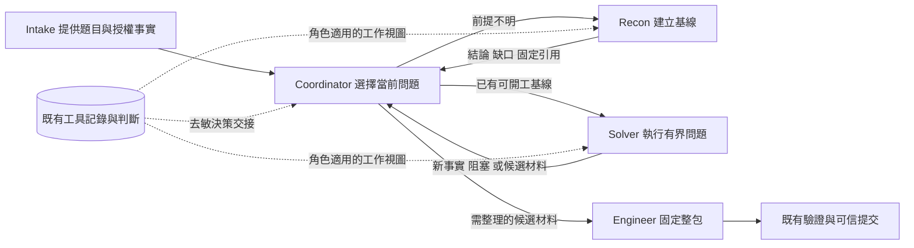

# Coordinator／Recon／Solver：決策上下文與責任調整

**狀態（2026-11-10）：** 候選設計，未實作。§4 問題 1、2 已回答（續派大致合理；Recon 時長大致合理，每題仍需派 Recon），§6 各片維持暫緩；剩 §4 問題 3，未有重新評估的證據。

本文是[核心 design v1](2026-10-22-ctf-agent-design-v1.md) C 的子設計，負責三角色之間的問題歸屬、決策交接與驗證方法，此範圍的細節以本文為準。既有產品行為仍以實作及原子設計為準，本文的候選不是已生效契約。

## 1. 結論

**目前已知：**
- **候選出現後的承接沒有缺口。** a3–a6 共 4 次交回提出候選材料，4 次的下一派單都是 Engineer（§3.2）。
- **沒有候選時的續派大致合理。** 19 個決策點中 16 個續派了新的、能區分假設的問題，沒有一次忽略換路訊號（§4 問題 1）。
- **主瓶頸是 Solver 沒產出候選。** 6 個未解 run 從未提出候選；[P2 復盤](../analysis/2026-11-06-alibaba-a1-a4-harness-findings.md)把它們歸為方法缺口（Java gadget 施工、特權 helper 列舉、native RASP）。這不屬本文。
- **Recon 不是 Solver 時間被壓縮的主因。** 16 個 Recon 階段中，建好基線後還繼續求解或列舉的只有 2 個（a3 C3、a7 F1），Intake 材料從來不足以直接派 Solver（§4 問題 2）。
- **相鄰的兩個執行問題已另行處理。** child `finish=length` 截斷已由輸出上限 32000 消除（a7，[結果完整性 §5.2](2026-10-25-design-v1-run-readiness-and-result-completeness.md)）；child 拖到 deadline 不交回已由執行中時間事實改善（a8，[Recon 重設計 §5](2026-10-29-design-v1-recon-redesign.md)）。兩者都不改變三角色的分工與決策。

**目前未知（本文要回答的）：**
1. Solver 的判斷是否需要持久化給下一角色（§4 問題 3）。原核心假設，目前未獲支持。

**不做：** 不重寫多 Agent 架構，不新增 Agent、知識服務、通用規劃器、監控調度器或摘要模型，不加專屬題解或新的 solved 判據。保留 OpenCode 原生模型／task 循環、薄 host、既有工具與獨立驗證／可信提交。不據現有證據判定模型能力不足。

## 2. 範圍與角色責任

### 2.1 目標

讓同一道題的證據和未決問題連續推進：Recon 給出可用基線，Solver 承接並完成一個具體問題，Coordinator 根據交回的新事實決定續接、補調查、換路、整理候選或停止。

即使整題未解，也要能分辨失敗發生在哪一層：資料交付、事實理解、實驗選擇、執行能力或收尾。只得到「一直跑到 deadline」不算可診斷。

### 2.2 責任分工（目標狀態）

| 角色 | 負責 | 不負責 |
| --- | --- | --- |
| Coordinator | 全題問題順序與資源取捨；決定續派、換路、請 Critic、進 Engineer 或停止 | 不寫逐條實驗腳本，不直接讀普通原始工具正文 |
| Recon | 讓求解具備可用前提：支持範圍內的基線、關鍵未知、可用材料 | 不為「調查完整」一直深解；不把未證實的猜測包裝成 Solver 必須遵守的結論 |
| Solver | 局部的推理—實驗—解釋閉環，包括與當前問題直接相關的補充觀察與修錯 | 不重做整套 Recon；只有需要獨立調查、跨範圍、缺上游材料或必須改全局方向時才請補調查 |
| host | 來源、綁定、完整性、時間、預算與機械投影 | 不以內容 hash、產物數或工具成功推斷語義進展，不代替模型選路 |

Engineer、Verifier 與裁判的權限不合併，「Solver 宣稱候選」不觸發 solved。

**與現行角色規則的差異（未審閱，不改 prompt）：**
- Recon 不是每題必跑的深度前置：簡單材料已有可開工基線時，Coordinator 可直接派 Solver。現行所有 run 都固定 intake→recon。
- Solver 可自行處理本輪所需的局部補充觀察。

## 3. 證據

### 3.1 已核對的實作事實

靜態核對，基線 `main / 9e874d44`（2026-11-07）。沒有量測「索引使模型分心」的因果效應，也沒有證明每次失敗都是遺失交接。

| 位置 | 當前事實 | 含義與限制 |
| --- | --- | --- |
| `apps/launcher/src/control-service.ts`：`prepareContext` | 調查投影只給 recon／domain-solver／engineer，Coordinator 不在其內 | 角色之間沒有共享決策視圖；Coordinator 仍有 task 交回和 progress |
| 同檔：`checkExperience` | Solver 可 `recon.read`，不可 `recon.note`；decision／handoff 只有 Recon 能寫 | Solver 的工具軌跡自動保留，但解釋、否定範圍和下一步理由只留在會話交回 |
| `apps/launcher/src/investigation-context.ts`：`investigationView` | full 投影是最近 200 條導航索引，加本 session 最後 6 個終態步驟；完整歷史可展開 | 新 Solver 看不到自己的最近步驟；索引不是可開工摘要 |
| `control-service.ts`：`prepareContext` | full 的 current_question 指回原生派單文字，delta 傳變更索引／狀態；已有 append-only、版本、失敗拒絕與審計 | 注入已接通，不需要新傳輸；縮小輸出 bytes 不等於決策品質改善 |
| `product/opencode/agents/coordinator.md` | Coordinator 從交回手工維護未測線索、轉交 refs、設定有界問題；背景 child 執行中不自動喚醒父會話 | 它同時做派單、語義整理與引用搬運；長 child 期間父端沒有決策機會 |
| `product/opencode/agents/domain-solver.md` | 已要求問題與停止條件、消費上游 ref、遇新前提缺口經 Coordinator 補調查 | 「再加一句提示」不算新方案；要改的是資料承載和責任邊界 |

### 3.2 已完成的核對

**交回時的四項決策事實（a6，2026-11-08）。** `remainingMs`、`turnMs`、`dispatches`、`packaged` 已於 `2ed7054c` 實作，權威 design 是[結果完整性 §5.2](2026-10-25-design-v1-run-readiness-and-result-completeness.md)。a6 沒有觀察到派單改變：ezoj 兩次都沒進 Engineer，F2 有 5 次 Solver→Solver 續派；對照題 K2 正常解出。單次、非配對，不判定無效，保留為所有對照的固定基線。

**交回內容核對（2026-11-08，[記錄](../analysis/2026-11-08-handoff-content-check.md)，a3–a6 共 10 個 run、43 次交回）。** 當時在實驗 session 中逐次分類並只交回分類結果；按現行 [AGENTS.md](../../../AGENTS.md) 工作模式，這類有界讀取既有 run 的分類屬於工程 session 的離線分析。
- 提出候選材料的 4 次交回，下一派單都是 Engineer，候選被忽略 0 次。
- 6 個 run（a3 C1、C2，a4 D1，a5 E2，a6 F1、F2）從未提出候選。
- 8 次交回因 `finish=length` 截斷，既沒回答問題也沒留線索，全部落在這 6 個 run。
- 未截斷的 Solver 交回大多含「回答／原因」與「下一問題／線索」，下一派單大多仍是 Solver。

**結論與適用範圍。** 原核心假設「判斷在交接中遺失或未被承接」沒有得到支持，所以第一片暫緩。但這次核對只回答了「交回有沒有內容」和「候選有沒有被接」，沒有判斷無候選時的續派是否合理，見 §4 問題 1。

### 3.3 反例與限制

- **只縮短 child 不夠。** a4 的 6 次交回各為 0.2–2.9 分鐘，Coordinator 仍每次再派 Solver（[結果完整性 §5.2](2026-10-25-design-v1-run-readiness-and-result-completeness.md)）。a8 時間事實生效後，F2 在 Critic 交回後又派 2 次 Solver，剩約 4.2 分鐘以 0 提交結束。
- **收尾延誤。** [Recon 重設計 §5](2026-10-29-design-v1-recon-redesign.md)離線重算：a3 C3 在 13.6 分鐘發布了後來被 Engineer 使用的材料，到 25.8 分鐘才派 Engineer。不能把「後來可用」倒推成 Coordinator 當時已知完整候選。
- **機械停滯指標不成立。** 換參數／不同結果 hash 很常見；「無新 artifact」門檻會截斷成功 run。本文不重新引入固定次數或剩餘分鐘的強制 gate。
- **已注入不等於已使用。** r18／r19 投影正常，但沒有角色用 `recon.read` 展開歷史（[Recon 重設計 §4](2026-10-29-design-v1-recon-redesign.md)）。有些內容可能已在原交回可見，須逐個決策點查必要資訊。
- **上下文大小不是已證實的耗時主因。** r18／r19 更支持生成量與延遲相關（[延遲設計 §2–3](2026-11-04-design-v1-run-latency-and-context-cost.md)）。本文研究資訊適配與判斷連續性，不宣稱縮短 context 能提速。
- **派單前提無法追溯。** 問題 2 的核對中，a3 C1、a5 E2、a8 F1 三次首個 Solver 派單寫入了 Recon 記錄找不到出處的前提（工具鏈可用性、位置相關觀察、精確環境數值）。這是 Coordinator 派單的寫法問題，不是 Recon 時長問題；目前 3 例，只記錄，不改派單規則。
- **a5 E2 的限制。** 只核對了終態與角色欄位（deadline、11 completed／1 cancelled、無 Engineer execution），約 13 分鐘的 Solver 回合引用[生命週期分析](../analysis/2026-11-07-a5-e2-lifecycle.md)。這支持「未進入整理鏈」，不能證明當時已有可打包的候選。

## 4. 未決問題

### 問題 1：沒有候選時，Coordinator 續派 Solver 是否合理

- **為什麼要問。** 在無候選的 run 中，Solver→Solver 續派是最常見的模式：a6 F2 續派 5 次後提前結束；a5 E2 的 Critic 給出 `redirect` 後仍續派同一個 Solver；a8 F2 在 Critic 交回後又派 2 次。§3.2 的核對確認交回含「下一問題」，但沒有判斷那個問題是否新、是否能區分假設。
- **方法。** 不跑模型、不訪問目標，在工程 session 中按摘要優先、只取必要字段或行的方式讀 a3–a8 已有 run，對每個「無候選交回 → 下一派單」決策點分類，記錄計數：
  - (a) 續派的問題與上輪不同，且能區分剩餘假設；
  - (b) 重複上輪問題，或沒有新前提；
  - (c) 有 Critic 建議或交回明示要換路，仍續派原路線；
  - (d) 無法判斷。
- **結果去向。**
  - 大多為 (a)：Coordinator 選擇合理，瓶頸在 Solver 方法（P2），本文維持暫緩。
  - (b)＋(c) 佔多數：缺口在 Coordinator 決策。第一片改為 §6.2 的派單／交回契約與 Coordinator 的交回呈現，不先做 Solver note。
  - (d) 佔多數：記錄缺口，先改善交回可判讀性，不推測。
- **判讀約定。** 只計下一派單為 Solver／Reference 的決策點，前一次交回被截斷的不計。a ≥ 2/3 判「大致合理」；b＋c ≥ 1/3 且出現在至少 3 個 run 判「Coordinator 決策缺口」。這是本次判讀約定，不是產品門檻。
- **結果（2026-11-10，[核對記錄](../analysis/2026-11-09-q1-redispatch-check.md)）：** 大致合理，本文第一片維持暫緩，轉 Solver 方法缺口（P2）。
  - **計數。** a3–a8 共 42 個 Solver execution，計入 N = 19（8 個 run，bypassit2、ezbean、ezoj 三題）：a 16、b 3、c 0、d 0。另有前序截斷 5 個；下一派單為 Critic 4 個、Engineer 5 個，只記錄。
  - **沒有忽略換路訊號。** 交回自稱路線窮盡或已有 Critic 交回的 4 個決策點，下一派單都換了路線或收斂到新線索。
  - **b 集中在收尾。** 3 個 b 只落在 a4 D1（2 個）與 a6 F2（1 個），都在 deadline 前最後幾分鐘：2 個是 Coordinator 自擬的同一阻塞再試，1 個是照搬 Solver 建議的「只執行」重述。不到 3 個 run，不算系統性缺口。
  - **無候選得到確認。** 19 個決策點對應的交回都沒提出候選材料，與 §3.2 一致。
  - **反例的覆蓋。** a6 F2 的 5 次續派中，計入的 4 次是 3 a、1 b；a8 F2 Critic 交回後的 2 次都是 a，其中 1 次是 Critic 執行期間並行派出。a5 E2 在 Critic `redirect` 後的那次續派，前一個交回是 Critic 而非 Solver，不在本次口徑內，未判斷。
  - **限制。** 單人分類，無第二評審；3 個邊界列全部改判時 a 為 13/19，結論不變。ezoj 佔多數，不代表題目分佈。

### 問題 2：Recon 何時算完成、是否每題都要派

- **為什麼要問。** 所有 run 都是 intake→recon 開場。Recon 總時長：ezoj 為 136–1170 秒，a7 F1 的 Recon 跑滿 30 分鐘未交回；8a6ac7ff 為 133–224 秒。按題 Recon cap 設 1000，等於關閉。Recon 佔掉的時間直接壓縮 Solver 的探索時間。
- **方法。** 同樣在工程 session 中有界讀取每次 Recon 的軌跡與交回，判斷「可開工基線」（入口、材料、環境前提）最早在何時已經具備，與實際交回時間比較，記錄時間差與分類。
- **結果去向。**
  - 基線早已具備、Recon 仍繼續深入：屬職責邊界問題，在本文定 Recon 的完成條件，並評估讓 Coordinator 在 Intake 材料足夠時跳過 Recon。改角色規則前先審閱。
  - 基線本身就需要長時間：不屬協作問題，回 [Recon 重設計 §5](2026-10-29-design-v1-recon-redesign.md)看預算分層。
- **邊界。** Recon 的時間上限、cap 與 closure 歸 Recon 重設計 §5，本文只定完成條件與是否派。
- **判讀約定。** T_base = 首個 Solver／Engineer 派單 S 所依賴的前提中，最晚建立的那次 Recon 工具呼叫時間；gap = 交回 − T_base。上限 max(60 秒, 階段時長 20%)：A 及時交回；B 超限且基線後主要是求解嘗試；C 超限且主要是擴大列舉或空轉；D 未超限但 T_base > 300 秒；E 無法判斷。續接 execution 合併，19 個 execution 成 16 個階段。比例是本次判讀約定，不是產品門檻。
- **結果（2026-11-10，[核對記錄](../analysis/2026-11-10-q2-recon-baseline-check.md)）：** Recon 時長大致合理，每題仍需派 Recon；不在本文定 Recon 完成條件。
  - **計數。** A 3、B 1、C 1、D 2、E 3，另 6 個階段（a3 C2、a4 D1、a6 F1、a7 K2、a8 F2、a8 K2）基線後主要是整理證據與寫交回，gap 60–139 秒，超過上限但不屬 B／C，原口徑未覆蓋。照字面套規則只能得出「混合」。
  - **事後補的口徑。** 交回準備屬於完成的一部分，這 6 個歸入 A：A 為 9/16，排除 E 後 9/13 ≈ 69%，達到「Recon 時長合理」的 2/3。這是看到結果後補的口徑，照實記錄。
  - **越界深入很少。** B＋C 為 2/16、只涉及 ezoj。a7 F1 是 Recon 跑滿 30 分鐘未交回，a8 加入執行中時間事實後未再出現；a3 C3 是基線後繼續查其他面約 2 分鐘。
  - **基線本身慢（D）。** a5 E1、a6 F2 都是 ezoj，派單依賴的較深入實測約 600 秒才建立。轉 [Recon 重設計 §5](2026-10-29-design-v1-recon-redesign.md) 的預算分層，不屬協作問題。
  - **Intake 不足以跳過 Recon。** 16/16 都是「部分」：有題面與入口，但沒有派單所用的實測、服務行為或環境前提。不評估「Intake 足夠時直接派 Solver」。
  - **無法判斷（E）。** a3 C1、a5 E2、a8 F1 的派單含 Recon 記錄找不到出處的前提，見 §3.3。a8 F1 的 Recon 用了 1202 秒，是 a8 最長的一次，因此其時長是否合理未判定。
  - **旁證。** 有確認解出的 5 個階段 gap 為 46–67 秒，未解的 a3 C3、a6 F2、a7 F1 為 116–1755 秒；樣本小、題目不同，不作因果結論。
  - **限制。** 判讀在 codex 手動 session 中完成，單人、無第二評審；a6 K2 的 Recon 在基線呼叫時已取得候選來源，分類為 A 不代表 Recon 沒有深入。ezoj 佔 10 個階段。

### 問題 3：Solver 判斷是否需要持久化給下一角色

- **現狀。** 原核心假設，§3.2 未獲支持，所以 §6.1 暫緩、不寫 plan。
- **重新評估的條件。** 出現「候選已提出但未被承接」，或「跨角色大量重做已確認的事實」的證據。問題 1 已排除 Coordinator 續派缺口，不因此提高本項優先級。

## 5. 方案比較

| 方案 | 作用點與代價 | 決定 |
| --- | --- | --- |
| 只補交回時 host 數字 | 提醒剩餘時間、派單統計、是否已打包；變更小，但說明不了「本輪解決了什麼、為何值得續派」 | 已實作（`2ed7054c`），作所有對照的基線，不稱完整修復 |
| **保留角色，形成可追溯的決策交接** | 沿既有主本保存 Recon／Solver 的簡短判斷；按角色呈現所需結果；Coordinator 不再重抄全部 refs | 推薦的候選方向（§6）；先由 §4 決定從哪一片開始 |
| 合併 Recon／Solver，同一會話持續探索 | 少一次上下文重建，但長會話仍會偏航，且改變現有分工和權限 | 後備對照；只有決策交接完整後仍有明顯跨角色重做才考慮 |
| 新增 Planner／Summarizer／監控角色 | 增加推理與交接成本，也可能增加摘要失真 | 不採用；Coordinator 已承擔全局選擇 |

## 6. 候選設計（未定）

以下全部為候選，§4 的結果決定先做哪一片。共同原則：一份事實主本（既有工具記錄與判斷），按角色提供工作視圖，工作視圖不是另一份可編輯事實庫。

### 6.1 Solver 交接 note 與接手方可見（原第一片，暫緩）

**做法。** 復用 `ExperienceStore.note` 現有的 observation／assessment／next_action／next_reason、related_ids、evidence_refs 與自動 scope 綁定，讓同題 Solver 也能追加自己的 decision／handoff。下一次派單時，接手角色（Recon、Solver、Engineer）的實際出站請求帶有被引用 note 的正文。Coordinator 視圖不在本片。

**規則。**
- 這改變了「只有 Recon 可寫」的准入。記錄是作者判斷，不是工具事實；Solver 不能覆寫 Recon 判斷，發現衝突時追加反證和相關 id。
- 不強制每步寫 decision。寫入時點：已回答問題、推翻重要前提、換路線或交回。無筆記不抹去自動工具記錄；note 缺失時不反覆要求模型重寫。
- Coordinator 的全局取捨仍放既有 progress.note，不另建詳細線索帳本。
- 歷史經驗檢索與題後 episode 會受新增作者記錄影響，必須核對來源角色，不把新 note 當已驗證 lesson。

**無模型接口驗證**（沿實際 launcher／plugin／固定 OpenCode 公開接口，用合成事件和固定回應）：
1. 上游判斷不在最後 6 條、歷史超過 200 條、新 Solver 沒有本 session 歷史時，仍能由指定 handoff ref 在實際出站請求得到必要正文與材料入口。
2. Solver 只能在 host 綁定的同題、當前 execution 下追加自己的判斷，不能改寫他人或異題記錄；Verifier 不獲得求解私有上下文。
3. 同 child 多次續接、同步／背景交回都對應本次 execution；舊 handoff 不冒充新結果，partial／empty／unknown 保留原語義。

只有 schema 通過、hook 有輸出而實際請求沒有正文，判失敗。若公開接口無法可靠綁定交回與 note，保留原生交回文字並報告缺口，不另造 provider 循環。

### 6.2 派單與交回的內容契約

內容契約，不建 JSON 動作協議，不要求每次工具呼叫填表。run／challenge／execution／refs／時間由 host 綁定，不讓模型重填可信身份。

- **每次派單：** 要回答的問題；相關結論及來源；仍未測的線索及前提；什麼結果足以交回；允許的操作與剩餘資源。
- **每次交回：** 本輪回答了什麼或仍未知；支持與反證及適用範圍；下一個有價值的問題；必要材料 refs 與未讀／不完整範圍；交回理由。候選材料單列，只是「可交 Engineer 檢查」的訊號，不是已登記候選。
- **交回語義：** 用短句區分「問題已回答」「需要具體前提」「提出候選材料」「當前探索無進展」「資源／執行中斷」。這是交回約定，不因缺標籤阻塞 task 結束，host 也不從自然語言解析成可信狀態。無交回或 length 時保存實際完整性與 unknown，不從舊摘要補造本輪結果。
- **續接：** 同問題續接保留同 session，新問題才考慮新 session。Coordinator 續派須指出還剩哪個不確定性、何種新前提或未完成步驟使繼續有價值；不用「繼續嘗試」掩蓋沒有下一問題。新 session 不重置預算，也不以舊題答案或人工解法初始化。

### 6.3 角色工作視圖

| 接收者 | 直接呈現 | 按需展開／禁止自動帶入 |
| --- | --- | --- |
| Coordinator | 本 execution 的交回判斷、去敏的支持／反證小摘錄與 refs、未決問題、完整性；host 的剩餘時間、回合時長、派單統計、已打包事實 | 不給全題工具索引和原始 body，不讀 sibling work，候選 bytes／憑據不進決策文字 |
| Recon／Solver | 本次問題、上游交回 note 的相關正文、必要材料 refs 與覆蓋缺口；本 session 局部歷史和當前 host 狀態 | 全題步驟索引和完整輸出仍可用既有 read 展開；歷史 lesson 作次要參考 |
| Engineer | Solver 提出的候選材料引用、提取說明、依賴、未知與必要觀察 | 仍自己讀固定 bytes 和整理整包；不把父端摘要當候選來源 |

- 使用既有追加式 hook，不改寫已完成消息，不破壞 tool-call/result 配對。
- 以明確的 execution／note 引用選正文，不由 host 猜「哪條最重要」。正常新派單優先呈現本次上游交回；同問題續接按引用補新增判斷。
- 正文超界須明示 coverage／omitted refs 並保留分頁入口，不能截斷後聲稱完整。索引超過 200、交回超過一頁、compaction／重啟失去基線都須可恢復。
- 初次驗證保留既有全索引投影，只隔離「有無直接決策正文」這一變量；索引是否改按需，留待讀取成本和行為證據支持。
- Coordinator 視圖必須經受限去敏呈現，不直接開放 `recon.read`，也不無條件注入 note 原文。欄位叫 observation 也不可信；無法安全呈現時報缺口，不用整段工具輸出補齊。可行性先以合成資料驗證。

### 6.4 候選與收尾

- `packaged=false` 只表示未打包，不表示沒有候選。Solver 提出候選材料時，Coordinator 應評估派 Engineer，而不是默認再次深挖。
- Engineer 無法整理就交回具體缺口；不能因時間緊要求它編造 bytes、補解或略過原出處契約。
- 不新增 host 的 candidate_available 真值欄位。若確需結構化訊號，必須用「角色聲稱＋綁定 refs＋unknown」語義另行定案；hash 只證明材料身份，不證明內容正確。
- 固定 deadline 或單回合上限不在本文。

### 6.5 後續片（前一片成立且有行為證據後才拆）

每片各自一份 plan，不合併成一次大改。
- **Coordinator 受限去敏視圖：** 碰到「控制憑據與私有資料不進模型上下文」的底線，單獨成片。驗證點：含合成敏感欄位的 note 不進 Coordinator 正文，不因新增視圖擴大原始資料權限。
- **衝突呈現：** 同一條合成觀察被 Recon 和 Solver 不同解釋時，父端能看到衝突與支持範圍；沒有額外證據時 host 不自動裁定。
- **恢復與經驗庫：** compaction、重啟、長交回及缺分頁時保留來源和缺口；經驗檢索／episode 保留作者與來源，不把 Solver 自述當成功。

## 7. 驗證方法

### 7.1 行為歸因：分清沒看到、沒理解與做不到

| 檢查結果 | 合理判斷 | 下一步 |
| --- | --- | --- |
| 必要 ref／正文未抵達，或錯題／錯輪 | 交接工程缺陷 | 修綁定／呈現；不歸因模型弱 |
| 已抵達，但事實被誤讀、反證範圍被擴大 | 理解或表示問題 | 固定相同合成事實，只對照工作視圖，不改題解提示 |
| 正確理解且有合理實驗，但工具不支持／結果不可讀 | 執行接口或環境缺口 | 從失敗接口定向處理，不增加泛化 Agent |
| 資訊與工具可用，仍反覆選無法區分假設的動作 | 任務分解或模型推理限制的證據增強 | 固定架構再做模型／thinking 單變量對照，不直接斷言能力上限 |
| Solver 有具體交回，Coordinator 不承接或不合理續派 | 全局決策／交回語義問題 | 檢查它當時收到的判斷與狀態，不延長 Solver |
| 交接完整但跨角色仍大量重做 | 分工成本假設獲支持 | 評估合併 Recon／Solver 的受控對照 |

使用既有安全合成案例評估「事實理解與下一步選擇」，不往自主題目上下文注入研究者知道的中間答案。讀取 API 被呼叫只證明訪問；實際行動引用並正確使用證據才支持承接。solved 仍只看原可信完成鏈。

### 7.2 真實能力驗收

需另行明確目標、環境、模型／provider、批次、token 上限及重試邊界，本文不授權運行。

- **題目選擇：** 先完成接口驗證，再從已授權題目中選「未產生候選」和「材料已出但收尾延遲」兩類，保留至少一個原成功對照，避免止損截斷成功探索。只用「被方法缺口卡住」與「每次都能解出」的題組，分辨不出協作改善。
- **對照：** 題目初態、材料、工具、版本、模型設定、時間和 token 邊界一致；兩臂都含四項 decisionFacts，只比較有無本片改動。每臂至少兩次只是初步方向；順序交錯，兩臂間不共享新 lesson。模型對照、角色合併各自另做。
- **記錄：** 首次可開工交接、實際承接的來源、錯輪／缺資料次數、無新前提的重做、首次候選聲稱／固定 package／提交時點、accepted／solved、用量和停止原因。人工復核保留判斷依據與不確定性，不以 hash 當「新資訊」。所有失敗計入，usage 缺失記 unavailable。

驗收分兩層：
- **接口成立：** 合成鏈路的必要判斷與引用可核對地抵達，沒有越權、錯輪或未知丟失。這不證明模型會用。
- **收益成立：** 配對軌跡支持必要事實被正確承接、相關重做或收尾延誤減少，且不是靠放寬判定、加預算或損失原成功樣本換來。整題不成功不能把接口結果改寫成產品成功。

正文已抵達但決策與結果沒有改善時，停止堆字段和提示，回到 §7.1 歸因。壓縮丟失關鍵前提時，保留原詳細讀取面並撤回該壓縮方式。

## 8. 與其他 design 的關係

- **四項決策事實：** 權威在[結果完整性 §5.2](2026-10-25-design-v1-run-readiness-and-result-completeness.md)，本文只引用。
- **child 輸出上限、執行中時間事實、Recon cap 與 closure：** 歸[結果完整性 §5.2](2026-10-25-design-v1-run-readiness-and-result-completeness.md)與 [Recon 重設計 §5](2026-10-29-design-v1-recon-redesign.md)。本文不調這些數值，只在分工與決策受其影響時引用。
- **Solver 方法缺口：** 歸 [P2 復盤](../analysis/2026-11-06-alibaba-a1-a4-harness-findings.md)及其後續，不在本文。
- **保留的底線：** Recon 記錄、追加式穩定歷史、完整 artifact 消費、失敗與 unknown、Critic 只建議、Engineer 整理、Verifier 獨立、oracle 規則與總預算。
- **延後：** 全索引按需化、強制 Solver closure、角色合併、模型更換、額外工具和摘要服務。沒有證據不預排下一里程碑。

## 附錄：參考系統

核對日期 2026-11-07。此前[單 Agent 能力分析 §3](../analysis/2026-10-29-single-agent-capability-analysis.md)的外部方法只是訓練知識，下表補核原論文，限定所引版本，不把舊模型成績外推到本項目。

| 系統與來源 | 相關做法 | 借鑑／不照搬 |
| --- | --- | --- |
| [PentestGPT §5](https://pinzger.github.io/papers/Deng2023-pentestgpt.pdf)、[USENIX 頁](https://www.usenix.org/conference/usenixsecurity24/presentation/deng) | Reasoning 以 PTT 保存任務狀態，Generation 展開局部操作，Parsing 處理輸出；三者各有上下文，有人參與 | 借鑑持續的任務判斷與原始輸出分開；不建第二棵任務樹或額外 Parser Agent |
| [D-CIPHER v1 §4.1–4.5](https://arxiv.org/html/2502.10931v1#S4) | Planner 委派具體任務，Executor 返回摘要；每次委派新建 Executor 歷史；Executor 有回合上限及最後交回機會 | 借鑑以具體問題為派單單位、父端只保留決策相關結果；不照搬每次清空會話或其輪次常數 |
| [EnIGMA v1 §3.1–3.2](https://arxiv.org/html/2409.16165v1#S3) | 單一主要 Agent，長輸出採可導航視窗或模型摘要，原輸出可查 | 借鑑先給可用觀察、原文可追溯；不據此推論單 Agent 必勝，不在無工具故障證據時擴充工具 |
| [Cybench v1 §2.3–2.4、§5](https://arxiv.org/html/2408.08926v1) | 分別評估無提示整題、帶子任務引導和子任務成功 | 借鑑區分定位與最終驗收；帶人工中間答案的成功不能當自主解題驗收 |

共同啟發是讓規劃記憶、局部工作上下文與詳細工具輸出各有用途，不是角色越多越好。這是本項目的綜合判斷，不是論文對本項目的結論。
