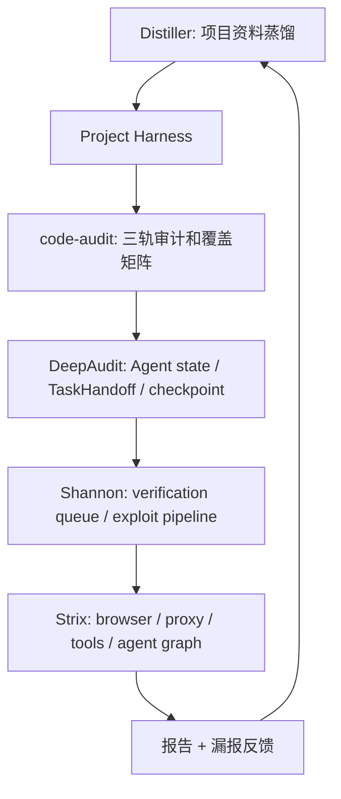

# 参考项目横向对比与迁移决策

## 总体结论

这些参考项目不是同一种东西，不能简单评判谁更好。它们分别解决灰白盒渗透测试 Agent 的不同层面：

| 项目 | 主要类型 | 解决的问题 |
|---|---|---|
| `code-audit-main` | Skill/方法论框架 | 如何让代码审计有状态机、覆盖率和多轮补漏 |
| `DeepAudit-3.0.0` | 产品化 Agent 平台 | 如何把 Agent 运行、状态、数据库、前端、沙箱连成系统 |
| `security-skill-distiller-master` | Harness 生成器 | 如何从历史资料和文档生成项目专属 Agent/Skill |
| `shannon-main` | 动态证明流水线 | 如何从白盒候选走到浏览器/API exploit 证据 |
| `strix-main` | CLI Agent runtime | 如何组织工具、skills、agent graph、沙箱和 CI/CD |

## 能力矩阵

| 能力 | code-audit | DeepAudit | Distiller | Shannon | Strix | 本项目建议 |
|---|---:|---:|---:|---:|---:|---|
| 白盒代码审计 | 强 | 中-强 | 模板化 | 中 | 中 | 用 code-audit 三轨模型做核心 |
| 多 Agent 编排 | 强约束文档 | 运行时对象 | 生成多个 Agent | Temporal 管线 | Agent graph | 组合状态机 + agent graph |
| 浏览器动态测试 | 弱 | 弱-中 | 弱 | 强 | 强 | 参考 Shannon/Strix |
| API 扫描/验证 | 中 | 中 | 模板化 | 强 | 强 | 生成 API inventory + verification queue |
| 断点续跑 | 文档级 | checkpoint | 生成后可跑 | workspace resume | agents.json + agents.db | 先文件化，后 DB |
| Skill 体系 | 强 | 知识模块 | 强生成 | prompt 分层 | 强分类 | 用 Strix 分类 + Distiller 生成 |
| 覆盖率门控 | 强 | 弱 | 中 | 按 agent 完成 | 弱-中 | 必须迁移 code-audit |
| PoC/证据 | 模板 | 沙箱验证 | 模板 | 强 | 强 | 动态证据 schema |
| 漏报反馈进化 | 弱 | 弱 | 强潜力 | 弱 | 平台化潜力 | 用 Distiller 模式补齐 |
| 产品 UI | 无 | 强 | 无 | CLI | CLI/TUI | 后置，先运行时 |

## 架构组合建议



## 不建议照搬的点

| 项目 | 不建议照搬 | 原因 |
|---|---|---|
| code-audit-main | 全量复制超长 reference | 容易上下文膨胀，应该拆 registry/playbook |
| DeepAudit | 完整前后端产品结构 | 当前阶段会过重，先做 harness/runtime |
| Distiller | 直接生成 D1-D15 但缺少动态工具 | 需要补浏览器/API/证据链 |
| Shannon | 直接引入 Temporal | 工程成本高，先用轻量任务状态 |
| Strix | 直接复制复杂 tool runtime | 先抽 browser/proxy/report/agent graph 的最小能力 |

## 本项目下一步优先级

### P0: 让现有 Agent/Skill 不空洞

参考：`code-audit-main` + `Distiller`

必须做到：

- 每个 Agent 有 contract。
- 每个 Skill 有输入、执行步骤、检测模式、覆盖指标、输出 schema。
- 质量门禁拒绝空泛文档。

### P1: 侦察、边界和威胁建模

参考：`code-audit-main` + `DeepAudit`

必须输出：

- 攻击面边界。
- 信任边界。
- 威胁分析。
- API/页面/端点-权限矩阵。

### P2: 动态验证

参考：`Shannon` + `Strix`

必须输出：

- verification queue。
- 浏览器证据。
- API 请求响应证据。
- 多角色认证验证。
- PoC 安全等级。

### P3: 断点续跑和并发协调

参考：`Shannon` + `Strix` + `DeepAudit`

必须输出：

- run_state。
- agent graph。
- completed_agents。
- checkpoints。
- R2/R3 增量任务。

### P4: 反馈进化

参考：`Distiller`

必须输出：

- 漏报反馈报告。
- feedback_catalog。
- skill/config 补丁建议。
- 回归用例。

## 最终模板形态

```text
pentest-agent/
  AGENT.md
  agents/
  skills/
  references/
  adapters/
  schemas/
  tools/
  templates/
  runs/
  reports/
  refer_project/
```

其中：

- `agents/` 参考 DeepAudit/Strix 的运行时状态和 graph。
- `skills/` 参考 code-audit/Strix 的分类和执行约束。
- `tools/` 参考 Shannon/Strix 的 browser、proxy、report、finish。
- `templates/` 参考 Distiller，用来生成项目专属 harness。
- `runs/` 参考 Shannon/Strix/DeepAudit，用来断点续跑。
