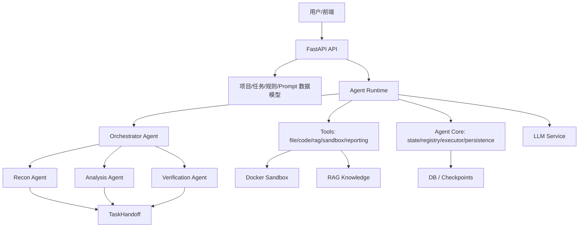

# DeepAudit 架构与编排分析

## 核心架构

## Orchestrator 机制

`backend/app/services/agent/agents/orchestrator.py` 采用 ReAct 风格：

- LLM 先输出 `Thought`。
- 再选择 `Action`。
- `Action` 可以是调度子 Agent、汇总发现、完成审计。
- 子 Agent 返回 Observation。
- Orchestrator 根据 Observation 决定下一步。

它不是固定状态机，而是“LLM 自主编排”。优点是灵活，缺点是难以保证覆盖率和稳定收敛。

对本项目建议：

- 可以采用 DeepAudit 的 ReAct 调度作为“智能决策层”。
- 但底层必须叠加 `code-audit-main` 式硬状态机，避免模型跳过 recon、跳过验证、提前写报告。

## Agent 基类

`backend/app/services/agent/agents/base.py` 定义了：

| 对象 | 作用 |
|---|---|
| `AgentType` | ORCHESTRATOR / RECON / ANALYSIS / VERIFICATION |
| `AgentPattern` | REACT / PLAN_AND_EXECUTE |
| `AgentConfig` | 模型、温度、max tokens、max iterations、timeout、tools、system prompt |
| `AgentResult` | success、data、error、iterations、tool_calls、tokens、duration、handoff |
| `TaskHandoff` | Agent 间结构化交接协议 |

这比单纯 Markdown Agent 更工程化。尤其是 `TaskHandoff` 值得迁移。

## TaskHandoff

TaskHandoff 字段包括：

- from_agent / to_agent
- summary
- work_completed
- key_findings
- insights
- suggested_actions
- attention_points
- priority_areas
- context_data
- confidence
- timestamp

它还能转成 prompt context，让下一个 Agent 理解前序工作。

对本项目可扩展为：

- `covered_assets`
- `uncovered_assets`
- `verified_findings`
- `unverified_candidates`
- `dynamic_evidence`
- `browser_state`
- `api_calls`
- `role_matrix`
- `safety_constraints`

## 状态与断点

DeepAudit 有两层状态：

1. 运行内存状态：`AgentState`、registry、message bus。
2. 持久化状态：文件 checkpoint 和数据库 `agent_checkpoints` 表。

相关模块：

| 模块 | 作用 |
|---|---|
| `core/state.py` | Agent 状态、等待、恢复、完成、失败 |
| `core/registry.py` | Agent 注册、状态获取、生命周期管理 |
| `core/persistence.py` | 保存/加载 checkpoint，清理旧 checkpoint，DB 持久化 |
| `models/agent_task.py` | AgentTask、AgentCheckpoint 等模型 |
| `alembic/versions/007_add_agent_checkpoint_tables.py` | checkpoint 表迁移 |

对本项目建议：

- `round_state.json` 是轻量版，可以先落地。
- 后续产品化时再引入数据库表：run、agent_task、agent_checkpoint、finding、evidence。
- 断点恢复不只保存文本日志，还要保存 Agent 状态、上下文摘要、已完成任务、证据路径。

## 工具层

DeepAudit 的工具包括：

| 工具 | 用途 |
|---|---|
| file_tool | 文件读取与项目文件操作 |
| code_analysis_tool | 代码分析 |
| pattern_tool | 模式扫描 |
| rag_tool | 知识检索 |
| sandbox_tool/run_code | 沙箱运行和 PoC 验证 |
| reporting_tool | 报告生成 |
| thinking_tool | 显式思考记录 |
| finish_tool | 标记完成 |

对灰白盒渗透测试 Agent，工具层需要再补：

- 浏览器自动化。
- HTTP proxy/HAR。
- API replay。
- 多账号 session 管理。
- 安全 payload registry。
- 请求响应证据存储。

## 事件流与前端展示

DeepAudit 的 README 展示了“审计流日志”和“智能仪表盘”。这说明它把 Agent 思考、工具调用、审计发现转成可见事件。

本项目如果要成为产品，而不是命令行脚本，应该保留类似设计：

- 任务进度。
- 当前 Agent。
- 当前阶段。
- 已发现风险。
- 已覆盖/未覆盖攻击面。
- 动态验证结果。
- 可下载报告。

## 与 code-audit-main 的互补

| 维度 | DeepAudit | code-audit-main |
|---|---|---|
| 形态 | 产品平台 | Skill/文档式执行框架 |
| 编排 | LLM 自主 ReAct | 强状态机 |
| Agent 粒度 | Recon/Analysis/Verification | D1-D10/策略维度 |
| 状态 | 工程化状态和 checkpoint | 文档化跨轮状态 |
| 验证 | 沙箱 PoC | 方法论和 PoC 模板 |
| 报告 | 平台报告 | 攻击者视角模板 |

本项目应合并两者：DeepAudit 的工程运行时 + code-audit-main 的审计质量门槛。
