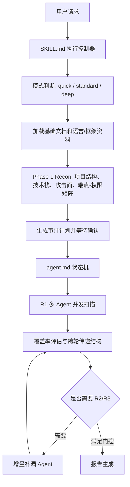

# 架构与多 Agent 编排分析

## 一句话架构

`code-audit-main` 的运行架构可以概括为：

`SKILL.md` 负责启动和外层门控，`agent.md` 负责 Deep 模式状态机，`references/` 负责按需加载审计知识，多个子 Agent 按攻击面并发执行，主线程负责覆盖率评估、跨轮补漏和最终报告。

## SKILL.md 的控制器价值

`SKILL.md` 不是描述性文档，它规定了运行时必须输出的阶段标记：

| 阶段 | 输出标记 | 目的 |
|---|---|---|
| 模式判断 | `[MODE]` | 明确 quick/standard/deep，不让模型自行降级 |
| 文档加载 | `[LOADED]` | 证明已加载对应模式需要的文档 |
| 侦察 | `[RECON]` | 固化项目规模、技术栈、入口点、模块 |
| 计划 | `[PLAN]` | 执行前暂停，等待用户确认 |
| 报告门控 | 覆盖/Agent/评估检查 | 防止未完成就生成最终报告 |

这给本项目一个直接约束：灰白盒渗透测试在正式执行前必须输出并确认：

- 授权范围。
- 目标环境。
- 账号与权限。
- 禁止测试项。
- 速率限制。
- 是否允许破坏性 PoC。
- 是否允许浏览器自动化。
- 是否允许调用本地/外部扫描工具。

## agent.md 的状态机

`agent.md` 把 Deep 模式拆成四个权威状态：

| 状态 | 责任 | 关键产物 |
|---|---|---|
| `PHASE_1_RECON` | 信息收集和任务分解 | 搜索路径、排除目录、攻击面地图、维度权重、Agent 切分、端点-权限矩阵 |
| `ROUND_N_RUNNING` | 并行启动子 Agent | 每个 Agent 的结构化输出 |
| `ROUND_N_EVALUATION` | 汇总、去重、覆盖率评估、下一轮决策 | COVERED、GAPS、CLEAN、HOTSPOTS、FILES_READ、GREP_DONE |
| `REPORT` | 最终报告 | 攻击路径、漏洞详情、覆盖说明、未完成项 |

这个状态机有两个非常值得借鉴的点：

1. `PHASE_1_RECON` 的产物不是自然语言总结，而是后续 Agent 的输入。
2. `ROUND_N_EVALUATION` 的产物不是报告草稿，而是下一轮执行的压缩状态。

## Phase 1 侦察的实现方式

Phase 1 使用“五层攻击面推导”：

| 层级 | 目标 | 对本项目的迁移 |
|---|---|---|
| T1 架构模式 | 单体、微服务、Serverless、桌面等 | 生成攻击面边界和信任边界 |
| T2 业务领域 | 金融、医疗、IoT、SaaS、CMS 等 | 调整 D1-D10 权重和动态测试策略 |
| T3 框架语言 | 根据技术栈推导 Source/Sink/Control 模式 | 路由到语言/框架 adapter |
| T4 部署环境 | Docker、K8s、Terraform、CI/CD | 增加运行时、供应链、暴露面检查 |
| T5 功能发现 | 用 Grep 和结构推理激活 D1-D10 | 建立 API、页面、表单、后台、导出、上传清单 |

Phase 1 的关键产物是“端点-权限矩阵”：

`{端点路径, HTTP方法, 认证要求, 权限注解, 资源归属校验}`

这个矩阵是 D3/D9 Agent 的输入，和 D1 的 Sink 列表同等重要。对本项目来说，它还应该扩展为：

`{端点路径, HTTP方法, 页面入口, API调用来源, 认证态, 角色, 参数Schema, 资源对象, 风险标签, 动态验证状态}`

## Agent 切分原则

项目明确禁止“检查所有问题”的通用型 Agent。它要求每个 Agent 聚焦 1-3 个相关漏洞类型，并按激活维度分组。

典型组合：

| Agent | 维度 | 策略 |
|---|---|---|
| 注入 Agent | D1 | sink-driven |
| 认证授权业务逻辑 Agent | D2 + D3 + D9 | control-driven + config-driven |
| 文件和 SSRF Agent | D5 + D6 | sink-driven |
| 反序列化和 RCE Agent | D4 | sink-driven |
| 配置加密供应链 Agent | D7 + D8 + D10 | config-driven |

迁移到本项目后，建议增加动态侧 Agent：

| Agent | 输入 | 输出 |
|---|---|---|
| 前端路由与页面 Agent | 源码路由、构建产物、浏览器爬取结果 | 页面地图、表单、按钮、API 调用 |
| API 调用 Agent | OpenAPI、前端请求、后端路由、代理流量 | API 清单、参数、认证需求 |
| 浏览器攻击面 Agent | URL、账号、权限、页面地图 | 可交互入口、状态变化、越权候选 |
| 动态验证 Agent | 白盒发现、API 清单、浏览器会话 | PoC 结果、请求响应证据、截图/HAR |
| 漏报复盘 Agent | 测试人员反馈、靶场结果、历史报告 | 漏报原因、规则更新建议、回归用例 |

## Agent Contract

`agent.md` 的 Agent Contract 是整个并发架构的硬约束。它包含：

| 字段 | 作用 |
|---|---|
| 搜索路径 | 限定核心代码目录，避免扫错范围 |
| 排除目录 | 排除 `node_modules`、`.git`、`build`、`dist`、`test` 等 |
| 工具约束 | 搜索、读文件、Bash 使用限制 |
| 调用预算 | 限制工具调用数量和 max_turns |
| Turn 预留 | 防止 Agent 最后才输出导致截断 |
| 审计策略 | sink-driven/control-driven/config-driven |
| 轮次目标 | R1 广度、R2 补漏、R3 攻击链 |
| 前轮输入 | COVERED/GAPS/CLEAN/HOTSPOTS/FILES_READ/GREP_DONE |
| 增量约束 | R2 禁止重复读文件、重复 grep、重复 CLEAN 方向 |
| 输出格式 | 必须结构化，禁止大段原始代码 |
| 截断防御 | HEADER 在最前，END 哨兵在最后 |

本项目已有 agent contract 工具，下一步应把字段补齐到类似粒度，特别是：

- 动态测试的浏览器会话 ID、角色、账号、cookie 存储位置。
- API 扫描的目标 base URL、速率限制、禁止参数。
- PoC 的破坏等级和是否允许执行。
- 证据字段，如请求、响应摘要、截图、HAR、代码位置。

## 跨轮传递结构

项目的 R2 不是“再扫一次”，而是通过结构化状态精确补漏：

| 字段 | 含义 | 本项目扩展 |
|---|---|---|
| `COVERED` | 已覆盖维度和发现数 | 加入静态/动态覆盖来源 |
| `GAPS` | 未覆盖或浅覆盖维度 | 加入未访问页面、未调用 API、未验证角色 |
| `CLEAN` | 已确认不存在的方向 | 加入已验证不可利用的 PoC |
| `HOTSPOTS` | 高风险但未深入点 | 加入待动态验证的代码路径/API/页面 |
| `FILES_READ` | 已读文件和结论 | 防止静态 Agent 重复阅读 |
| `GREP_DONE` | 已执行搜索模式 | 防止重复低价值搜索 |

对灰白盒 Agent，还需要：

- `URLS_VISITED`: 已访问 URL 和角色。
- `FORMS_TESTED`: 已测试表单和参数。
- `APIS_CALLED`: 已调用 API、方法、状态码、认证态。
- `PARAMS_TESTED`: 参数与测试向量。
- `EVIDENCE_COLLECTED`: 截图、响应摘要、日志、代码位置。
- `BLOCKERS`: 需要用户补充账号、验证码、MFA、测试窗口等。

## 覆盖率评估

`code-audit-main` 的覆盖率不是单一百分比，而是按策略分轨：

| 策略 | 覆盖标准 |
|---|---|
| sink-driven | 核心 Sink 类别均搜索，有数据流追踪，Sink 扇出率达到阈值 |
| control-driven | 端点审计率达到阈值，CRUD 权限一致性覆盖足够资源类型 |
| config-driven | 核心配置项检查完成，并与安全基线比对 |

这个设计能避免两个常见问题：

1. 只 grep 到危险函数就误以为完成。
2. 用 grep 检查授权/业务逻辑这类“缺失类漏洞”，天然漏报。

本项目应该把覆盖率拆成：

- 代码覆盖：语言、框架、模块、入口点、Source/Sink。
- API 覆盖：API 清单、认证态、角色、参数。
- 页面覆盖：页面、表单、按钮、工作流。
- 权限覆盖：角色矩阵、资源对象、CRUD 操作。
- 动态验证覆盖：PoC 执行状态、证据、不可利用原因。

## 并发协调经验

这个项目对并发协调的优化体现在：

1. R1 按不重叠维度并发，减少争抢同一上下文。
2. 每个 Agent 有独立搜索路径和策略，避免“大家都扫全部”。
3. R1 输出 `FILES_READ` 和 `GREP_DONE`，R2 依此去重。
4. R2 Agent 数量由缺口数决定，不固定。
5. R3 只在发现跨模块攻击链候选时启动。
6. HEADER 和 TRANSFER BLOCK 放在输出前部，避免长报告截断后丢失决策数据。

对本项目来说，并发协调应由“任务合同 + 共享状态 + 仲裁器”组成：

- 任务合同：每个 Agent 的输入范围、角色、策略、预算、输出 schema。
- 共享状态：覆盖矩阵、证据库、已访问/已搜索清单、缺口列表。
- 仲裁器：合并发现、处理冲突、分配 R2/R3、判断报告门控。

## 缺失与补强

`code-audit-main` 在白盒审计上很成熟，但对我们目标还缺：

- 浏览器自动化爬取与交互。
- API 请求重放、参数变异和响应差异分析。
- 多账号/多角色会话矩阵。
- 代理流量、HAR、截图等动态证据标准。
- 靶场反馈和测试人员漏报反馈驱动的知识更新机制。
- 持久化进度、断点恢复、可重放任务队列。

这些正是本项目应该在参考它的基础上进一步产品化的地方。
