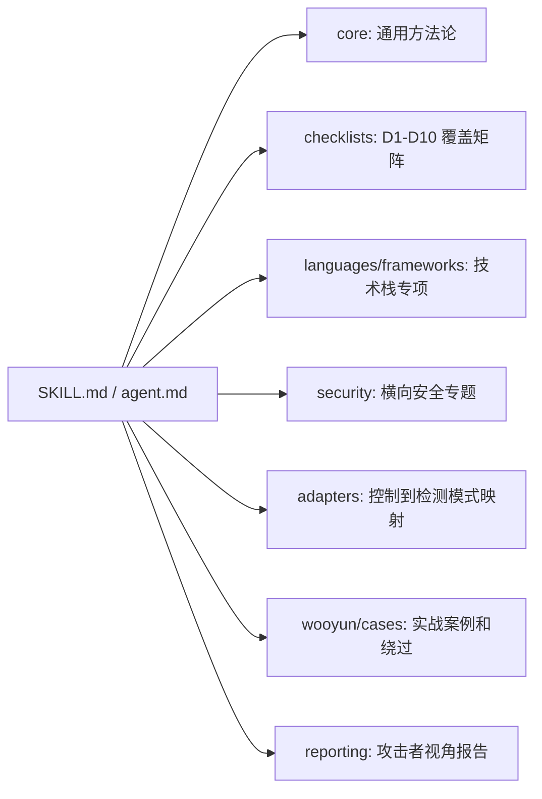

# 模块实现地图

## 模块关系总览

`code-audit-main` 的 reference 不是平铺知识，而是按运行时问题组织：



## core 模块

| 文件 | 作用 | 可迁移点 |
|---|---|---|
| `anti_hallucination.md` | 强制验证文件存在、代码真实性、行号、技术栈，不允许基于经验猜测 | 我们应把“必须有证据”写进所有 Agent 输出 schema |
| `phase2_deep_methodology.md` | 定义 sink/control/config 三轨审计 | 直接作为本项目静态审计和灰盒验证的策略骨架 |
| `comprehensive_audit_methodology.md` | 攻击面测绘、入口点清单、覆盖追踪、完成标准 | 适合作为 Recon Agent 的主方法论 |
| `data_flow_methodology.md` | Source 到 Sink 的数据流追踪方法 | 适合作为注入、SSRF、文件操作、反序列化类 skill |
| `taint_analysis.md` | 污点传播、净化、传播类型、风险评分 | 可转为静态分析 Agent 的判断规则 |
| `sinks_sources.md` | 多语言 Source/Sink、保护指标、误报过滤、gadget chain | 可拆成语言 adapter 和 sink registry |
| `security_controls_methodology.md` | 控制建模法：敏感操作、应有控制、缺失控制到漏洞映射 | 可作为 D3/D9 以及灰盒权限测试的核心 |
| `security_controls_matrix.yaml` | 通用安全控制和敏感操作定义 | 应迁移成机器可读配置 |
| `verification_methodology.md` | 验证、复核、证据链 | 适合报告前置信度校准 |
| `false_positive_filter.md` | 误报过滤 | 适合作为 Findings Arbiter 的输入 |
| `poc_generation.md` | SQLi、命令注入、SSRF、路径遍历、XSS、反序列化、SSTI PoC 模板 | 可转为动态验证 Agent 的 payload 模板库，但需加授权和安全边界 |
| `dynamic_code_audit.md` | 反射、动态方法、配置加载、AOP、消息队列、异步回调 | 可增强“静态 grep 不易覆盖”的动态调用面分析 |
| `systematic_reflection.md` | 系统性反思和遗漏复盘 | 可迁移为每轮结束后的漏报复盘流程 |

### core 的工程启发

`core` 模块的重点不是“告诉模型有哪些漏洞”，而是定义每类漏洞该如何证明：

- 注入类：必须有 Source、传播路径、Sink、缺失防护。
- 授权类：必须有端点/操作、应有控制、实际缺失、可访问角色。
- 配置类：必须有配置项、版本/算法、基线、风险解释。
- 动态类：必须有运行时入口、触发条件、可达性、影响。

这对应本项目的输出 schema：每个发现都应该有 `evidence_static`、`evidence_dynamic`、`affected_asset`、`attack_path`、`confidence`、`verification_status`。

## checklists 模块

`checklists/coverage_matrix.md` 定义 D1-D10 覆盖矩阵和终止判定。语言 checklist 不是主扫描入口，而是 Phase 2B 补漏时按未覆盖维度加载。

| 文件类型 | 内容 | 用法 |
|---|---|---|
| `coverage_matrix.md` | D1-D10、覆盖标准、终止判定 | 主线程评估 R1/R2 是否足够 |
| `{language}.md` | 每个语言下 D1-D10 的语义提示 | 某维度浅覆盖/未覆盖时按需加载 |
| `universal.md` | 通用 D2/D3/D7/D8/D9 提示 | 多语言或技术栈不明时兜底 |

对本项目的改造：

- 增加 `web_dynamic_coverage_matrix.md`，覆盖页面、API、角色、工作流、浏览器状态。
- 增加 `graybox_intake_checklist.md`，覆盖账号、权限、架构文档、测试边界、禁止项。
- 增加 `frontend_checklist.md`，覆盖前端路由、状态管理、前端鉴权、DOM XSS、CORS、Token 存储、隐藏 API。

## languages 模块

语言模块的共同结构大致是：

1. 语言审计方法论。
2. 控制建模法。
3. Source/Sink 数据流分析。
4. 语言特定漏洞。
5. 检测命令或 grep 模式。
6. 快速检查清单。
7. 最小 PoC 示例。

代表性观察：

| 语言 | 特点 |
|---|---|
| Java | Spring、MyBatis、JPA、反序列化、JNDI、XXE、JWT、权限注解 |
| JavaScript/Node.js | Express/Nest/Koa、原型污染、NoSQL 注入、JWT、ReDoS、前后端交界 |
| Python | Django/FastAPI/Flask、pickle、模板、ORM、路径和配置 |
| Go | 并发安全、unsafe、cgo、GORM、SSRF、路径遍历、race detector |
| PHP | 文件包含、反序列化、上传、弱类型、历史 CMS 风险 |

迁移建议：

- 不要把语言模块写成大段说明。
- 每个语言 skill 至少包含：识别规则、入口枚举规则、Source/Sink registry、Control pattern、误报过滤、输出字段。
- 大型语言知识应进一步拆为 `registry` 与 `playbook`：registry 给机器搜索，playbook 给 Agent 判断。

## frameworks 模块

框架模块把语言知识落到实际框架行为。例如：

| 框架 | 覆盖重点 |
|---|---|
| Spring | SpEL、Actuator、Spring Security、CORS、JWT、文件上传、SSRF、XXE、AOP |
| Express | NoSQL 注入、原型污染、路径遍历、命令注入、Session、CORS、安全头 |
| Django | ORM 注入、模板 XSS、CSRF、Session、SECRET_KEY、Admin、文件处理 |
| FastAPI | 依赖注入、Pydantic 绕过、响应模型泄露、BackgroundTasks、SQLAlchemy、上传 |

对本项目很关键的一点：前端+后端混合项目不能只按后端框架识别。框架识别应至少包括：

- 前端：React、Vue、Angular、Next.js、Nuxt、Vite、Webpack、Electron。
- 后端：Spring、Express、Nest、Django、FastAPI、Gin、Laravel。
- API：REST、GraphQL、gRPC、WebSocket。
- 部署：Docker、K8s、Nginx、API Gateway、Serverless。

## security 模块

`security/` 是横向安全专题，适合转成“按攻击面激活的 skill”。其中对本项目特别重要：

| 文件 | 价值 |
|---|---|
| `api_security.md` | API 枚举、认证、参数、响应、版本、批量操作 |
| `authentication_authorization.md` | 登录、Token、Session、权限、IDOR |
| `business_logic.md` | 金额、订单、状态机、验证码、密码重置、流程绕过 |
| `frontend_frameworks.md` | 前端安全、DOM XSS、Token 存储、客户端鉴权、前端路由 |
| `graphql.md` | introspection、批量查询、权限绕过、N+1、字段级授权 |
| `cross_service_trust.md` | 内部接口、内部 header、服务间 token、mTLS、gRPC |
| `file_operations.md` | 上传、下载、路径、解析、内容检查 |
| `infra_supply_chain.md` | CI/CD、镜像、依赖、制品、配置 |

这些模块可以成为本项目的 skill 目录模板：

```text
skills/
  api-security/
    SKILL.md
    registry.yaml
    playbook.md
    output.schema.json
  frontend-security/
  authorization-control/
  business-logic/
  browser-dynamic-verification/
```

## adapters 模块

`adapters/*.yaml` 是最值得工程化迁移的部分。它把“控制”映射为不同语言/框架下的检测模式。

例如 `security_controls_matrix.yaml` 先定义通用控制：

- authentication
- authorization
- ownership_check
- csrf_protection
- input_validation
- audit_log
- rate_limit
- secure_transport
- secure_storage
- session_management
- security_headers
- file_validation
- parameterized_query

然后 `adapters/java.yaml` 把这些控制映射到 Java/Spring/Shiro/JWT 的检测模式，如 `@PreAuthorize`、`@RequiresPermissions`、`SecurityContextHolder`、`repository.findByIdAndUserId`。

这个设计适合本项目做成可执行规则：

```text
通用控制矩阵 -> 技术栈 adapter -> 端点-权限矩阵 -> control-driven Agent -> 缺失控制发现
```

需要注意：adapter 不能只作为提示词存在，应该被工具读取，生成 Agent Contract 和 coverage 任务。

## wooyun 与 cases 模块

WooYun 案例库的价值是把白盒发现转成攻击者测试向量：

- SQL 注入高频参数和绕过。
- XSS 输出上下文和编码绕过。
- 命令执行拼接符和平台差异。
- 逻辑漏洞模式，如密码重置、验证码、越权、支付。
- 未授权访问和 IDOR。
- 文件上传、遍历、信息泄露。

对本项目迁移时要增加安全边界：

- 区分安全探测 payload 与破坏性 payload。
- 动态测试必须绑定授权范围。
- PoC 输出应记录“未执行/安全验证/需人工确认/已验证”状态。
- 生产环境默认禁用破坏性动作。

## reporting 模块

`reporting/attacker_perspective.md` 强调攻击者视角：

- 哪里最容易进入。
- 最短攻击路径是什么。
- 需要什么权限。
- 攻击成本和影响范围。
- 修复优先级。

本项目最终应输出两份报告：

1. 渗透测试报告：面向业务和研发，包含漏洞、攻击路径、证据、影响、修复建议。
2. 漏报反馈报告：面向测试人员和 Agent 迭代，说明哪些类型漏报、为什么漏报、需要补哪些规则/skill/测试用例。

## 模块化落地标准

后续我们补充自己的 agents/skills 时，每个模块都应满足以下标准：

| 项 | 必须具备 |
|---|---|
| 触发条件 | 什么项目/技术栈/攻击面会加载它 |
| 输入 | 文件、端点矩阵、API 清单、页面地图、账号角色、历史反馈 |
| 执行步骤 | 可操作步骤，不是泛泛建议 |
| 检测模式 | grep pattern、AST/LSP 查询、浏览器动作、API payload |
| 覆盖指标 | 端点审计率、页面覆盖率、sink 扇出率、角色覆盖率 |
| 输出 schema | 发现、证据、未覆盖、下一轮热点 |
| 误报过滤 | 哪些情况降置信度或标记不可利用 |
| 安全边界 | 是否允许动态 PoC、破坏等级、速率限制 |
