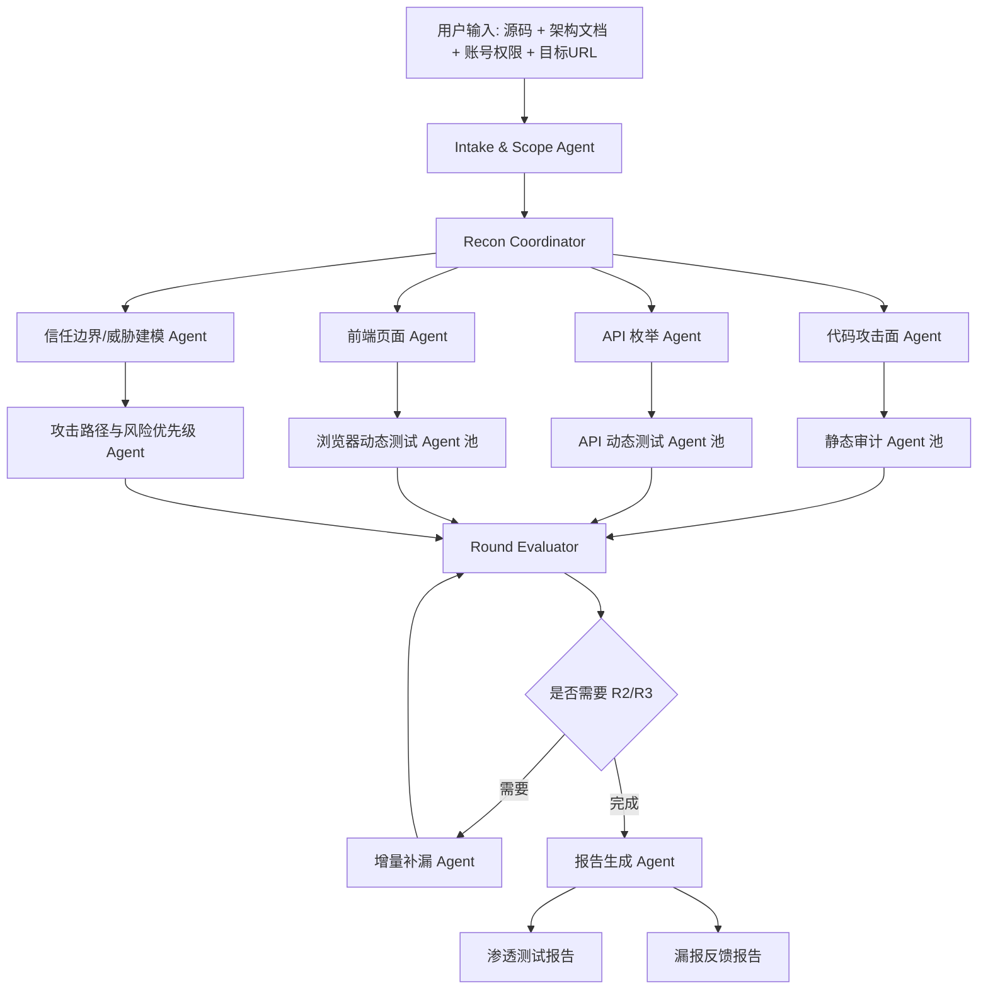

# 对灰白盒渗透测试 Agent 的迁移路线

## 总体迁移原则

参考 `code-audit-main` 时，不建议直接复制它的长文档，而应迁移它的工程骨架：

1. 用 `AGENT.md` 定义运行时权威状态机。
2. 用 skills 定义可执行的专项能力。
3. 用 adapters 把通用安全控制映射到语言、框架、前端和浏览器行为。
4. 用 contracts 约束每个子 Agent 的输入、预算、输出、证据和安全边界。
5. 用 coverage matrix 决定是否进入下一轮或报告。
6. 用 feedback loop 把漏报反馈转成规则、用例和版本迭代。

## 本项目目标架构



## 子 Agent 设计模板

每个子 Agent 都必须具体，不允许“全面检查安全问题”这种空泛角色。

| Agent | 输入 | 核心任务 | 输出 |
|---|---|---|---|
| Intake & Scope Agent | 源码路径、文档、账号、URL、授权说明 | 标准化测试范围、安全边界、账号角色、禁测项 | scope.json、roles.json、safety_policy.json |
| Recon Coordinator | 文件树、依赖、路由、前端构建信息、URL | 生成攻击面地图、信任边界、端点-权限矩阵、页面/API 清单 | attack_surface.json、endpoint_matrix.json |
| Code Static Agent | 搜索路径、技术栈 adapter、D1-D10 目标 | sink/control/config 三轨审计 | findings、coverage、hotspots |
| API Inventory Agent | 后端路由、OpenAPI、前端请求、代理流量 | 汇总 API、参数、认证态、角色需求 | api_inventory.json |
| Frontend Agent | 前端源码、路由、状态管理、浏览器爬取 | 页面地图、表单、按钮、Token 存储、隐藏 API | page_map.json、frontend_findings |
| Browser Dynamic Agent | URL、账号、页面地图、API 清单 | 浏览器访问、表单测试、越权验证、DOM XSS 初筛 | dynamic_evidence、screenshots、HAR |
| Authorization Matrix Agent | 端点-权限矩阵、多角色账号 | 横向/纵向越权、CRUD 权限一致性 | authz_findings、role_coverage |
| Threat Boundary Agent | 架构文档、部署文件、服务关系 | 攻击面边界、信任边界、数据流、威胁分析 | threat_model.md/json |
| Round Evaluator | 各 Agent 输出 | 去重、冲突处理、覆盖判断、R2 任务生成 | round_state.json |
| Report Agent | findings、evidence、coverage、threat_model | 生成正式报告和漏报反馈报告 | report.md、miss_feedback.md |

## Skill 设计模板

每个 skill 应至少包含：

```text
技能名称:
适用场景:
输入:
禁止/安全边界:
执行步骤:
检测模式:
覆盖指标:
输出 schema:
R2 增量规则:
误报过滤:
示例:
```

建议优先补齐的 skills：

| Skill | 目标 |
|---|---|
| `scope-intake` | 把用户资料转成授权范围、账号角色、测试边界 |
| `attack-surface-recon` | 生成攻击面、信任边界、端点-权限矩阵 |
| `api-inventory` | 从源码、前端、文档、浏览器流量提取 API |
| `frontend-security` | 前端路由、Token、本地存储、DOM XSS、前端鉴权 |
| `authorization-control` | D3/D9 control-driven 权限和业务逻辑 |
| `static-taint` | D1/D4/D5/D6 sink-driven 污点分析 |
| `config-baseline` | D2/D7/D8/D10 config-driven 基线检查 |
| `browser-dynamic-test` | 浏览器全量访问、表单、工作流、证据采集 |
| `safe-poc-verification` | PoC 安全验证和破坏等级控制 |
| `miss-feedback-distiller` | 漏报反馈转规则、用例、版本变更 |

## 版本路线

### MVP-1: 让 Agent 不空洞

目标：把现有子 agents 和 skills 从“角色描述”升级为“可执行合同”。

必须完成：

- 为每个 Agent 增加输入、输出、覆盖指标、禁止项、R2 规则。
- 增加统一 `Agent Contract` 模板。
- 增加 `attack_surface.json`、`endpoint_matrix.json`、`round_state.json` schema。
- 把 D1-D10 覆盖矩阵扩展为静态 + API + 页面 + 角色四类覆盖。
- 增加质量门禁：空泛词过多、缺少输入输出、缺少覆盖指标则失败。

### MVP-2: 侦察和边界建模

目标：先把测试对象建模清楚，再开始扫描。

必须完成：

- 源码结构识别：前端、后端、服务、部署、测试目录。
- 技术栈识别：语言、框架、路由、API、数据库、消息队列、认证库。
- 攻击面边界：外部入口、内部接口、管理后台、文件/导入导出、定时任务、WebSocket/GraphQL。
- 信任边界：浏览器到后端、网关到服务、服务到数据库、服务间调用、第三方回调。
- 威胁分析：STRIDE 或自定义威胁矩阵，映射到 D1-D10 和动态测试任务。

### MVP-3: 白盒静态审计可执行

目标：按三轨策略跑出稳定的白盒发现和覆盖缺口。

必须完成：

- sink-driven：D1/D4/D5/D6 Source/Sink registry、数据流追踪、扇出率。
- control-driven：端点-权限矩阵、CRUD 一致性、IDOR、Mass Assignment、状态机/竞态。
- config-driven：认证、加密、配置、依赖供应链。
- 技术栈 adapter：Java、JavaScript/TypeScript、Python 优先。
- 输出 findings schema，包含代码位置、证据、置信度、验证建议。

### MVP-4: API 和浏览器动态测试

目标：把白盒发现和 API/页面可达性结合，形成灰盒验证能力。

必须完成：

- API 清单汇总：源码路由、OpenAPI、前端请求、浏览器流量。
- 多账号会话管理：角色、Cookie、Token、权限边界。
- 浏览器爬取：页面、表单、按钮、上传、导出、工作流。
- 安全 payload 分级：无害探测、低风险验证、需确认验证、禁止验证。
- 动态证据：请求响应摘要、状态码差异、截图、HAR、复现步骤。

### MVP-5: 多轮评估与断点恢复

目标：让多 Agent 并发后能稳定续跑，不重复劳动。

必须完成：

- `round_state.json` 持久化：COVERED、GAPS、CLEAN、HOTSPOTS、FILES_READ、GREP_DONE、URLS_VISITED、APIS_CALLED。
- R2 任务生成器：根据缺口数、风险、未验证热点分配 Agent。
- 截断恢复：HEADER、TRANSFER BLOCK、END 哨兵。
- 断点继续：按 project_id/run_id/round_id 恢复执行。
- 冲突仲裁：同一漏洞多 Agent 发现时合并证据和最高严重度。

### MVP-6: 反馈进化

目标：把不同项目、靶场、测试人员反馈变成可回归的能力。

必须完成：

- 漏报反馈报告：漏报类型、原因、缺失 skill、缺失 payload、缺失 adapter、缺失动态步骤。
- 反馈蒸馏：把一次漏报转成规则、测试用例、文档补丁。
- 回归集：靶场项目、预期发现、预期不报、动态验证结果。
- 版本边界：每次迭代说明新增能力、已知缺口、回归结果。

## 最终模板建议

本项目最终可形成以下模板结构：

```text
pentest-agent-template/
  AGENT.md
  skills/
    scope-intake/
    attack-surface-recon/
    api-inventory/
    frontend-security/
    authorization-control/
    static-taint/
    config-baseline/
    browser-dynamic-test/
    safe-poc-verification/
    miss-feedback-distiller/
  references/
    core/
    checklists/
    languages/
    frameworks/
    frontend/
    security/
    payloads/
    cases/
    reporting/
  adapters/
    java.yaml
    javascript.yaml
    typescript.yaml
    python.yaml
    frontend.yaml
    browser.yaml
  schemas/
    scope.schema.json
    attack_surface.schema.json
    endpoint_matrix.schema.json
    api_inventory.schema.json
    page_map.schema.json
    finding.schema.json
    round_state.schema.json
    report.schema.json
  tools/
    recon/
    static_scan/
    browser/
    api/
    evaluation/
    reporting/
  tests/
    fixtures/
    regression/
    quality_gates/
  reports/
    templates/
```

## 下一步建议

下一步不应继续泛化讨论，而应从当前项目已有 agents/skills 中选 3 个核心模块做实：

1. `Recon Agent`: 输出攻击面边界、信任边界、威胁分析、端点-权限矩阵。
2. `Authorization/Business Logic Skill`: 按 control-driven 方法写清端点枚举、权限验证、IDOR、CRUD 一致性。
3. `Frontend/API Inventory Skill`: 支持前后端混合源码，提取前端路由、页面动作、隐藏 API、Token 存储和 API 调用。

完成这 3 个后，再把它们接入现有 harness 的 dry-run 和质量门禁，就能明显改善“看起来有 Agent，但没有具体实现”的问题。
