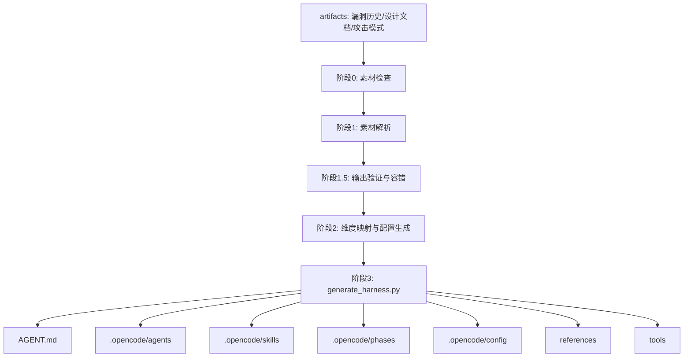

# Pentest Distiller 架构与生成流程

## 工作流

## generate_harness.py

`tools/generate_harness.py` 是核心生成器。它读取配置并生成 harness 工程。

关键输入：

- `target_profile.json`
- `attack_surface.json`
- `vulnerability_catalog.json`
- `control_mapping.json`
- `attack_patterns.json`

关键生成物：

| 生成物 | 来源 | 作用 |
|---|---|---|
| `AGENT.md` | skeleton 模板 | 顶层调度入口 |
| `opencode.json` | skeleton 模板 + Agent 列表 | OpenCode Agent 配置 |
| `.opencode/agents/*.md` | Agent 模板 + D 维度变量 | 维度 Agent |
| `.opencode/skills/*` | skeleton skills | 可加载技能 |
| `.opencode/phases/*.md` | 6 个通用阶段模板 | PTES 执行阶段 |
| `.opencode/config/*.json` | 解析后配置或空骨架 | 项目专属配置 |
| `references/` | skeleton references | 通用知识库 |
| `.opencode/tools/*.py` | 聚合和报告脚本 | 机器执行辅助 |

## D1-D15 Agent

生成器始终生成 D1-D15 基线 Agent：

| 维度 | Agent | 主题 |
|---|---|---|
| D1 | normal-injection | 注入 |
| D2 | auth-bypass | 认证绕过 |
| D3 | idor | 越权/IDOR |
| D4 | deserialization | 反序列化 |
| D5 | file-upload | 文件上传/路径 |
| D6 | ssrf | SSRF |
| D7 | crypto-weakness | 加密弱点 |
| D8 | misconfig | 配置错误 |
| D9 | business-logic | 业务逻辑 |
| D10 | supply-chain | 供应链 |
| D11 | code-quality | 代码质量 |
| D12 | exception-handling | 异常处理 |
| D13 | race-condition | 竞态 |
| D14 | numeric-error | 数值错误 |
| D15 | improper-input | 不正确输入 |

与 `code-audit-main` 的 D1-D10 相比，Distiller 增加了偏代码质量和健壮性的 D11-D15。

## Agent 权重

权重逻辑：

| 历史实例数 | 权重 | 含义 |
|---|---|---|
| >= 5 | `++` | 高频维度，R1+R2 深度测试 |
| >= 2 | `+` | 中频维度，标准测试 |
| 其他 | `default` | 基线扫描 |

这适合用于“历史漏洞驱动的测试优先级”。本项目可以把靶场反馈、测试人员漏报、历史真实漏洞都汇入同一套权重系统。

## Phase 模板

项目生成 6 个通用阶段：

1. Recon
2. Enumeration
3. Vulnerability Analysis
4. Exploitation
5. Post-Exploitation
6. Reporting

这和 PTES 思路一致，适合黑盒/灰盒渗透测试；但对代码审计还需要加入：

- Static Source Review
- Endpoint Permission Matrix
- Frontend/API Inventory
- Dynamic Browser Verification
- Missed Finding Feedback

## Skills

生成器复制 skeleton skills，例如：

- adaptive-weighting
- agent-contract
- anti-confirmation-bias
- anti-hallucination
- attack-chain
- config-driven-methodology
- control-driven-methodology
- coverage-matrix
- finding-verification
- pentest-harness
- report-template
- severity-rating
- sink-driven-methodology
- taint-analysis
- tech-stack-router

这些 skill 名称本身就提供了本项目可借鉴的模块边界。

## 工程价值

Distiller 的核心不是某个 Agent 文档，而是“生成约束”：

- Agent 从模板生成，避免手写漂移。
- Skill 从模板复制，确保能力一致。
- Config 从素材生成，支持项目差异。
- 权重由历史数据计算，支持反馈进化。
- 素材缺失也能降级，不阻塞运行。

这正是本项目防止“每次生成还是空洞”的关键：用模板和质量门禁限制输出结构。
