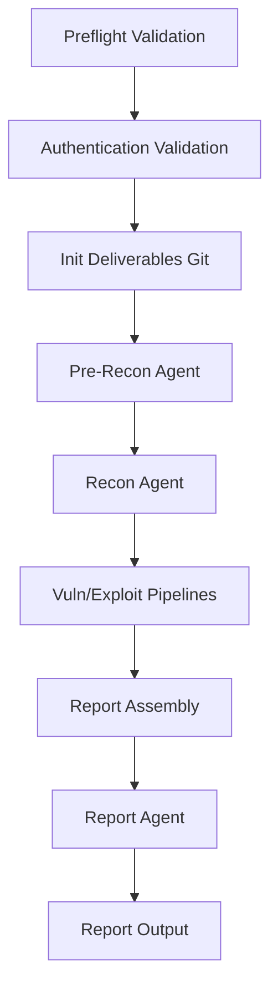

# Shannon 架构与编排分析

## 流水线架构

Shannon 使用 Temporal workflow 编排渗透测试流程。

## 阶段设计

`apps/worker/src/temporal/workflows.ts` 中的主线：

| 阶段 | 说明 |
|---|---|
| preflight | 快速检查目标、配置、路径，避免昂贵 Agent 运行后失败 |
| auth-validation | 浏览器驱动的认证验证，确认账号/登录配置可用 |
| init deliverables git | 初始化结果目录的 git，方便 checkpoint/恢复 |
| sync deny rules | 同步代码路径拒绝规则，控制 Agent 可读范围 |
| pre-recon | 源码预侦察，识别框架、入口、数据流 |
| recon | 运行时侦察，映射攻击面 |
| vulnerability-exploitation | 漏洞分析和利用验证并发管线 |
| reporting | 汇总报告、元数据注入、输出 |

## vuln→exploit 管线

Shannon 把每类漏洞拆成一对 Agent：

- `injection-vuln` → `injection-exploit`
- `xss-vuln` → `xss-exploit`
- `auth-vuln` → `auth-exploit`
- `ssrf-vuln` → `ssrf-exploit`
- `authz-vuln` → `authz-exploit`

关键点：

1. vuln agent 完成后，不等待其他漏洞类型。
2. 立即检查 exploitation queue。
3. 如果有可利用候选且 exploit 模式开启，就启动对应 exploit agent。
4. 多条 vuln→exploit pipeline 通过并发限制运行。
5. 单条 pipeline 失败不会阻塞全部流程。

这比固定 R1/R2 更工程化：它是“发现即验证”的流水线。

## 并发控制

`runWithConcurrencyLimit` 支持限制同时运行的 pipeline 数量，默认可并发 5 类漏洞。

对本项目的启发：

- 静态 Agent 可以并发跑。
- 动态验证应按目标环境和速率限制控制并发。
- 浏览器测试和 API fuzz 不能无限并发，必须尊重规则约束。

## 断点恢复

Shannon 的 resume 机制包括：

- `resumeFromWorkspace`
- 读取 resume state。
- 校验已完成 agents。
- 恢复 git checkpoint。
- 清理未完成 deliverables。
- 已完成 agent 跳过。
- 所有 expected agents 已完成时直接短路。
- 每个 agent 完成后保存 checkpoint。

重要字段：

- `completedAgents`
- `checkpointHash`
- `originalWorkflowId`
- `sessionId`
- `expectedAgents`

本项目可以参考这个模型，把每个 Agent 的产物都变成可恢复的 deliverable。

## 状态查询

Workflow 通过 `getProgress` 暴露实时状态：

- status
- currentPhase
- currentAgent
- completedAgents
- failedAgent
- error
- startTime
- agentMetrics
- summary

这对 UI 和 CLI 状态展示都很有用。

## 报告策略

Shannon 的理念是 proof-by-exploitation：

- speculative finding 不进入最终报告。
- exploit 成功后才报告。
- 报告包含可复现步骤和证据。

本项目要兼顾白盒和灰盒，可以将发现分层：

| 层级 | 含义 |
|---|---|
| Candidate | 白盒或黑盒迹象，未验证 |
| Reachable | 动态可达，但未利用 |
| Verified | 安全验证成功 |
| Exploited | PoC 成功证明影响 |
| Blocked | 因边界、账号、验证码、禁测项无法验证 |

## 安全边界

Shannon README 明确提醒它会主动执行 exploit，可能创建用户、提交表单、改变状态、触发外连请求。

对本项目必须落地：

- 授权范围。
- 环境类型。
- 是否允许状态变更。
- 是否允许外连。
- 是否允许破坏性 PoC。
- 速率限制。
- 禁测路径和禁测操作。

## 与本项目现有方向的连接

建议把 Shannon 的 pipeline 拆成我们的阶段：

1. Intake & Scope。
2. Pre-Recon Source。
3. Runtime Recon Browser/API。
4. Static Vulnerability Candidates。
5. Dynamic Verification Queue。
6. Exploit/Safe PoC Agents。
7. Evidence-backed Report。
8. Missed Finding Feedback。
