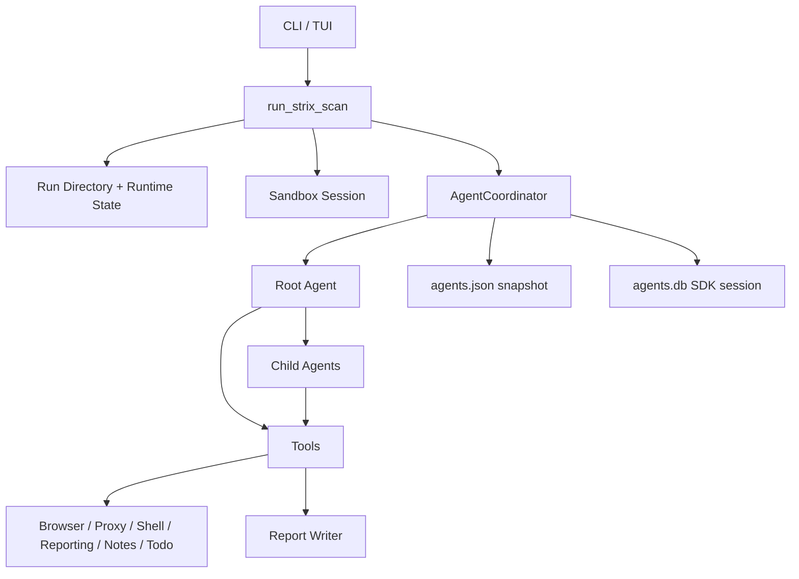

# Strix 架构与运行时分析

## 运行时架构

## run_strix_scan

`strix/core/runner.py` 的主函数负责：

1. 创建或恢复 scan_id。
2. 创建 run_dir 和 runtime_state_dir。
3. 初始化日志和 scan id。
4. 判断是否 resume。
5. 加载 LLM settings。
6. 创建 AgentCoordinator。
7. 恢复 todos/notes。
8. 创建或复用沙箱 session。
9. 构造 root task。
10. 构造 root agent。
11. 构造 child agent factory。
12. 启动 root agent loop。
13. 结束时 snapshot、清理 sandbox、关闭 session。

这个函数非常适合作为本项目 CLI 运行器参考。

## AgentCoordinator

`strix/core/agents.py` 是 Agent 图状态的单一所有者，管理：

- status
- parent_of
- names
- metadata
- pending_counts
- runtimes
- snapshot_path
- budget stop
- message passing
- waiting/wake
- stop/cancel descendants
- graph snapshot

这比简单的“并发几个 Agent”更成熟：每个 Agent 都是可寻址节点，可收消息、等待、暂停、恢复、取消。

对本项目的直接启发：

- 子 Agent 必须有 id 和 parent_id。
- Orchestrator 能查看 agent graph。
- Agent 间通信应通过 coordinator，而不是互相写自然语言。
- 状态快照要能恢复。

## Root Agent skill

`strix/skills/coordination/root_agent.md` 明确要求 root agent：

- 分解目标为可并行任务。
- 创建和监控专门子 Agent。
- 聚合发现到最终报告。
- 管理依赖和 handoff。
- 动态创建 Agent，不只在开始时创建。
- 避免重复覆盖。
- 复杂发现可继续派 discovery/validation/reporting/fix Agent。

这和我们之前讨论的“多轮结果比对判断、并发协调优化”高度一致。

## Skill 动态加载

Strix 每个 Agent 创建时最多可加载 5 个相关 skill。skill 被动态注入 system prompt。

这种机制适合本项目：

- Recon Agent 加载 `source_aware_whitebox`、`frontend`、`api_inventory`。
- Authz Agent 加载 `idor`、`business_logic`、`authentication_jwt`。
- Browser Agent 加载 `agent_browser`、`proxy`、`xss`。
- Tool Agent 加载 `nuclei`、`ffuf`、`httpx`、`sqlmap`。

## 工具封装

`agents/factory.py` 把工具封装成 agent 可调用工具，并处理：

- tool error 作为模型可见结果。
- custom tool 输入 schema。
- shell 工具参数校验。
- chat completions tool schema 兼容。
- sandbox filesystem/shell capability。

这说明工具系统要工程化：不能只在 prompt 里说“可以用浏览器”，而要把浏览器、代理、shell、reporting 做成稳定工具。

## Resume 机制

Strix resume 依赖：

- `agents.json`：Agent 图快照。
- `agents.db`：SDK session database。
- `state_dir`：todos、notes 等运行态。
- `respawn_subagents`：恢复子 Agent。
- resume instruction 注入 root session。

对本项目而言：

- `round_state.json` 适合早期。
- 后续需要 `agents.json` + `sessions.db` 或等价结构。
- resume 时新用户指令必须能注入已有 root session。

## 报告完成门控

非交互模式中，如果 agent 没调用 `finish_scan`，runner 会记录错误：没有生命周期工具调用，最终报告未写入。

这点很重要：最终报告不应靠 Agent 随便输出一段文本，而应通过 `finish_scan` 或 `generate_report` 这类工具完成。

本项目也应要求：

- 未调用 `finish_report` 不算完成。
- 报告工具校验 findings/evidence/coverage。
- 非交互模式可根据风险返回非零 exit code。
